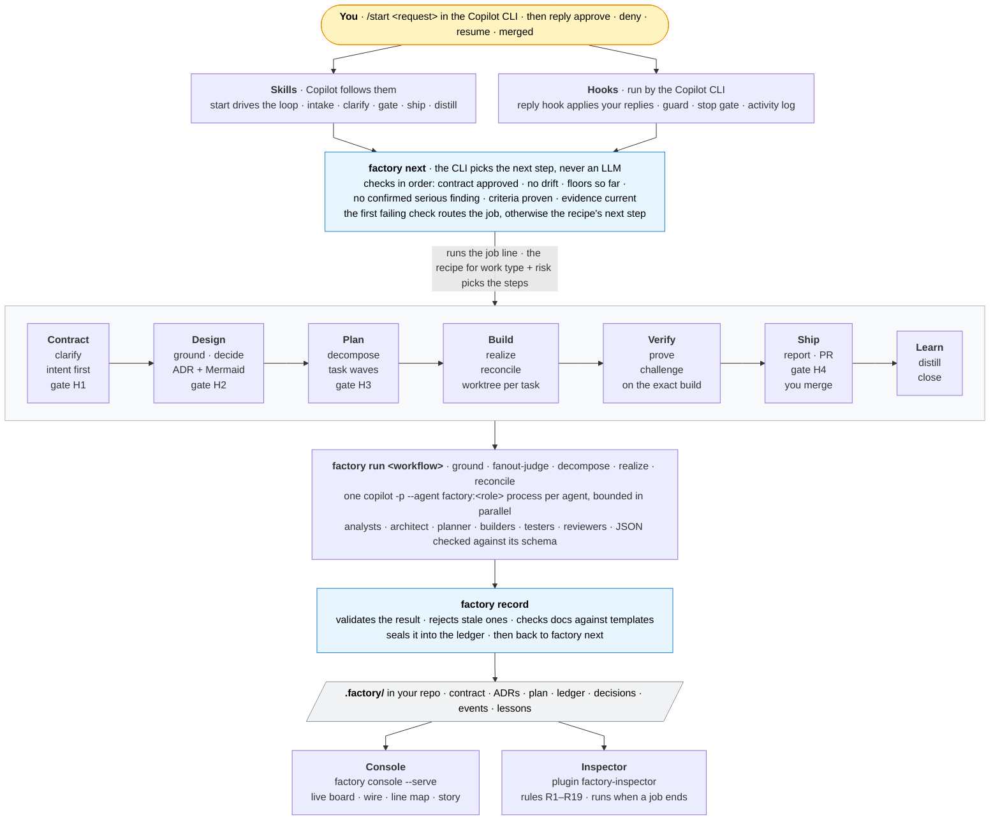

# Copilot Factory: the Software Factory for the GitHub Copilot CLI

Turns a request into a verified, merged change. Copilot does the work through specialist custom agents, but **a CLI decides every next step by fixed rules**, every result is **checked and sealed** before it counts, evidence is **bound to the exact build**, and **you approve** the contract, the design, the plan and the merge. A second plugin, the **inspector**, audits all of it from the outside.

This is a port of [claude-factory](https://github.com/reshif/claude-factory) (the Claude Code plugin "Software Factory") to the GitHub Copilot CLI. The CLI core is the same: router, floors, record, seals, ledger, recipes, policy, worktrees, verify, ship, document templates and console. What changed is the shell around it: Copilot skills and custom agents, Copilot-format hooks, and a `factory run` command that runs the workflows by starting one `copilot -p` process per agent, because Copilot has no Workflow tool. The full component mapping is in [`docs/COPILOT.md`](docs/COPILOT.md); the design decisions are in [`docs/DESIGN-COPILOT.md`](docs/DESIGN-COPILOT.md).

| Plugin | Version | What it is |
|---|---|---|
| `factory` | 0.1.0 | The orchestrator: skills, hooks, the `factory` CLI with `factory run`, workflows, 19 custom agents, recipes, templates and the console |
| `factory-inspector` | 0.1.0 | An independent auditor: checks each job against the rulebook it declared and the factory's health (rules R1–R19) |

The version line starts again at 0.1.0 for Copilot. It is separate from claude-factory's (0.10.0 / 0.2.0 at the time of the port).

## How it fits together



**The one rule that holds it together:** agents *propose*, the CLI *decides*. Copilot never chooses the next step. The `start` skill runs `factory next` and does exactly what it returns: a skill, a gate, a CLI command, or a workflow. A workflow always goes through `factory run <workflow>`, which starts the agents, checks their JSON, records the result and prints it. Then the skill asks `factory next` again. The skill never writes a brief or an envelope and never fans work out itself. Hooks enforce the parts Copilot could get wrong: your replies are applied by the CLI before the model acts on them, the guard blocks edits to protected files, and the stop gate sends Copilot back to work while the job has steps left and nothing is waiting on you.

## Install

Requirements:
- GitHub Copilot CLI, with a Copilot plan. Use 1.0.81 or later, because installed-plugin agents only load in `copilot -p` from that version. 1.0.97 or later is recommended for the hook fixes.
- Node 18 or later, and git.
- Optional: the GitHub CLI (`gh`), logged in, for automatic PRs.

```bash
copilot plugin marketplace add reshif/copilot-factory
copilot plugin install factory@copilot-factory
copilot plugin install factory-inspector@copilot-factory   # optional, recommended
```

Run `/plugin` (or `copilot plugin list`) to check that both are listed with the versions above. The docs say plugin agents and skills are available as soon as they are installed. If they don't show up, restart the CLI (`/restart`).

**Put `factory` on your PATH.** Copilot does not put a plugin's `bin/` on the PATH. Inside a session, the factory's session-start hook gives Copilot the absolute command (`node "<plugin root>/bin/factory"`), so the skills work without it. For your own terminal (`factory console --serve` and the human-only commands), run this once:

```bash
node ~/.copilot/installed-plugins/copilot-factory/factory/bin/factory shim
```

It links `factory` and `factory-inspect` into `~/.local/bin`. Make sure that directory is on your PATH.

**Trust the repository.** When the Copilot CLI asks whether to trust the folder, say yes. Hooks, skills and agents need it.

**Never use Autopilot with the factory.** Autopilot answers questions and permission prompts by itself, and every gate here is yours. Run the factory in an interactive session. The cloud agent is out of scope: it is non-interactive and turns "ask" into "deny".

### Update

```bash
copilot plugin marketplace update copilot-factory
copilot plugin update factory
copilot plugin update factory-inspector
```

`copilot plugin update --all` updates everything. In a session, `/plugin` shows when an update is available.

### Check what you have installed

```bash
copilot plugin list --json                                  # name, marketplace, version, enabled, source
ls ~/.copilot/installed-plugins/copilot-factory/            # the installed copies: factory/, factory-inspector/
ls ~/.cache/copilot/marketplaces/                           # marketplace cache (macOS: ~/Library/Caches/copilot/marketplaces/)
readlink -f "$(command -v factory)"                         # the factory on your PATH (after factory shim)
```

`COPILOT_HOME` moves `~/.copilot` and `COPILOT_CACHE_HOME` moves the cache. Install metadata is in `~/.copilot/config.json`.

## Use

In any git repository with at least one commit, inside the Copilot CLI:

| You type | What happens |
|---|---|
| `/start <what you want>` | Intake: Copilot reads the repo, restates your intent in one line, proposes work type, risk and job-vs-epic, and asks you **one** question to confirm all of it. The CLI creates the job and picks the recipe; then the loop runs until it needs you. |
| `/start` | Continue the current job. |
| `/why [job]` | Every routing decision for the job and the rule behind it. |
| `/console [job]` | The console (below). |
| "run the factory review" | Monthly 30-minute telemetry review (the `review` skill). Copilot's built-in `/review` is its code reviewer, so ask in words or try `/factory/review`. |
| `/inspect [job\|all\|active\|status\|health]` | Run the inspector and walk through its findings. |

Plugin skills are invoked by their own name (`/start`). If another plugin or a project skill also has a skill called `start`, the CLI documents plugin-qualified names: `/factory/start`, `/factory/why`, `/factory-inspector/inspect`. You can also just ask ("continue the factory job"), because the skill descriptions let Copilot pick them up.

The first run initialises the repo (`factory init`): a `.factory/` folder kept out of git via `.git/info/exclude`, and a `commit-msg` hook that adds `Factory-Job` / `Factory-Task` trailers on factory branches. Each job gets a branch `factory/J-0001` and each task its own git worktree under `.factory/worktrees/`.

### Your replies

The reply hook (`userPromptSubmitted`) applies these through the CLI **as soon as you send them**. Nothing else counts as approval. Case and trailing punctuation or emoji don't matter (`Approve!`, `approve 👍`), but the reply must be the whole message. Something that only looks like a reply (`aprove`, `approve the plan please`) is **not applied**.

The hook also writes the outcome to `.factory/last-reply.json`. The next `factory next` shows it as `last_reply`, and the `start` skill tells you in one line whether your reply was applied, and why not if it wasn't. (Copilot's docs and changelog disagree on whether a prompt hook can add text to the conversation, so the factory doesn't depend on that.) Add a job id to target one job: `approve J-0007`.

| Reply | Effect |
|---|---|
| `approve` | Approve the waiting gate. Bound to the document's hash: if it changed since you saw it, the approval is refused. |
| `deny <what must change>` | Send it back with your reason. |
| `resume` | Un-park; the cap that stopped it gets one more round. |
| `cancel job` · `abandon job` | Stop for good; files are kept. |
| `merged <commit>` | Record a local merge (when there's no GitHub PR). |
| `confirm AC-3` | Confirm a criterion whose evidence type is `human`. |
| `waive ci_reverify <reason>` · `waive ship_size <reason>` | The only waivable floors. |
| `accept lesson L4` · `reject lesson L4 <why>` | Decide on a proposed lesson. |
| `ack finding F3` · `fixed finding F3` · `wontfix finding F3 <why>` | Settle an inspector finding. |
| `inspect mode <recipe\|all> on\|off\|sample <N>` | How often the inspector runs. |

From your own terminal you can run the human-only commands directly: `factory approve`, `factory resume`, `factory reseal`, `factory-inspect mark …`. Agents are blocked from running them.

### Gates you may see

| Gate | When |
|---|---|
| **H1** contract | Every job |
| **H2** design | Medium risk when there is an ADR; always at high risk |
| **H3** plan | Medium and high; at low risk (`feature@low`) God Eye's plan critique can approve it for you |
| **HS** ship sign-off | High risk, before shipping |
| **H4** merge | Every change: you merge |
| **HF** spike findings · **EH1–EH3** epic contract, architecture, slices · **A** amendment · **P** parked | As they come up |

### Questions you may get (clarify)

The contract starts with an **Intent** section: problem, who, outcome, why now, success signal. An intent analyst reads it first, alone. Until the intent is settled you get **only intent questions**; then scope, constraint and acceptance questions follow, in that order. **At most 5 questions in round 1 and 3 in later rounds**, as one numbered list. Each has an id (`Q-3`), why it matters, the default the factory will use if you skip it, and options where possible. Nothing is asked twice. If the intent is still unclear after two rounds the job **parks rather than guessing**; reply `resume` for one more round. God Eye must restate and confirm the intent before H1.

## How a job runs

**Recipes.** The CLI picks one by rule from work type and risk ([`recipes/_selection.json`](plugins/factory/recipes/_selection.json)) and locks it into the job (`recipe.lock.json`). Recipes are human-authored and versioned; agents can't edit them.

| Recipe | Picked for | Steps |
|---|---|---|
| `bug@low` | bug, docs, dependency at low risk | clarify → H1 → ground → decompose (one task from the contract) → realize → reconcile → prove → challenge(code) → ship → H4 → distill → close |
| `feature@low` | other work at low risk | as above, with a planned task graph, God Eye plan critique → H3, challenge(code, tests) |
| `standard@medium` | any medium-risk work | clarify → H1 → ground → decide → H2 (if ADR) → decompose → H3 → realize → reconcile → prove → challenge(code, tests, security) → ship → H4 → distill → close |
| `full@high` | any high-risk work; migrations are floored here | as medium, plus a threat model, H2 always, every lane, **HS** before ship |
| `hotfix@high` | hotfix | as `full@high`, grounding scoped to the failing path, plus a post-merge review; confirmed problems open a linked follow-up job |
| `spike` | spike | clarify → H1 → ground → decide (recommendation) → HF → close |
| `epic` | `--epic` | contracts freeze first, then each slice runs as its own job with its own recipe |

**Routing.** `factory next` checks, in order: contract approved → no drift from what you approved → floors met so far → no confirmed serious finding → every criterion proven → evidence still matches the build. The first that fails decides (clarify, amendment, the missing floor step, a fix round, a verify-fix round, prove again); if all pass, the recipe's next undone step runs. Loops are capped and **park** for you when a cap is hit. Every decision is a line in `.factory/log/decisions.jsonl`; `/why` shows them.

**Workflows.** When `factory next` says `workflow`, the skill runs `factory run <workflow>` with the fields it was given (`--config`, `--mode`, `--scope`, `--lanes`, `--threat-model`/`--no-threat-model`, `--plan-critique`, and `--accept-degraded` when you chose to go on without a failed analyst). `factory run` executes the same workflow scripts as claude-factory (`workflows/*.js`) in a Node runtime that provides their agent API. Each agent call becomes one non-interactive Copilot process: `copilot -p <prompt> --agent factory:<role> --model <id> …`. Builders run in their task's worktree. Calls run in parallel up to `limits.max_parallel_agents`. Each agent must return one JSON object; the runner validates it against the agent's schema and asks once for a correction. The result goes through `factory record` and `factory run` prints the record result. `factory run --dry-run` shows what would run without starting Copilot.

**Floors** are the steps no recipe may skip at a risk level. Examples: contract approval, isolated builds, proof and code review everywhere; grounding, a design record, a validated plan and three review lanes from medium; a threat model, H2/H3, every lane and ship sign-off at high. They are enforced when a recipe loads, and again by `factory ship`, `factory close`, the stop gate and CI. See [`FLOORS.md`](plugins/factory/docs/FLOORS.md).

**Evidence.** Builders work in per-task worktrees; only `factory task verify` produces task evidence, and only `factory verify run` proves criteria on the integrated build. Every proof and review is bound to that build's fingerprint, so a later change makes it stale.

### Models and cost

Each agent runs on the model its role is given in `policy.agents.models` (an alias: `opus`, `sonnet`, `haiku`). `policy.agents.model_ids` turns the alias into a Copilot model id, passed as `--model`. The agent files set no `model`, so this choice always wins. If a role has no model, the agent uses your Copilot default (`COPILOT_MODEL` or `model` in `~/.copilot/settings.json`). Run `/model` in a session to see the model ids your plan offers.

Every agent is its own Copilot session, so a job uses many requests. A `standard@medium` job typically starts dozens of agents (analysts, researchers, option generators, builders, testers, reviewers, verifiers). Copilot bills these against your plan: AI Credits on token-based plans, premium requests on the older request-based plans. Model multipliers apply, so `opus`-class roles cost more. To keep cost down, use cheaper models for the read-only roles (researcher, analysts, reviewers), keep `builder_escalation` short, and lower `limits.max_agent_runs_per_job`. The factory counts agent runs and wall time, not credits.

## Documents

Every document the factory keeps follows a versioned template in [`templates/docs/`](plugins/factory/templates/docs): ADR, no-ADR note, spike recommendation, threat model, epic contracts, findings, ship report (also the PR body), lessons, and a per-job docs index. Each has the same front matter, fixed sections in a fixed order, and guidance comments.

- **ADRs must include a Mermaid architecture diagram**: a C4-style view of the system after the change, with the changed parts highlighted. A sequence diagram for the key flow is optional. A threat model needs a STRIDE table and a data-flow diagram with each trust boundary drawn as a box.
- **Enforced when the design is recorded:** `factory record` checks the design record against its template. Problems go back to the architect, and three failures in a row park the job.
- **Traceability:** `factory doc index` writes a table tracing each acceptance criterion through the design and the task to its proof.

```bash
factory doc list                  # types, template versions, sections
factory doc template adr          # print a template
factory doc check --job J-0007    # check every templated doc of a job
factory doc index --job J-0007    # (re)write the docs index
```

Details: [`DOCS.md`](plugins/factory/docs/DOCS.md).

## The console: watch the factory work

Run `factory console`, or `/console` in the Copilot CLI, then open `.factory/console.html`. Or run `factory console --serve` and open the URL it prints: the same page, kept current as the agents work. Either way it reads `.factory/` and writes only the page. It checks seals only when this machine already has the factory key, and never creates one.


- **The floor.** The header has the project, a **LED** (`live` when served, `reconnecting` if the server went away, `snapshot` for a written file), the time of the last update, the seal check, any open factory-health findings from the inspector, and a filter box.
  - **Five tiles**: your turn, running, parked, stopped, done. Each is a count and a one-click filter (keys `1`–`5`). The tab title shows how many jobs wait for you, e.g. `(2) Factory Console`.
  - **Filters** on the left, with counts: status, recipe, risk, the gate a job waits at, inspector findings, epic or slice, and how recently it changed.
  - **The filter box** takes words and tokens: `is:waiting` `risk:high` `recipe:bug@low` `gate:H2` `has:finding` `has:rework` `agent:builder` `since:2d`; `-` excludes. Words match ids, titles and what happened.
- **Board.** One dense row per job, grouped by attention: your turn, then stopped, running, parked, and done (collapsed). Each row has a beacon (flashing amber on your turn), the recipe and risk, the eight stage lights, the current step or the gate and how long it has waited, the agents running now (coloured by model; `?` for one that started and never reported back), the task bar, return trips `↺`, retries `↻`, inspector findings `⚑`, a three-day activity sparkline and the age of the last change. A blue dot marks a job that changed since you last opened it. Group by status, recipe, risk, stage, epic or day; sort by urgency, updated, created or id. Slices sit under their epic.
- **Line map.** Every job as a transit line on one time axis. A line steps down one track per stage, with 45° bends. Gates are double rings, a dashed amber stretch is time waiting on you, dotted violet is parked, red marks a return trip, a buffer stop ends a cancelled or abandoned job, and a dotted transfer leads to a follow-up. Quiet hours are squeezed by default (switch to linear); zoom with `+`/`−`/Fit or ctrl-scroll, drag to pan, hover a station for the router's reason, the agents and the result.

  
- **The wire.** On the right, everything that happened across all jobs, newest first: routes, results, agent runs, your replies, guard blocks, parks, hook errors, refused "done" claims and inspector findings. Pause it while you read; narrow it to the selected job; click a line to open the job at that moment.
- **A job.** Click a row (or `Enter`). The list stays on the left so `j`/`k` still switch jobs; `Esc` goes back.
  - **Line**: the flow canvas. Stages are columns and time runs downward; each visit to a step is a row. Moving on is a blue line right; going back is a red line left, labelled with why (a fix round, a verify-fix round, re-proving, your denial); a repeated step drops straight down. Parks, resumes, amendments, cancels and abandons have their own rows. Each row shows the router's reason, every agent with its model (O/S/H), runs, retries `↻`, failures `✕` and escalation `↑`, the result and findings, your replies with how long each took, and guard blocks. A crew band shows who worked in each stage, inspector findings sit in a column beside the row they cite, and **Replay** drives the job down the canvas with the router's six checks at each decision.
  - **Story**: the same job as prose, one paragraph per step visit, with return trips on a red rule and inspector findings as margin notes. A pinned **Now** card says what the job waits on and the exact reply to type, with a copy button (e.g. `approve J-0004 H3`).
  - **Tasks**, **Events** (a filterable table of every event) and **Lessons**.

  
- **Live.** With `--serve`, the page gets each change over server-sent events. Only the rows whose job changed are redrawn, with a short highlight, and a row that changes group slides there. A new gate brings a toast with the reply to copy, and, if you turn on the bell, a desktop notification. On an open job, new steps play in if you are watching the latest moment, and your place is kept if you are scrubbing back. The server listens on this machine only (`http://127.0.0.1:4477/`, `--port 0` for any free port), refuses foreign `Host` headers and is read-only.
- **Keys.** `j`/`k` move, `Enter` opens, `Esc` goes back, `/` filters, `⌘K` (or ctrl-K) opens a palette to jump to any job or view, `1`–`5` toggle the tiles, `g w` opens the next job waiting for you, `?` lists them all. The view, filters and open job are in the URL, so a link brings you back to the same place.
- **Recipe map and Crew.** *Recipe map* is the whole factory as a floor plan for any recipe; *Crew* lists the 19 agents and how often each ran.
- **Where the data comes from.** Each workflow returns a roster of every agent it started, and `factory record` seals it into the ledger as an `agents` entry tied to the routing decision. Hooks add timings. Parks, amendments, follow-ups, hook errors and refused "done" claims come from the event log and the job's own records. An agent that started but never stopped counts as running for two hours at most, and only while its job is active; after that it shows as stale.
- **Options.** `--job J-0003` makes the page for one job, `--out file.html` writes it elsewhere, `--label "…"` adds a banner, and `--data file.json` also writes the data as JSON. Dark is the default look when your system is dark; the half-moon button switches theme.
- **Sample.** `node plugins/factory/console/dev/make-sample.js <dir>` builds a realistic sample: nine jobs over about three days on a simulated clock. They run through the real CLI, workflows, hooks and inspector, with scripted agents. More screenshots are in [`plugins/factory/console/dev/screenshots/`](plugins/factory/console/dev/screenshots/).

## The inspector

`factory-inspector` audits the factory from the outside. It imports none of the factory's code: it reads `.factory/` directly, with its own seal check, so a bug in the factory can't hide itself. It never blocks or changes a job; its findings are questions for you, kept in `.factory/inspect/register.json`.

- **Per job (R1–R9):** forged records, the wrong recipe, steps out of order, gates approved without being shown, review on an unproven build, loops past caps, the agent not doing what `factory next` said, the same situation routed differently, recurring friction.
- **Factory health (R10–R19):** hook failures, torn log lines, repeated guard denials / blocked "done" claims / refused replies, CLI failures and crashes, degraded workflows and agent retries, agents that never stopped, repeated parks, idle jobs, slow gate replies, and clarify parking on an unclear intent or overrunning its question budget. Thresholds live in `.factory/inspect/config.json` (`limits`, `rules_off`).
- **When it runs:** whenever a job ends (closed, cancelled or abandoned), however it ended: right after Copilot runs the command, at the end of the turn if you ended it with a chat reply, or at the next session start if you ended it from your terminal. On demand with `/inspect` (`active` also covers running jobs). Once a recipe has a long clean streak it suggests sampling, then off.

Rule table and CLI: [`plugins/factory-inspector/README.md`](plugins/factory-inspector/README.md).

## Hooks

Both plugins ship hooks in Copilot's own format (`hooks/hooks.json`, `{ "version": 1, "hooks": { "<event>": [ … ] } }`, camelCase events). Every script reads its input through one normaliser that accepts Copilot's camelCase payloads (`toolName`, `toolArgs`) and the snake_case ones (`tool_name`, `tool_input`).

| Plugin | Event | Script | What it does |
|---|---|---|---|
| factory | `sessionStart` | `session-start.js` | Tells Copilot about the current job and what's waiting, and gives it the absolute `node "<root>/bin/factory"` command |
| factory | `userPromptSubmitted` | `prompt.js` | Applies your replies through the CLI and writes the outcome to `.factory/last-reply.json` (shown by `factory next` as `last_reply`); flags look-alikes as not applied |
| factory | `preToolUse` (shell, file reads and edits, search) | `guard.js` | Blocks writes to protected paths, recipes and policy, and reads of secrets (`.env`, keys, the seal key); keeps builders inside their task's allowed paths. Denies with `permissionDecision: "deny"` and exit code 2 |
| factory | `postToolUse`, `subagentStart` | `activity.js` | Appends a sealed line per event to `.factory/log/events.jsonl` |
| factory | `subagentStop` | `subagent-stop.js` | Records that an agent finished |
| factory | `agentStop` | `stop.js` | The stop gate: sends Copilot back to work while the current job is active, nothing waits on you (no gate, not parked, no open questions, last `factory next` not `wait` or `done`) and floors are unmet. Honours `stop_hook_active` and stays under Copilot's limit of 8 blocks in a row |
| inspector | `postToolUse` (shell) | `after-close.js` | Inspects right after `factory close / cancel / abandon` |
| inspector | `agentStop` · `sessionStart` | `catch-up.js` · `session-start.js` | Inspects jobs that ended any other way |
| inspector | `userPromptSubmitted` · `preToolUse` | `prompt.js` · `guard.js` | Applies your finding replies; keeps marking and modes human-only |

A hook that fails never breaks the Copilot CLI, but it leaves a `hook_error` event, which the inspector reports. Copilot treats a hook that **times out** as allowing the action (fail open), so the guard is kept fast.

## CI re-verify (recommended)

From your own terminal, once per repo: `factory ci install` (human-only). It copies a self-contained CLI to `.github/factory-cli/` and adds `.github/workflows/factory-gate.yml`, which re-runs every shipped job's verify commands on the PR's merge result. Add your project's setup steps, commit both on your base branch, and make `factory-gate` a required check. Without GitHub, `factory ci verify` re-verifies a local merge.

## Configure

Project overrides go in `.factory/policy.json` (you edit it; agents can't). Defaults: [`policy/default-policy.json`](plugins/factory/policy/default-policy.json).

```json
{
  "base_branch": "main",
  "checks": [{ "cmd": "npm run lint" }],
  "agents": {
    "models": { "researcher": "haiku", "builder": "sonnet" },
    "model_ids": { "opus": "claude-opus-5.5", "sonnet": "claude-sonnet-5.5", "haiku": "claude-haiku-5.5" },
    "builder_escalation": ["opus"]
  },
  "copilot": { "flags": ["--effort", "medium"] },
  "protected_paths": [".factory/**", ".git/**", ".github/workflows/**", "migrations/**"],
  "limits": { "max_review_rounds": 3, "max_parallel_tasks": 4, "max_parallel_agents": 4, "max_agent_runs_per_job": 400 }
}
```

- `agents.models` sets a model alias per role. `agents.builder_escalation` moves a builder to a stronger model from its second attempt.
- `agents.model_ids` maps each alias to a Copilot model id. The ids above are examples from the Copilot CLI's supported-models list; the defaults are in `default-policy.json`. Any id your plan offers works, including non-Claude models.
- `limits.max_parallel_agents` caps how many `copilot -p` processes `factory run` runs at once (default 4). Keep it at or below what your plan allows for concurrent sessions.
- `copilot.flags` adds flags to every `copilot -p` call the runner makes, for example `--effort` or extra `--deny-tool` patterns (see `factory run --dry-run` for the full command line).
- `COPILOT_BIN` (environment) points `factory run` at a different `copilot` binary. The tests use it to run a fake.

Every workflow agent runs as its real factory custom agent (`agents/<role>.agent.md`), so each role's tool list applies.

## Start over in a repo

To clear old jobs (for example ones made by an older version) and initialise again:

```bash
cd your-repo
tar czf ~/factory-backup.tgz .factory                     # keep a copy
git worktree list | grep '.factory/worktrees' | awk '{print $1}' | xargs -r -n1 git worktree remove --force
git worktree prune
git branch --list 'factory/*' | xargs -r git branch -D    # review the list first
rm -rf .factory
```

Then `/start <request>` initialises the repo again. Keep `~/.config/software-factory/secret` (the seal key) unless you want old seals to stop verifying.

## Repository layout

```text
.github/plugin/marketplace.json     the marketplace: copilot-factory
docs/                               DESIGN-COPILOT.md (port decisions) · COPILOT.md (Claude → Copilot mapping) · research/
plugins/factory/
  .github/plugin/plugin.json        plugin manifest (legacy format; version)
  skills/                           start · intake · clarify · gate · ship · distill · amend · park · why · console · review
  agents/                           19 custom agents (<role>.agent.md): intent-analyst, judge, god-eye, researcher,
                                    option-generator, threat-modeler, architect, planner, slicer, builder, tester, integrator,
                                    code/test/security/ux-reviewer, finding-verifier, epic-reviewer, lesson-writer
  hooks/                            hooks.json (Copilot format) + the scripts in the table above
  cli/                              the factory CLI: main.js, core/ (router, record, floors, run, ship, console, doc …), lib/
  workflows/                        ground · fanout-judge · decompose · realize · reconcile (run by factory run)
  config/workflows/                 fan-out configs: clarify · decide · challenge
  recipes/                          the recipes and _selection.json
  policy/                           default-policy.json · floors.json
  schemas/                          envelope, contract, plan, ledger and agent-output schemas
  templates/                        docs/ (document templates) · git/commit-msg · github/factory-gate.yml
  console/                          console.html (the page) · dev/ (sample builder, screenshots)
  docs/                             ARCHITECTURE · DESIGN-v2 · RECIPES · FLOORS · DOCS
  tests/                            end-to-end, unit and packaging tests
plugins/factory-inspector/
  .github/plugin/plugin.json        plugin manifest
  inspector/                        observe · rules (R1–R19) · register · config · io
  hooks/ · skills/inspect/ · bin/factory-inspect · tests/
```

## Develop / test

```bash
cd plugins/factory && npm test             # end-to-end jobs, routing, caps, guard, seals, hooks, workflows, schemas, console, docs, packaging
cd plugins/factory-inspector && npm test   # the inspector's rules, hooks and independence
node plugins/factory/console/dev/make-sample.js /tmp/sample   # a realistic nine-job sample to look at
```

The tests drive the real CLI against throwaway git repos and play the agents and the human. They run the workflow scripts in a harness, and `factory run` against a fake `copilot` (`COPILOT_BIN`). `tests/packaging.test.js` checks the marketplace and plugin manifests, every agent's and skill's frontmatter, and that every `factory:<role>` the workflows start has an agent file.

To try a working copy in the real CLI without installing it:

```bash
copilot --plugin-dir plugins/factory --plugin-dir plugins/factory-inspector
```

Then check `/skills` (11 factory skills plus `inspect`), `/agent` (19 factory agents) and `/env` (hooks loaded). Bump the version in `plugin.json`, `package.json` and the marketplace entry with every change you ship, so installs can tell versions apart.

## Troubleshooting

| Symptom | Fix |
|---|---|
| `factory: command not found` in a session | The skills fall back to the absolute command from the session-start note. In your terminal, run `node ~/.copilot/installed-plugins/copilot-factory/factory/bin/factory shim` and make sure `~/.local/bin` is on your PATH |
| `/start` runs something else | Another skill with the same name wins the bare name. Use `/factory/start` |
| `/plugin` shows an old version | `copilot plugin marketplace update copilot-factory`, then `copilot plugin update factory` (and the inspector), then `/restart` |
| `factory run` fails to start agents | Check that `copilot` is on the PATH (or set `COPILOT_BIN`), that you are logged in, and that `copilot -p "hi" --agent factory:researcher` works in the repo. `factory run --dry-run` shows the commands |
| An agent's result is rejected | The runner asks once for a correction, then records the agent as failed. The workflow goes on degraded or retries per its rules; `/why` and the console show which agent and why |
| Your `approve` was ignored | It must be the whole message. `factory next` shows `last_reply` with the reason and the accepted forms |
| Copilot keeps going when you wanted it to stop | That is the stop gate: the job has steps left and nothing waits on you. Say what you want instead, or `cancel job` |
| A job is parked | `/why` shows why; reply `resume` for one more round, or `deny` / `cancel job` |
| Hooks don't seem to run | Trust the folder, check `/env`, and check `disableAllHooks` isn't set in `.github/copilot/settings.json` or `.claude/settings.json` |
| The console doesn't update | Use `factory console --serve` (a written file is a snapshot); the LED shows live / reconnecting / snapshot |

## Status: verified here vs. needs checking on a real Copilot CLI

**Verified in this repository** (automated tests, no Copilot needed): the CLI core, routing, floors, seals, record, console and inspector (unchanged from claude-factory); the workflow scripts under the harness; the manifests and every agent and skill frontmatter against the field lists in Copilot's docs (`tests/packaging.test.js`).

**Needs checking on a real Copilot CLI.** These are open points from the research reports in [`docs/research/`](docs/research/); none could be run here.

Packaging and invocation ([plugins-cli](docs/research/plugins-cli.md), [agents-skills](docs/research/agents-skills.md)):
- [ ] `copilot plugin marketplace add reshif/copilot-factory` finds `.github/plugin/marketplace.json`, and both plugins install from it.
- [ ] `/skills` lists the 11 factory skills and `inspect`; `/agent` lists 19 agents. Plugin agents in `agents/` load as `*.agent.md` files (the docs disagree about `.md` vs `.agent.md`; we chose `.agent.md`).
- [ ] Plugin agent ids are `factory:<role>`, and `copilot -p … --agent factory:<role>` works headless (the only source is the 1.0.81 changelog).
- [ ] How plugin skills are invoked: `/start`, `/factory/start` (the current reference), or `/factory:start` (older changelog entries and VS Code). Which wins when a built-in command has the same name (`/review`).
- [ ] The `tools` aliases restrict agents as expected, and `web` gives the researcher web search as well as fetch (the CLI documents `web_fetch` but no web-search tool).
- [ ] The model ids in `model_ids` are accepted by `--model` on your plan, and Auto mode doesn't override them.
- [ ] Plan limits on concurrent sessions and rate limits at `max_parallel_agents` processes.

Hooks ([hooks](docs/research/hooks.md)):
- [ ] Plugin hooks load and fire in `copilot -p` agent processes (the docs only cover repo hooks in `-p`). If they don't, the guard does not protect files inside `factory run` agents.
- [ ] The exact `toolArgs` / `tool_input` keys for `create`, `edit`, `str_replace_editor`, `apply_patch` and `view` (path and content fields).
- [ ] Whether a command hook's `additionalContext` on `userPromptSubmitted` reaches the model (the reference says no, the 1.0.65 changelog says yes). The factory doesn't rely on it.
- [ ] `sessionStart` `additionalContext` (the absolute `factory` command) reaches the model.
- [ ] `agentStop` block with `stop_hook_active` behaves as documented, including the limit of 8 blocks in a row.
- [ ] Whether the session mode (Autopilot) is visible to hooks, so a hook could warn about it.

Surfaces ([surfaces-patterns](docs/research/surfaces-patterns.md)):
- [ ] The GitHub Copilot app and VS Code's Copilot harness behave like the CLI (they share its runtime per the docs; hook coverage in the app is not documented).
- [ ] Subagent depth and concurrency defaults (4 vs 6; plan-based caps), which matter only for the `distill` skill's single lesson-writer subagent.

## Known limits

- Young on Copilot: the CLI core is tested, but the Copilot shell has not run on a real CLI yet (see Status). Try a `bug@low` job first.
- The guard and seals are defence in depth, not a sandbox: agents run as your OS user, and `factory run` pre-approves the agents' tools because `-p` processes can't ask you. CI re-verify and your own merge are the hard backstops (ARCHITECTURE.md §6a).
- Every agent is a separate Copilot session: more start-up time and more requests than in-session subagents, and the agents don't appear in `/tasks`.
- Budgets count agent runs and wall time, not AI Credits or premium requests.
- Interactive CLI only. Not for Autopilot, `/fleet` or the cloud agent.
- Not included in this build: standards packs (`python@1`, `typescript@1`); project checks go in `policy.checks`.

More: [`COPILOT.md`](docs/COPILOT.md) · [`DESIGN-COPILOT.md`](docs/DESIGN-COPILOT.md) · [`ARCHITECTURE.md`](plugins/factory/docs/ARCHITECTURE.md) · [`DESIGN-v2.md`](plugins/factory/docs/DESIGN-v2.md) · [`RECIPES.md`](plugins/factory/docs/RECIPES.md) · [`FLOORS.md`](plugins/factory/docs/FLOORS.md) · [`DOCS.md`](plugins/factory/docs/DOCS.md)
