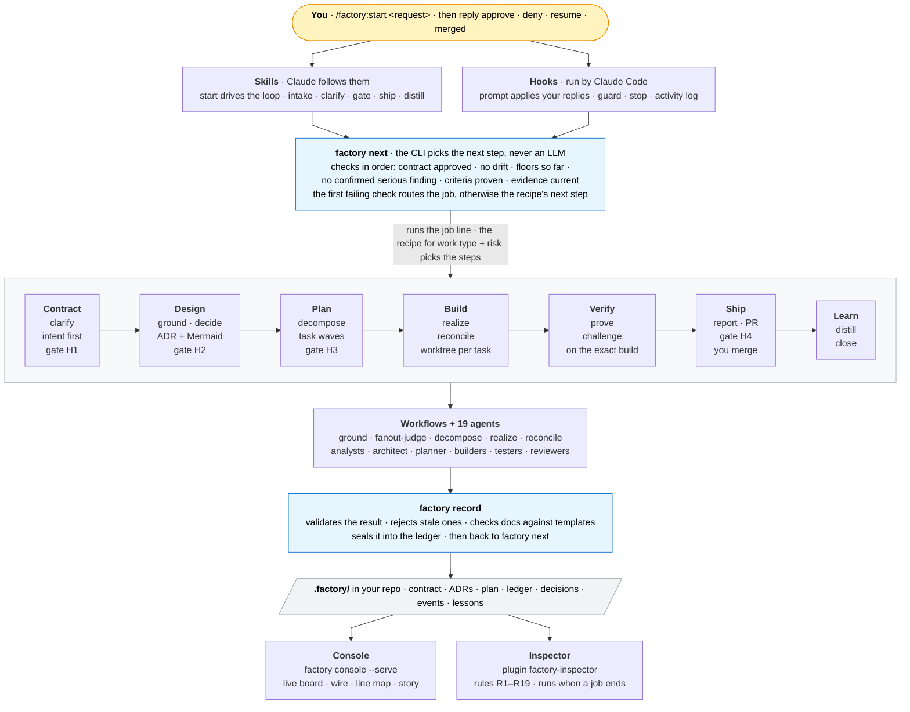
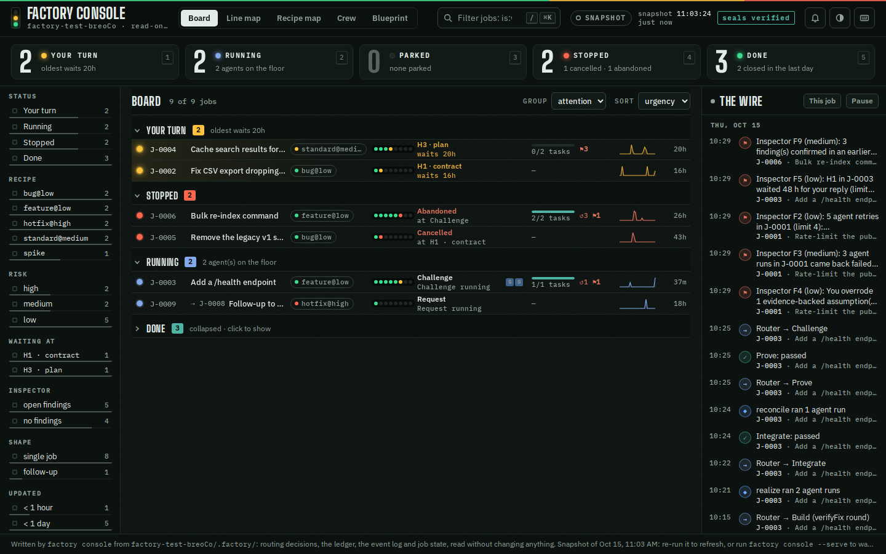
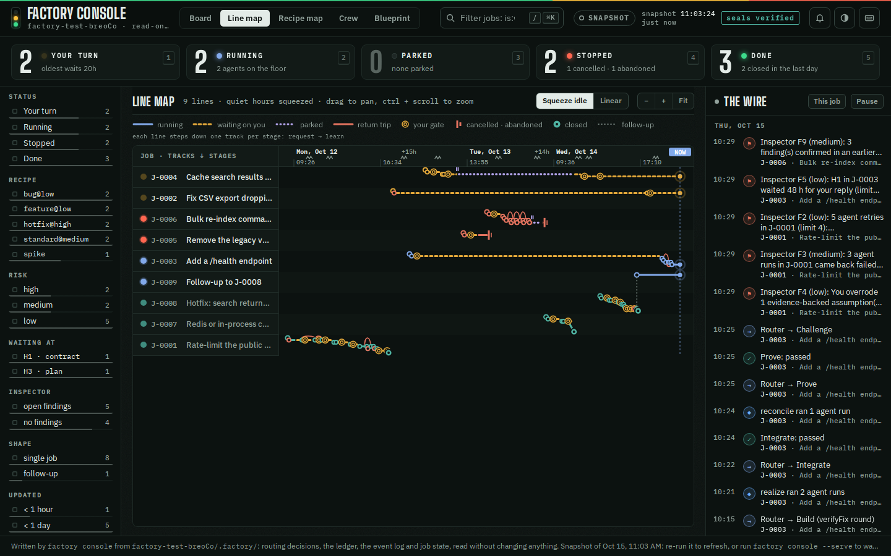
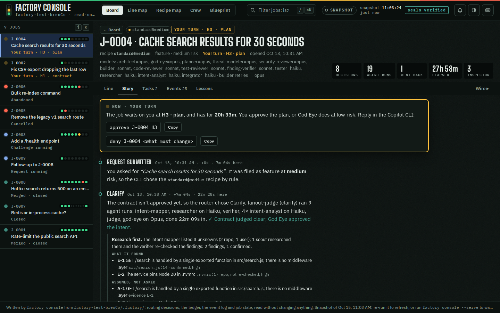

# Software Factory — a Claude Code plugin

Turns a request into a verified, merged change. Claude does the work through specialist agents, but **a CLI decides every next step by fixed rules**, every result is **checked and sealed** before it counts, evidence is **bound to the exact build**, and **you approve** the contract, the design, the plan and the merge. A second plugin, the **inspector**, audits all of it from the outside.

| Plugin | Version | What it is |
|---|---|---|
| `factory` | 0.10.0 | The orchestrator: skills, hooks, the `factory` CLI, workflows, 19 agents, recipes, templates and the console |
| `factory-inspector` | 0.2.0 | An independent auditor: checks each job against the rulebook it declared and the factory's health (rules R1–R19) |

## How it fits together



**The one rule that holds it together:** agents *propose*, the CLI *decides*. Claude never chooses the next step. The `start` skill runs `factory next`, does exactly what it returns (a workflow, a skill, a gate, a CLI command), hands the result to `factory record`, and asks `factory next` again. Hooks enforce the parts Claude could get wrong: your replies are applied by the CLI before Claude sees them, the guard blocks edits to protected files, and the Stop hook refuses "it's done" while floors are unmet.

## Install

Requirements: Claude Code, Node 18+, git. Optional: GitHub CLI (`gh`) logged in, for automatic PRs. The workflows need Claude Code's **Workflow tool** (paid plans and the API; on Pro, enable it in `/config`); without it the driver skill runs the same fan-outs with the Agent tool — slower, same rules.

```bash
claude plugin marketplace add reshif/claude-factory
claude plugin install factory@software-factory
claude plugin install factory-inspector@software-factory   # optional, recommended
```

Restart Claude Code, then run `/plugin`: both should be listed with the versions above.

To use the CLI from your own terminal (for `factory console --serve` and the human-only commands), link it onto your PATH:

```bash
ln -sf ~/.claude/plugins/marketplaces/software-factory/plugins/factory/bin/factory ~/.local/bin/factory
ln -sf ~/.claude/plugins/marketplaces/software-factory/plugins/factory-inspector/bin/factory-inspect ~/.local/bin/factory-inspect
```

### Update

```bash
claude plugin marketplace update software-factory
claude plugin update factory@software-factory
claude plugin update factory-inspector@software-factory
```

### Check what you have installed

```bash
grep -A6 '"factory' ~/.claude/plugins/installed_plugins.json        # version + gitCommitSha
git -C ~/.claude/plugins/marketplaces/software-factory log --oneline -1
ls ~/.claude/plugins/cache/software-factory/factory/                  # old version folders can go
readlink -f "$(command -v factory)"                                   # the factory on your PATH
factory help | grep -- --serve                                        # present in 0.10.0+
```

If `extraKnownMarketplaces.software-factory` in `~/.claude/settings.json` still points at a local `directory` (an old zip install), change it to `{ "source": "github", "repo": "reshif/claude-factory" }`, run `claude plugin marketplace remove software-factory`, and add it again as above.

## Use

In any git repository with at least one commit, inside Claude Code:

| You type | What happens |
|---|---|
| `/factory:start <what you want>` | Intake: Claude reads the repo, restates your intent in one line, proposes work type, risk and job-vs-epic, and asks you **one** question to confirm all of it. The CLI creates the job and picks the recipe; then the loop runs until it needs you. |
| `/factory:start` | Continue the current job. |
| `/factory:why` | Every routing decision for the job and the rule behind it. |
| `/factory:console` | The console (below). |
| `/factory:review` | Monthly 30-minute telemetry review. |
| `/factory-inspector:inspect [job\|all\|active\|status\|health]` | Run the inspector and walk through its findings. |

The first run initialises the repo (`factory init`): a `.factory/` folder kept out of git via `.git/info/exclude`, and a `commit-msg` hook that adds `Factory-Job` / `Factory-Task` trailers on factory branches. Each job gets a branch `factory/J-0001` and each task its own git worktree under `.factory/worktrees/`.

### Your replies

The `UserPromptSubmit` hook applies these **before Claude sees them**; nothing else counts as approval. Case and trailing punctuation or emoji don't matter (`Approve!`, `approve 👍`), but the reply must be the whole message. Something that only looks like a reply (`aprove`, `approve the plan please`) is **not applied**, and Claude is told so with the exact forms. Add a job id to target one job: `approve J-0007`.

| Reply | Effect |
|---|---|
| `approve` | Approve the waiting gate. Bound to the document's hash: if it changed since you saw it, the approval is refused. |
| `deny <what must change>` | Send it back with your reason. |
| `resume` | Un-park; the cap that stopped it gets one more round. |
| `cancel job` · `abandon job` | Stop for good; files are kept. |
| `merged <commit>` | Record a local merge (when there's no GitHub PR). |
| `confirm AC-3` | Confirm a criterion whose evidence type is `human`. |
| `waive ci_reverify <reason>` · `waive ship_size <reason>` | The only waivable floors. |
| `accept lesson L4` · `reject lesson L4 <why>` | Decide on a proposed lesson. |
| `ack finding F3` · `fixed finding F3` · `wontfix finding F3 <why>` | Settle an inspector finding. |
| `inspect mode <recipe\|all> on\|off\|sample <N>` | How often the inspector runs. |

From your own terminal you can run the human-only commands directly: `factory approve`, `factory resume`, `factory reseal`, `factory-inspect mark …`. Agents are blocked from running them.

### Gates you may see

| Gate | When |
|---|---|
| **H1** contract | Every job |
| **H2** design | Medium risk when there is an ADR; always at high risk |
| **H3** plan | Medium and high; at low risk (`feature@low`) God Eye's plan critique can approve it for you |
| **HS** ship sign-off | High risk, before shipping |
| **H4** merge | Every change: you merge |
| **HF** spike findings · **EH1–EH3** epic contract, architecture, slices · **A** amendment · **P** parked | As they come up |

### Questions you may get (clarify)

The contract starts with an **Intent** section — problem, who, outcome, why now, success signal — and an intent analyst reads it first, alone. Until the intent is settled you get **only intent questions**; then scope, constraint and acceptance questions follow, in that order. **At most 5 questions in round 1 and 3 in later rounds**, as one numbered list. Each has an id (`Q-3`), why it matters, the default the factory will use if you skip it, and options where possible. Nothing is asked twice. If the intent is still unclear after two rounds the job **parks rather than guessing**; reply `resume` for one more round. God Eye must restate and confirm the intent before H1.

## How a job runs

**Recipes.** The CLI picks one by rule from work type and risk ([`recipes/_selection.json`](plugins/factory/recipes/_selection.json)) and locks it into the job (`recipe.lock.json`). Recipes are human-authored and versioned; agents can't edit them.

| Recipe | Picked for | Steps |
|---|---|---|
| `bug@low` | bug, docs, dependency at low risk | clarify → H1 → ground → decompose (one task from the contract) → realize → reconcile → prove → challenge(code) → ship → H4 → distill → close |
| `feature@low` | other work at low risk | as above, with a planned task graph, God Eye plan critique → H3, challenge(code, tests) |
| `standard@medium` | any medium-risk work | clarify → H1 → ground → decide → H2 (if ADR) → decompose → H3 → realize → reconcile → prove → challenge(code, tests, security) → ship → H4 → distill → close |
| `full@high` | any high-risk work; migrations are floored here | as medium, plus a threat model, H2 always, every lane, **HS** before ship |
| `hotfix@high` | hotfix | as `full@high`, grounding scoped to the failing path, plus a post-merge review; confirmed problems open a linked follow-up job |
| `spike` | spike | clarify → H1 → ground → decide (recommendation) → HF → close |
| `epic` | `--epic` | contracts freeze first, then each slice runs as its own job with its own recipe |

**Routing.** `factory next` checks, in order: contract approved → no drift from what you approved → floors met so far → no confirmed serious finding → every criterion proven → evidence still matches the build. The first that fails decides (clarify, amendment, the missing floor step, a fix round, a verify-fix round, prove again); if all pass, the recipe's next undone step runs. Loops are capped and **park** for you when a cap is hit. Every decision is a line in `.factory/log/decisions.jsonl`; `/factory:why` shows them.

**Floors** are the steps no recipe may skip at a risk level — e.g. contract approval, isolated builds, proof and code review everywhere; grounding, a design record, a validated plan and three review lanes from medium; a threat model, H2/H3, every lane and ship sign-off at high. They are enforced when a recipe loads, and again by `factory ship`, `factory close`, the Stop hook and CI. See [`FLOORS.md`](plugins/factory/docs/FLOORS.md).

**Evidence.** Builders work in per-task worktrees; only `factory task verify` produces task evidence, and only `factory verify run` proves criteria on the integrated build. Every proof and review is bound to that build's fingerprint, so a later change makes it stale.

## Documents

Every document the factory keeps follows a versioned template in [`templates/docs/`](plugins/factory/templates/docs): ADR, no-ADR note, spike recommendation, threat model, epic contracts, findings, ship report (also the PR body), lessons, and a per-job docs index. Each has the same front matter, fixed sections in a fixed order, and guidance comments.

- **ADRs must include a Mermaid architecture diagram** (a C4-style view of the system after the change, changed parts highlighted); a sequence diagram for the key flow is optional. A threat model needs a STRIDE table and a data-flow diagram with each trust boundary drawn as a box.
- **Enforced when the design is recorded:** `factory record` checks the design record against its template; problems go back to the architect, and three failures in a row park the job.
- **Traceability:** `factory doc index` writes a table tracing each acceptance criterion through the design and the task to its proof.

```bash
factory doc list                  # types, template versions, sections
factory doc template adr          # print a template
factory doc check --job J-0007    # check every templated doc of a job
factory doc index --job J-0007    # (re)write the docs index
```

Details: [`DOCS.md`](plugins/factory/docs/DOCS.md).

## The console: watch the factory work

Run `factory console`, or `/factory:console` in Claude Code, then open `.factory/console.html`. Or run `factory console --serve` and open the URL it prints: the same page, kept current as Claude works. Either way it reads `.factory/` and writes only the page. It checks seals only when this machine already has the factory key, and never creates one.



- **The floor.** The header has the project, a **LED** (`live` when served, `reconnecting` if the server went away, `snapshot` for a written file), the time of the last update, the seal check, any open factory-health findings from the inspector, and a filter box.
  - **Five tiles**: your turn, running, parked, stopped, done. Each is a count and a one-click filter (keys `1`–`5`). The tab title shows how many jobs wait for you, e.g. `(2) Factory Console`.
  - **Filters** on the left, with counts: status, recipe, risk, the gate a job waits at, inspector findings, epic or slice, and how recently it changed.
  - **The filter box** takes words and tokens: `is:waiting` `risk:high` `recipe:bug@low` `gate:H2` `has:finding` `has:rework` `agent:builder` `since:2d`; `-` excludes. Words match ids, titles and what happened.
- **Board.** One dense row per job, grouped by attention: your turn, then stopped, running, parked, and done (collapsed). Each row has a beacon (flashing amber on your turn), the recipe and risk, the eight stage lights, the current step or the gate and how long it has waited, the agents running now (coloured by model; `?` for one that started and never reported back), the task bar, return trips `↺`, retries `↻`, inspector findings `⚑`, a three-day activity sparkline and the age of the last change. A blue dot marks a job that changed since you last opened it. Group by status, recipe, risk, stage, epic or day; sort by urgency, updated, created or id. Slices sit under their epic.
- **Line map.** Every job as a transit line on one time axis. A line steps down one track per stage, with 45° bends. Gates are double rings, a dashed amber stretch is time waiting on you, dotted violet is parked, red marks a return trip, a buffer stop ends a cancelled or abandoned job, and a dotted transfer leads to a follow-up. Quiet hours are squeezed by default (switch to linear); zoom with `+`/`−`/Fit or ctrl-scroll, drag to pan, hover a station for the router's reason, the agents and the result.

  
- **The wire.** On the right, everything that happened across all jobs, newest first: routes, results, agent runs, your replies, guard blocks, parks, hook errors, refused "done" claims and inspector findings. Pause it while you read; narrow it to the selected job; click a line to open the job at that moment.
- **A job.** Click a row (or `Enter`). The list stays on the left so `j`/`k` still switch jobs; `Esc` goes back.
  - **Line**: the flow canvas. Stages are columns and time runs downward; each visit to a step is a row. Moving on is a blue line right; going back is a red line left, labelled with why (a fix round, a verify-fix round, re-proving, your denial); a repeated step drops straight down. Parks, resumes, amendments, cancels and abandons have their own rows. Each row shows the router's reason, every agent with its model (O/S/H), runs, retries `↻`, failures `✕` and escalation `↑`, the result and findings, your replies with how long each took, and guard blocks. A crew band shows who worked in each stage, inspector findings sit in a column beside the row they cite, and **Replay** drives the job down the canvas with the router's six checks at each decision.
  - **Story**: the same job as prose, one paragraph per step visit, with return trips on a red rule and inspector findings as margin notes. A pinned **Now** card says what the job waits on and the exact reply to type, with a copy button (e.g. `approve J-0004 H3`).
  - **Tasks**, **Events** (a filterable table of every event) and **Lessons**.

  
- **Live.** With `--serve`, the page gets each change over server-sent events. Only the rows whose job changed are redrawn, with a short highlight, and a row that changes group slides there. A new gate brings a toast with the reply to copy, and, if you turn on the bell, a desktop notification. On an open job, new steps play in if you are watching the latest moment, and your place is kept if you are scrubbing back. The server listens on this machine only (`http://127.0.0.1:4477/`, `--port 0` for any free port), refuses foreign `Host` headers and is read-only.
- **Keys.** `j`/`k` move, `Enter` opens, `Esc` goes back, `/` filters, `⌘K` (or ctrl-K) opens a palette to jump to any job or view, `1`–`5` toggle the tiles, `g w` opens the next job waiting for you, `?` lists them all. The view, filters and open job are in the URL, so a link brings you back to the same place.
- **Recipe map and Crew.** *Recipe map* is the whole factory as a floor plan for any recipe; *Crew* lists the 19 agents and how often each ran.
- **Where the data comes from.** Each workflow returns a roster of every agent it started, and `factory record` seals it into the ledger as an `agents` entry tied to the routing decision. Hooks add timings. Parks, amendments, follow-ups, hook errors and refused "done" claims come from the event log and the job's own records. An agent that started but never stopped counts as running for two hours at most, and only while its job is active; after that it shows as stale.
- **Options.** `--job J-0003` makes the page for one job, `--out file.html` writes it elsewhere, `--label "…"` adds a banner, and `--data file.json` also writes the data as JSON. Dark is the default look when your system is dark; the half-moon button switches theme.
- **Sample.** `node plugins/factory/console/dev/make-sample.js <dir>` builds a realistic sample: nine jobs over about three days on a simulated clock. They run through the real CLI, workflows, hooks and inspector, with scripted agents. More screenshots are in [`plugins/factory/console/dev/screenshots/`](plugins/factory/console/dev/screenshots/).

## The inspector

`factory-inspector` audits the factory from the outside. It imports none of the factory's code: it reads `.factory/` directly, with its own seal check, so a bug in the factory can't hide itself. It never blocks or changes a job; its findings are questions for you, kept in `.factory/inspect/register.json`.

- **Per job (R1–R9):** forged records, the wrong recipe, steps out of order, gates approved without being shown, review on an unproven build, loops past caps, Claude not doing what `factory next` said, the same situation routed differently, recurring friction.
- **Factory health (R10–R19):** hook failures, torn log lines, repeated guard denials / blocked "done" claims / refused replies, CLI failures and crashes, degraded workflows and agent retries, agents that never stopped, repeated parks, idle jobs, slow gate replies, and clarify parking on an unclear intent or overrunning its question budget. Thresholds live in `.factory/inspect/config.json` (`limits`, `rules_off`).
- **When it runs:** whenever a job ends — closed, cancelled or abandoned — however it ended: right after Claude runs the command, at the end of the turn if you ended it with a chat reply, or at the next session start if you ended it from your terminal. On demand with `/factory-inspector:inspect` (`active` also covers running jobs). Once a recipe has a long clean streak it suggests sampling, then off.

Rule table and CLI: [`plugins/factory-inspector/README.md`](plugins/factory-inspector/README.md).

## Hooks

| Plugin | Event | Script | What it does |
|---|---|---|---|
| factory | SessionStart | `session-start.js` | Tells Claude about the current job and what's waiting |
| factory | UserPromptSubmit | `prompt.js` | Applies your replies through the CLI; flags look-alikes as not applied |
| factory | PreToolUse (Write, Edit, Bash, Read, Grep, Glob …) | `guard.js` | Blocks writes to protected paths, recipes and policy, and reads of secrets (`.env`, keys, the seal key); keeps builders inside their task's allowed paths |
| factory | PostToolUse (tools that change things), SubagentStart | `activity.js` | Appends a sealed line per event to `.factory/log/events.jsonl` |
| factory | SubagentStop | `subagent-stop.js` | Records that an agent finished |
| factory | Stop | `stop.js` | Blocks "it's done" while any job it names has unmet floors |
| inspector | PostToolUse (Bash) | `after-close.js` | Inspects right after `factory close / cancel / abandon` |
| inspector | Stop · SessionStart | `catch-up.js` · `session-start.js` | Inspects jobs that ended any other way |
| inspector | UserPromptSubmit · PreToolUse | `prompt.js` · `guard.js` | Applies your finding replies; keeps marking and modes human-only |

A hook that fails never breaks Claude Code, but it leaves a `hook_error` event, which the inspector reports.

## CI re-verify (recommended)

From your own terminal, once per repo: `factory ci install` (human-only). It copies a self-contained CLI to `.github/factory-cli/` and adds `.github/workflows/factory-gate.yml`, which re-runs every shipped job's verify commands on the PR's merge result. Add your project's setup steps, commit both on your base branch, and make `factory-gate` a required check. Without GitHub, `factory ci verify` re-verifies a local merge.

## Configure

Project overrides go in `.factory/policy.json` (you edit it; agents can't). Defaults: [`policy/default-policy.json`](plugins/factory/policy/default-policy.json).

```json
{
  "base_branch": "main",
  "checks": [{ "cmd": "npm run lint" }],
  "agents": { "models": { "researcher": "haiku", "builder": "sonnet" }, "builder_escalation": ["opus"] },
  "protected_paths": [".factory/**", ".git/**", ".github/workflows/**", "migrations/**"],
  "limits": { "max_review_rounds": 3, "max_parallel_tasks": 4, "max_agent_runs_per_job": 400 }
}
```

Every workflow agent runs as its real factory agent (`agents/<role>.md`), so each role's tools and model apply. `agents.models` sets a model per role; `agents.builder_escalation` moves a builder to a stronger model from its second attempt.

## Start over in a repo

To clear old jobs (for example ones made by an older version) and initialise again:

```bash
cd your-repo
tar czf ~/factory-backup.tgz .factory                     # keep a copy
git worktree list | grep '.factory/worktrees' | awk '{print $1}' | xargs -r -n1 git worktree remove --force
git worktree prune
git branch --list 'factory/*' | xargs -r git branch -D    # review the list first
rm -rf .factory
```

Then `/factory:start <request>` initialises the repo again. Keep `~/.config/software-factory/secret` (the seal key) unless you want old seals to stop verifying.

## Repository layout

```text
.claude-plugin/marketplace.json     the marketplace: software-factory
plugins/factory/
  .claude-plugin/plugin.json        plugin manifest (version)
  skills/                           start · intake · clarify · gate · ship · distill · amend · park · why · console · review
  agents/                           19 agents: intent-analyst, judge, god-eye, researcher, option-generator, threat-modeler,
                                    architect, planner, slicer, builder, tester, integrator, code/test/security/ux-reviewer,
                                    finding-verifier, epic-reviewer, lesson-writer
  hooks/                            hooks.json + the scripts in the table above
  cli/                              the factory CLI: main.js, core/ (router, record, floors, ship, console, doc …), lib/
  workflows/                        ground · fanout-judge · decompose · realize · reconcile
  config/workflows/                 fan-out configs: clarify · decide · challenge
  recipes/                          the recipes and _selection.json
  policy/                           default-policy.json · floors.json
  schemas/                          envelope, contract, plan, ledger and agent-output schemas
  templates/                        docs/ (document templates) · git/commit-msg · github/factory-gate.yml
  console/                          console.html (the page) · dev/ (sample builder, screenshots)
  docs/                             ARCHITECTURE · DESIGN-v2 · RECIPES · FLOORS · DOCS
  tests/                            end-to-end and unit tests
plugins/factory-inspector/
  inspector/                        observe · rules (R1–R19) · register · config · io
  hooks/ · skills/inspect/ · bin/factory-inspect · tests/
```

## Develop / test

```bash
cd plugins/factory && npm test             # 64 tests: end-to-end jobs, routing, caps, guard, seals, hooks, workflows, schemas, console, docs
cd plugins/factory-inspector && npm test   # 14 tests
node plugins/factory/console/dev/make-sample.js /tmp/sample   # a realistic nine-job sample to look at
```

The tests drive the real CLI against throwaway git repos, play the agents and the human, and run the workflow scripts in a harness that emulates the Workflow runtime. Bump the version in both `plugin.json` and `package.json` with every change you ship, so installs can tell versions apart.

## Troubleshooting

| Symptom | Fix |
|---|---|
| `marketplace add` fails: source doesn't match its `extraKnownMarketplaces` entry | Point that entry in `~/.claude/settings.json` at `github` / `reshif/claude-factory` (see Install) |
| `/plugin` shows an old version | `claude plugin marketplace update software-factory`, then update both plugins and restart |
| `factory` in your terminal behaves like an old version | `readlink -f "$(command -v factory)"`; relink it to the marketplace copy (see Install) |
| Your `approve` was ignored | It must be the whole message; Claude says when a reply wasn't applied and shows the accepted forms |
| A job is parked | `/factory:why` shows why; reply `resume` for one more round, or `deny` / `cancel job` |
| Old jobs fail `factory contract check` or `factory doc check` | They predate the Intent section and doc front matter; start over in the repo (above) |
| The console doesn't update | Use `factory console --serve` (a written file is a snapshot); the LED shows live / reconnecting / snapshot |

## Known limits

- Covered by the automated tests above, but young in live use: try a `bug@low` job first, and run `claude plugin validate plugins/factory` after installing.
- The guard and seals are defence in depth, not a sandbox: agents run as your OS user. CI re-verify and your own merge are the hard backstops (ARCHITECTURE.md §6a).
- Budgets count agent runs and wall time, not tokens.
- Not included in this build: standards packs (`python@1`, `typescript@1`); project checks go in `policy.checks`.

More: [`ARCHITECTURE.md`](plugins/factory/docs/ARCHITECTURE.md) · [`DESIGN-v2.md`](plugins/factory/docs/DESIGN-v2.md) · [`RECIPES.md`](plugins/factory/docs/RECIPES.md) · [`FLOORS.md`](plugins/factory/docs/FLOORS.md) · [`DOCS.md`](plugins/factory/docs/DOCS.md)
