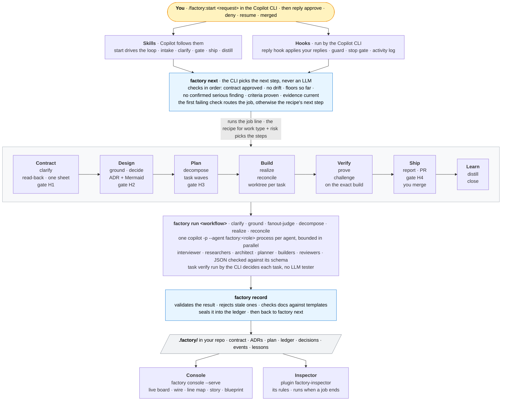
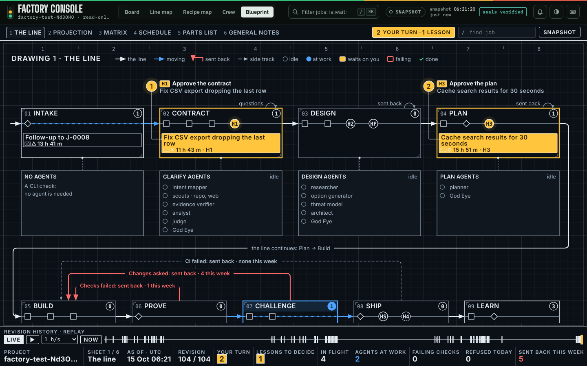

# Copilot Factory: the Software Factory for the GitHub Copilot CLI

Turns a request into a verified, merged change. Copilot does the work through specialist custom agents, but **a CLI decides every next step by fixed rules**, every result is **checked and sealed** before it counts, evidence is **bound to the exact build**, and **you approve** the contract, the design, the plan and the merge. A second plugin, the **inspector**, audits all of it from the outside.

This is a port of [claude-factory](https://github.com/reshif/claude-factory) (the Claude Code plugin "Software Factory") to the GitHub Copilot CLI. The CLI core is the same: router, floors, record, seals, ledger, recipes, policy, worktrees, verify, ship, document templates and console. What changed is the shell around it: Copilot skills and custom agents, Copilot-format hooks, and a `factory run` command that runs the workflows by starting one `copilot -p` process per agent, because Copilot has no Workflow tool. The full component mapping is in [`docs/COPILOT.md`](docs/COPILOT.md); the design decisions are in [`docs/DESIGN-COPILOT.md`](docs/DESIGN-COPILOT.md).

| Plugin | Version | What it is |
|---|---|---|
| `factory` | 0.7.0 | The orchestrator: skills, hooks, the `factory` CLI with `factory run`, workflows, the custom agents (one per role), recipes, templates and the console |
| `factory-inspector` | 0.7.0 | An independent auditor: checks each job against the rulebook it declared and the factory's health (its rule table is in the inspector README) |

0.3.0 adds **grounded intent**: clarify researches the repo and the web before it asks you anything. 0.3.1 makes the hooks work in VS Code's Local harness as well as the Copilot one, says when chat replies aren't reaching the factory, asks you to type the job id when you approve from a terminal, and runs the distill lesson-writer through `factory distill write` (see [Use it in VS Code](#use-it-in-vs-code)). 0.4.0 raises the quality bar of every skill and agent: least-privilege per-role tool approval in `factory run`, an untrusted-content rule, role- and tool-aware briefs, a final-message recipe and golden example per agent, a finding-verifier `unverifiable` verdict, trigger-first skill descriptions, and an evaluation pipeline (see [Quality and evals](#quality-and-evals)). 0.4.1 adds the console's **Blueprint** view (the line as an engineering drawing set) and makes every view show 0.4.0 data faithfully: unverified findings stay visibly blocking, Crew's tools come from the agent files, and an Autopilot sighting is flagged as a gate-safety warning. 0.4.2 shows the agents `factory run` starts as at work while they run (they are separate `copilot -p` processes, so no subagent hook ever reported them). 0.4.3: when clarify asks you questions, the Blueprint shows it as your turn (a Q callout at Contract), matching the Board. 0.4.4 shows each workflow run step by step, live, inside the Blueprint's agent banks (done, running, next, with the agents, failures and retries of every step) and in a job's section view. 0.5.0 rebuilds clarify around one issue ledger per job (see docs/DESIGN-CLARIFY-v2.md): issues keep their identity across rewording and stay settled, every answer attaches to an issue (`factory answer U-n|Q-n`, numbered chat replies), research that cannot settle an issue becomes one question with a default, implementation facts are deferred to design, rounds review only what changed, a job parks only when it stops making progress, the contract is written only through the CLI during clarify, and `factory clarify status` shows where things stand. v1 jobs migrate on first use. 0.5.1: the Blueprint's Build detail follows the wave at work (it showed only waves 1 and 2). 0.5.3: the Blueprint's replay speed is a dropdown from 1 s/s (real time) through 1, 2, 5 and 10 min/s to 1 and 4 h/s, 1 min/s by default and remembered per browser. 0.6.0: outcome integrity and builds that work — an unverified serious finding is carried until a verifier or you settle it (`dismiss|accept finding`); a task is done only when this attempt's builder finished and its dependencies are merged; `task verify`, run by the CLI, decides (no LLM tester); retries resume the builder's session with the raw failure; each worktree runs in a confirmed build environment; the plan names its interfaces and every wave is integrated and checked before the next (see [How a job runs](#how-a-job-runs) and [The build environment](#the-build-environment-what-each-worktree-runs-in)). A job mid-build when you upgrade keeps going: see *Upgrading with a job mid-build* under Evidence. 0.6.1 (clarify fixes): issues no longer merge just because they share the job title's words; nothing is dropped without who and why, shown at H1; God Eye's blockers are shown at H1 as objections, never counted as approval; a failed intent mapper or an unavailable web is stated, not hidden; two failed (degraded) rounds in a row park the job; agents never ask for the confirmation code; `factory doctor` checks the Node the hooks run with (14+ needed). 0.7.0 replaces clarify with **clarify v3** (see docs/DESIGN-CLARIFY-v3.md): a read-back of your request and versions, one research pass pinned to those versions, one decision sheet (at most 5 decisions with options and a recommendation), one contract writer and a readiness checklist whose blockers go back to their stage, then H1. Your words outrank evidence and agents; a denial or redirect is read back clause by clause and each clause is reported done or not; you may edit contract.md (the CLI re-checks it); every reply costs 1–3 agent calls instead of a full round. v1/v2 jobs migrate on first use (a job waiting at H1: approve before upgrading to keep its contract). **Clarify v3** (unreleased, on this branch) replaces the analyst panel and its rounds with a read-back, one research pass pinned to the versions you confirmed, one decision sheet, one contract writer and a readiness check; see [Clarify](#clarify-two-short-replies-in-the-common-case) and [docs/DESIGN-CLARIFY-v3.md](docs/DESIGN-CLARIFY-v3.md).

The version line started again at 0.1.0 for Copilot. It is separate from claude-factory's (0.10.0 / 0.2.0 at the time of the port).

## How it fits together



**The one rule that holds it together:** agents *propose*, the CLI *decides*. Copilot never chooses the next step. The `start` skill runs `factory next` and does exactly what it returns: a skill, a gate, a CLI command, or a workflow. A workflow always goes through `factory run <workflow>`, which starts the agents, checks their JSON, records the result and prints it. Then the skill asks `factory next` again. The skill never writes a brief or an envelope and never fans work out itself. Hooks enforce the parts Copilot could get wrong: your replies are applied by the CLI before the model acts on them, the guard blocks edits to protected files, and the stop gate sends Copilot back to work while the job has steps left and nothing is waiting on you.

## Install

Requirements:
- GitHub Copilot CLI, with a Copilot plan. Use 1.0.81 or later, because installed-plugin agents only load in `copilot -p` from that version. 1.0.97 or later is recommended for the hook fixes.
- Node 18 or later, and git.
- Optional: the GitHub CLI (`gh`), logged in, for automatic PRs.

```bash
copilot plugin marketplace add reshif/copilot-factory
copilot plugin install factory@copilot-factory
copilot plugin install factory-inspector@copilot-factory   # optional, recommended
```

Run `/plugin` (or `copilot plugin list`) to check that both are listed with the versions above. The docs say plugin agents and skills are available as soon as they are installed. If they don't show up, restart the CLI (`/restart`).

**Put `factory` and `factory-inspect` on your PATH.** Copilot does not put a plugin's `bin/` on the PATH, and the plugin folder is outside your workspace, so without the link Copilot asks for permission before every `node "<plugin root>/bin/factory" …` it runs (and refuses it in `copilot -p`). With `factory` on the PATH the skills run `factory …` and there is nothing to approve (checked on CLI 1.0.97). The session-start hook says which case you're in. Run this once, in your own terminal:

```bash
node "${COPILOT_HOME:-$HOME/.copilot}/installed-plugins/copilot-factory/factory/bin/factory" shim
```

If you'd rather not link anything, allow the plugin folder instead: `/add-dir <plugin root>` in a session, or start Copilot with `copilot --add-dir <plugin root>` (the session-start hook prints the exact path).

**Where the plugins live.** That path is right for the install above, from GitHub: Copilot copies each plugin to `installed-plugins/copilot-factory/<plugin>/` under `~/.copilot`, or under `COPILOT_HOME` when that is set. A marketplace added from a local folder (`copilot plugin marketplace add <your clone>`) is different: Copilot loads it live from that folder and copies nothing, so use `node <your clone>/plugins/factory/bin/factory shim` instead. To see which case you have, run `copilot plugin list --json`. `"source": "installed"` means the copied folder; `"source": "live"` means the plugin runs from `<installedFrom>/plugins/<plugin>/`.

`factory shim` links both commands into `~/.local/bin` (`--dir <folder>` for another place; `--force` replaces old links, e.g. from claude-factory). The inspector link needs the `factory-inspector` plugin installed. If `~/.local/bin` is not on your PATH yet, add it and open a new terminal:

```bash
echo 'export PATH="$HOME/.local/bin:$PATH"' >> ~/.bashrc    # or ~/.zshrc
```

Or link them by hand (for a local-folder install, set `P=<your clone>/plugins` instead):

```bash
P="${COPILOT_HOME:-$HOME/.copilot}/installed-plugins/copilot-factory"
mkdir -p ~/.local/bin
ln -sf "$P/factory/bin/factory" ~/.local/bin/factory
ln -sf "$P/factory-inspector/bin/factory-inspect" ~/.local/bin/factory-inspect
```

Check: `factory help | head -1` and `factory-inspect help | head -1` each print a line, and `readlink -f "$(command -v factory-inspect)"` points into the plugin folder.

**First run in a folder.** `/factory:start` (the first time, via `factory init`) sets up the folder. If the folder has no git history yet, it runs `git init` if needed and makes a first commit of the folder's existing files (respecting `.gitignore`), so builders' worktrees start from your code. Files that look like secrets (`policy.secret_paths`: `.env`, keys, credentials) are not committed; init lists them as `left_untracked`, and you should add them to `.gitignore`. It also keeps `.factory/` out of git and adds a commit-msg hook. It refuses your home folder itself (`home_folder`), so open Copilot in a project folder. If git doesn't know your name and email yet, it tells you the two `git config --global` commands to run first, before it changes anything.

**Trust the repository.** When the Copilot CLI asks whether to trust the folder, say yes. Hooks, skills and agents need it.

**Never use Autopilot with the factory.** Autopilot answers questions and permission prompts by itself, and every gate here is yours. It can't approve a gate (only your own typed reply does), but it pushes the agent on past the points where the factory waits for you. Run the factory in an interactive session. The factory checks for it: the reply hook recognises Autopilot's own continuation prompt and records it in `.factory/autopilot.json` (event `autopilot_seen`), and for six hours afterwards `factory next` carries an `autopilot` warning (the start skill shows it and stops) and `factory doctor` warns. It can't see an Autopilot session that never stops early, and plan-then-autopilot only through `COPILOT_PLAN_THEN_AUTOPILOT` (doctor). The cloud agent is out of scope: it is non-interactive and turns "ask" into "deny".

### Update

```bash
copilot plugin marketplace update copilot-factory
copilot plugin update factory
copilot plugin update factory-inspector
```

`copilot plugin update --all` updates everything. In a session, `/plugin` shows when an update is available.

### Check what you have installed

```bash
copilot plugin list --json                                  # name, marketplace, version, enabled, source (installed / live + installedFrom)
ls ~/.copilot/installed-plugins/copilot-factory/            # the installed copies: factory/, factory-inspector/ (GitHub installs only)
ls ~/.cache/copilot/marketplaces/                           # marketplace cache (macOS: ~/Library/Caches/copilot/marketplaces/)
readlink -f "$(command -v factory)"                         # the factory on your PATH (after factory shim)
```

`COPILOT_HOME` moves `~/.copilot`, and the marketplace cache moves under it too (`$COPILOT_HOME/.cache/copilot/marketplaces/`). `COPILOT_CACHE_HOME` moves the cache on its own. Install metadata, including each installed plugin's folder (`installedPlugins[].cache_path`), is in `~/.copilot/config.json`. A marketplace added from a local folder is loaded live from that folder, so it has no copy under `installed-plugins/`.

### Use it in VS Code

VS Code's Copilot Chat can use the same plugins, but it needs three things the CLI doesn't:

1. **Turn agent plugins on.** They are off by default in VS Code. Open Settings and enable **Chat › Plugins: Enabled**, or add this to your user `settings.json`, then run **Developer: Reload Window**:

   ```json
   "chat.plugins.enabled": true
   ```

2. **Install the plugins.** Either way works:
   - **From the CLI (simplest).** Install them with `copilot plugin install … @copilot-factory` as above. VS Code automatically picks up plugins the CLI installed from a marketplace (they live in `~/.copilot/installed-plugins/copilot-factory/`). A marketplace added from a *local folder* is loaded live and not copied there, so VS Code won't see it; add the marketplace as `reshif/copilot-factory`.
   - **From VS Code.** Add the marketplace to your settings and install from the **Extensions** view (search `@agentPlugins`) or the chat's **gear › Plugins**:

     ```json
     "chat.plugins.marketplaces": ["reshif/copilot-factory"]
     ```

   Check the **Agent Plugins - Installed** view in the Extensions view: `factory` and `factory-inspector` should be listed and enabled.

3. **Keep the Copilot CLI installed and signed in.** `factory run` (and `factory distill write`) starts each agent as a `copilot -p` process, so it needs the `copilot` command even when you drive the factory from VS Code.

4. **Pick the Copilot harness.** The harness is not the agent picker ("Agent" there is a role): it is the **Session Target**. Before the first prompt of a session, select **New Chat** (`+`), open the **Session Target** control and choose **Copilot**. The chat title's prefix (in the Agents window, the input box watermark) shows the harness of the current session; switching the model or the role doesn't change it. The Copilot harness runs the same hook runtime as the CLI.

   **Local** works too when hooks run there: `chat.useHooks` on (the default), the folder trusted (Workspace Trust), and no policy restricting hooks to managed plugins. Every factory hook answers in both formats in one JSON object (the Copilot fields plus Local's `hookSpecificOutput`), each hook entry has the `command` field Local's own format uses, and the guard knows VS Code's tool names (`run_in_terminal`, `editFiles`/`replace_string_in_file`/`createFile`, `readFile`, `textSearch`, `fileSearch`, `runSubagent` …). Two Local limits: a prompt hook can't add context for the model there, so the outcome of a chat reply shows to you as a message and reaches Copilot through `factory next` (`last_reply`); and Local reports a custom agent's stop as a subagent stop, which the stop gate leaves alone.

**Check that your chat replies reach the factory.** Approvals in chat (`approve`, `deny …`, `resume`) are applied by the prompt hook, before the model sees them. If the hooks don't run in your session, nothing is applied, and `factory next` says so once in a `notice` while it waits on you. To find out why:

- the chat title prefix: is the session on the Copilot (or Local) harness?
- **Chat: Configure Hooks** (Command Palette) lists the hook files the session loads: the factory's `hooks.json` should be there;
- VS Code's logs show hook runs and their errors: look in the **Output** panel's Copilot Chat channels, or the chat's debug logs (channel names vary by version; the agent debug logs show the payloads);
- `factory doctor` (`hooks node`) shows the Node the hooks would run under, from a login shell (`bash -lc`) and `/usr/bin/node`: the hooks need Node 14 or newer, and a launcher that finds an older one says so on stderr (`node v12… is too old for the factory hooks`);
- `chat.useHooks` is on and the folder is trusted (**Workspaces: Manage Workspace Trust**);
- in the Copilot CLI, `/plugin list` shows `factory` enabled and `/env` lists its hooks.

Meanwhile, act from your own terminal (not the chat's): `factory approve H2 --job J-0007`, `factory deny --job J-0007 --reason "…"`, `factory resume`, … Each human-only command shows a short random code on the terminal and asks you to type it back, for example `To approve H2 (J-0007), type the code K7QM:`. The code is new each time, is not derived from anything in the repository or the job, and is written only to the terminal device: not to stdout or stderr, a file or the event log, so an agent that runs a command and reads its output never sees it. It works the same in a plain terminal, VS Code's integrated terminal and WSL (`/dev/tty`; on Windows the console, `CONIN$`/`CONOUT$`); stdin and stdout must both be that terminal. There is no `--yes`.

The command also refuses to run in a shell that belongs to an agent: inside `factory run`, and wherever an agent harness marks its shell: VS Code's agent terminals (`COPILOT_AGENT=1` since VS Code 1.121, `AI_AGENT=github_copilot_vscode_agent` since 1.124, `VSCODE_AGENT_ZSH_FIXUPS`, `VSCODE_PREVENT_SHELL_HISTORY`), commands the Copilot CLI runs (`COPILOT_CLI=1`), Claude Code (`CLAUDECODE`, `AI_AGENT`), Codex and Gemini CLI. Sources and the full list are in [`docs/research/hooks.md`](docs/research/hooks.md) §10. **The limit, honestly:** an agent that can drive an interactive terminal (VS Code can show an agent a terminal waiting for input and let it type into it) could read the code off that terminal's screen and type it, so the code alone does not stop it; what stops it is the agent-terminal marker, and VS Code before 1.121 sets none an agent couldn't also find in your own terminal. VS Code's tool confirmations ("Allow", Autopilot, auto-approve) are not a human channel: never let an agent run these for you, and keep human-only commands to a terminal you opened yourself.

Then type `/factory:start <what you want>` in the chat. The same five commands appear as in the CLI: `/factory:start`, `/factory:why`, `/factory:console`, `/factory:review`, `/factory-inspector:inspect`. Each plugin's manifest is `plugin.json` at the plugin root, the location both the CLI and VS Code read (VS Code does not read `.github/plugin/plugin.json`, where versions before 0.2.1 kept it, which is why the commands didn't show up there).

## Use

In any project folder (the first run makes it a git repository and commits its files if needed), inside the Copilot CLI:

| You type | What happens |
|---|---|
| `/factory:start <what you want>` | Intake: Copilot reads the repo, restates your intent in one line, proposes work type, risk and job-vs-epic, and asks you **one** question to confirm all of it. The CLI creates the job and picks the recipe; then the loop runs until it needs you. |
| `/factory:start` | Continue the current job. |
| `/factory:why [job]` | Every routing decision for the job and the rule behind it. |
| `/factory:console [job]` | The console (below). |
| `/factory:review` | Monthly 30-minute telemetry review. (Copilot's built-in `/review` is its own code reviewer, a different command.) |
| `/factory-inspector:inspect [job\|all\|active\|status\|health]` | Run the inspector and walk through its findings. |

Copilot lists plugin skills under the plugin's name: `/factory:start`, `/factory:why`, `/factory:console`, `/factory:review` and `/factory-inspector:inspect` (verified on CLI 1.0.95, and on 1.0.97 against a mock model). The other seven skills (intake, clarify, gate, ship, distill, amend, park) are steps the start skill runs for you, so they are hidden from the menu, as in claude-factory. A project or personal skill with the same name as one of these hides the factory's (see [Troubleshooting](#troubleshooting)).

The first run initialises the repo (`factory init`): a `.factory/` folder kept out of git via `.git/info/exclude`, and a `commit-msg` hook that adds `Factory-Job` / `Factory-Task` trailers on factory branches. Each job gets a branch `factory/J-0001` and each task its own git worktree under `.factory/worktrees/`.

### Your replies

The reply hook (`userPromptSubmitted`) applies these through the CLI **as soon as you send them**. Nothing else counts as approval. Case and trailing punctuation or emoji don't matter (`Approve!`, `approve 👍`), but the reply must be the whole message. Something that only looks like a reply (`aprove`, `approve the plan please`) is **not applied**.

The hook also writes the outcome to `.factory/last-reply.json`. The next `factory next` shows it as `last_reply`, and the `start` skill tells you in one line whether your reply was applied, and why not if it wasn't. (On CLI 1.0.97 the prompt hook's added text does reach the model, but Copilot's docs say it is dropped, so the factory doesn't depend on it.) Add a job id to target one job: `approve J-0007`.

| Reply | Effect |
|---|---|
| `approve` | Approve the waiting gate. Bound to the document's hash: if it changed since you saw it, the approval is refused. |
| `deny <what must change>` | Send it back with your reason (`deny: …` works too). The job goes back to the step that made the document, with your reason, and the gate comes back afterwards. A bare `deny` is refused: say what must change. |
| `resume` | Un-park; the cap that stopped it gets one more round. |
| `cancel job` · `abandon job` | Stop for good; files are kept. |
| `merged <commit>` | Record a local merge (when there's no GitHub PR). |
| `confirm AC-3` | Confirm a criterion whose evidence type is `human`. |
| `waive ci_reverify <reason>` · `waive ship_size <reason>` | The only waivable floors. |
| `accept lesson L4` · `reject lesson L4 <why>` | Decide on a proposed lesson. |
| `confirm environment <hash>` · `confirm environment none` | Use the proposed build environment (its setup runs in every worktree), or none. See [The build environment](#the-build-environment-what-each-worktree-runs-in). |
| `dismiss finding code-1 <why>` · `accept finding code-1 <why>` | Settle a serious review finding no verifier could settle (it is carried from round to round and blocks ship). `dismiss`: not a problem. `accept`: a known risk that ships. The reason is required; it is recorded in the ledger and the completion report lists the finding as dismissed or accepted by you. From a terminal: `factory finding dismiss\|accept <id> --reason "…"` (typed code). |
| `ok` | While clarify waits on you: the read-back is right (or, on the decision sheet, take every recommendation). |
| `ok, but 2 b` · `1 a, 3: other: per tenant` · `2 defer` · `fact 1: it is 2.4.3` | A structured answer to clarify's decision sheet, by the decisions' numbers. Anything else you say to clarify (corrections, plain prose such as "whatever's standard, but keep the old names") is recorded verbatim by Copilot with `factory clarify reply "…"` and read by the interviewer; it never answers for you. |
| `proceed` | Go on from a clarify cap (research or the contract could not be settled in the passes allowed) with the gaps shown: H1 lists them, and God Eye's open objections are shown as objections, never as approval. Not offered when an agent failed (reply `resume` to try again). |
| `ack finding F3` · `fixed finding F3` · `wontfix finding F3 <why>` | Settle an inspector finding. |
| `inspect mode <recipe\|all> on\|off\|sample <N>` | How often the inspector runs. |

From your own terminal you can run the human-only commands directly: `factory approve`, `factory resume`, `factory proceed`, `factory reseal`, `factory-inspect mark …`. Agents are blocked from running them.

### Gates you may see

| Gate | When |
|---|---|
| **H1** contract | Every job |
| **H2** design | Medium risk when there is an ADR; always at high risk |
| **H3** plan | Medium and high; at low risk (`feature@low`) God Eye's plan critique can approve it for you |
| **HS** ship sign-off | High risk, before shipping |
| **H4** merge | Every change: you merge |
| **HF** spike findings · **EH1–EH3** epic contract, architecture, slices · **A** amendment · **P** parked | As they come up |

### Clarify: two short replies in the common case

Clarify turns your request into the outcome contract. It is a few short stages, each a rule in the CLI ([design](docs/DESIGN-CLARIFY-v3.md)); you normally reply twice.

1. **Read-back** (one short agent call). The interviewer reads your words back: the intent and scope in its words, the facts you stated, **quoted**, the versions research will use (only from a repo file such as `pyproject.toml`, or from your own words, never guessed), and the research plan, each item tagged *repo*, *docs* or *decision*. You reply **`ok`**, or say what to change in plain words.
2. **One research pass**, time-boxed by risk (`clarify.research_minutes`: 6, 10, 15 minutes), pinned to the versions you confirmed. Repo researchers quote `file:line` (the CLI checks the quote is at that line); docs researchers fetch the documentation **for the confirmed version**. A page for another version, or a moving page (`stable`, `latest`), is never evidence: it is listed as skipped. A brief writer turns the pass into decision records (decision, options, evidence, recommendation). What research could not settle is listed, never dropped.
3. **Decision sheet**: at most five decisions, each with its options, evidence and recommendation, then **Facts I'll assume** with their sources, and the research gaps. One reply answers it: `ok` takes the recommendations, `ok, but 2 b` changes one, or plain words. If research contradicts something you said, the sheet asks you; it never overrules you silently.
4. **Contract**: one contract writer writes it from what was settled; the CLI adds its own sections (`## Decisions` with who made each, `## Facts relied on` with sources, `## Design may choose`, `## Research gaps`). **You may edit `contract.md` yourself at any time**; the CLI checks your text again.
5. **Readiness check**: the CLI's checks (every criterion testable and covered by a verify command, every fact you stated honoured, no rejected source cited), then God Eye's fixed checklist (intent clear, scope bounded, criteria testable, self-consistent, facts honoured, instructions handled, decisions closed). A blocker sends clarify back to the stage it names (the writer, research or the sheet), never into a note.

**H1** then shows the goal, what done means, the contract **checked against what you said** (each of your own words quoted, with where the contract honours it), the decisions **and who made them**, what design may choose, the research gaps, anything dropped (with who dropped it and why), and God Eye's objections if you chose to proceed over them (never shown as approval).

**Changing direction.** Deny H1 with what must change, or tell Copilot at any time and it runs `factory clarify redirect "<your words>"`. The interviewer reads your redirect back as tracked items (one short call); you say ok; clarify restarts from the earliest stage they touch, and the next H1 reports each item **done** or **not done**.

**Who decides.** Clarify keeps one ledger of items (`I-n`) in `.factory/jobs/<J>/clarify.json` (sealed), each with its source and strength: **you** > **evidence** > **accepted** (you took the recommendation) > **assumption**. You can always reopen anything; an agent overturns your words only with stronger evidence, and then the sheet asks you. `factory clarify status` prints the ledger (items with who decided them, findings with their source and verdict, gaps, drops, redirects); the console shows the same in the job's Clarify block.

**Caps, not loops.** Research runs at most `clarify.max_research_passes` (2) passes and the writer `clarify.max_writer_attempts` (2) attempts per readiness cycle; an agent that returns nothing is tried twice. At a cap clarify parks with the reason: reply `resume` for one more try, or `proceed` (yours only) to go on with the gaps shown. Your replies cost no full rounds: a read-back ok starts research, a structured sheet answer goes straight to the contract writer, and plain prose costs one short interviewer call first.

**Without the reply hook.** Everything works with Copilot recording your words through `factory clarify reply "…"`; the hook only saves that step for a plain `ok` or a structured sheet answer. Approving H1 stays yours alone.

**Jobs started before v3** migrate on their first clarify touch: answered issues keep your answer as your words, accepted defaults stay accepted, assumptions made without asking are shown again under "Facts I'll assume", dropped issues stay dropped (with who dropped them), folded duplicates become their own items, and a job that was mid-clarify starts again at the read-back, pre-filled; your last H1 denial is read back as a redirect. The old `intent-evidence.json` is left as it was.

## How a job runs

**Recipes.** The CLI picks one by rule from work type and risk ([`recipes/_selection.json`](plugins/factory/recipes/_selection.json)) and locks it into the job (`recipe.lock.json`). Recipes are human-authored and versioned; agents can't edit them.

| Recipe | Picked for | Steps |
|---|---|---|
| `bug@low` | bug, docs, dependency at low risk | clarify → H1 → ground → decompose (one task from the contract) → realize → reconcile → prove → challenge(code) → ship → H4 → distill → close |
| `feature@low` | other work at low risk | as above, with a planned task graph, God Eye plan critique → H3, challenge(code, tests) |
| `standard@medium` | any medium-risk work | clarify → H1 → ground → decide → H2 (if ADR) → decompose → H3 → realize → reconcile → prove → challenge(code, tests, security) → ship → H4 → distill → close |
| `full@high` | any high-risk work; migrations are floored here | as medium, plus a threat model, H2 always, every lane, **HS** before ship |
| `hotfix@high` | hotfix | as `full@high`, grounding scoped to the failing path, plus a post-merge review; confirmed problems open a linked follow-up job |
| `spike` | spike | clarify → H1 → ground → decide (recommendation) → HF → close |
| `epic` | `--epic` | contracts freeze first, then each slice runs as its own job with its own recipe |

Medium and high risk add the floor `intent_grounded`: the contract may not rest on a source clarify rejected (another version, a moving page, a quote not at its line). After H1, `ground` and `decide` get clarify's confirmed versions, facts, decisions, gaps and what design may choose, so they don't research the same things again.

**Routing.** `factory next` checks, in order: contract approved → no drift from what you approved → floors met so far → no confirmed serious finding → every criterion proven → evidence still matches the build. The first that fails decides (clarify, amendment, the missing floor step, a fix round, a verify-fix round, prove again); if all pass, the recipe's next undone step runs. Loops are capped and **park** for you when a cap is hit. Every decision is a line in `.factory/log/decisions.jsonl`; `/factory:why` shows them.

**Workflows.** When `factory next` says `workflow`, the skill runs `factory run <workflow>` with the fields it was given (`--config`, `--mode`, `--scope`, `--lanes`, `--threat-model`/`--no-threat-model`, `--plan-critique`, and `--accept-degraded` when you chose to go on without a failed agent). `factory run` executes the same workflow scripts as claude-factory (`workflows/*.js`) in a Node runtime that provides their agent API. Each agent call becomes one non-interactive Copilot process: `copilot -p <pointer to its prompt file> --agent factory:<role> [--model <id>] --add-dir <project root> --add-dir <plugin root> …`. The full prompt goes to `.factory/scratch/runner/<job>/<run>/`, and the plugin folder is an allowed path so agents can run the factory CLI headless. Agents may run only the factory commands their role is briefed for; anything else (driving the job, approvals) is refused with `agent_not_allowed`. Builders run in their task's worktree. Calls run in parallel up to `limits.max_parallel_agents`. Each agent must return one JSON object; the runner validates it against the agent's schema and asks once for a correction. The result goes through `factory record`, and `factory run` prints a short text summary of the recorded result, starting with `status: <x>` (`--json` gives the same as JSON, with the workflow's own status and summary under `workflow`). A run can take many minutes; only one runs per job at a time (`run_in_progress`). Each agent runs in its own process group: stopping `factory run` (Ctrl+C, a closed terminal, a cancelled tool call: SIGINT, SIGTERM or SIGHUP) stops every agent and what it started, logs the run's end as `interrupted` and releases the lock. The lock carries a heartbeat (every 15 s), so a lock whose holder stopped beating for 2 minutes is stale even if its pid was reused, and it names the running agents, so the next run stops any a killed run (SIGKILL) left behind. A run refuses before starting any agent when the job isn't waiting for that workflow (`not_waiting_for_workflow`) or Copilot is missing or signed out (`copilot_unavailable`). `factory run --dry-run` shows what would run without starting Copilot.

**Floors** are the steps no recipe may skip at a risk level. Examples: contract approval, isolated builds, proof and code review everywhere; grounding, a design record, a validated plan and three review lanes from medium; a threat model, H2/H3, every lane and ship sign-off at high. They are enforced when a recipe loads, and again by `factory ship`, `factory close`, the stop gate and CI. See [`FLOORS.md`](plugins/factory/docs/FLOORS.md).

**Interfaces and integration after every wave.** The plan names what tasks build for each other: `interfaces: [{name, kind, file, owner}]`, and each task lists the ones it `consumes`. `plan validate` makes a consumer depend on the owner, refuses an interface consumed but produced by no task (or living outside its owner's paths), and prints who consumes what, which the H3 view shows. After each wave the factory merges the wave's finished tasks into the job branch and runs the job's checks there (every integrated task's verify commands, the contract's commands for criteria already built, `policy.checks`), inside the build environment; the next wave starts from that branch. A break between tasks (a renamed function a sibling still calls) shows up after the wave that caused it, not at prove: it goes back with the raw output to the task whose file the failure names (one of that wave's tasks, when the output names one: a traceback through an earlier, already integrated task's file doesn't reopen it), which is rebuilt on the integrated branch. If the integrated build is still broken after that (the task ran out of attempts, or was built in an earlier run), later waves don't start on it: their tasks end `skipped_dependency` and the job parks with the per-task table. When every wave is integrated, reconcile is already done and no integrator agent runs (`limits.integrate_each_wave: false` restores the old flow).

**The design reaches the build.** `factory task show` returns each task's packet, assembled by the CLI from the job's documents: the ADR's Decision and architecture diagram, the task's rows of the ADR's "How each acceptance criterion is met" table, the ground findings on its paths, the interfaces it owns (and who consumes them) or consumes, and every other task's objective in one line. The builder's brief points to it. Every review lane gets the design record and the plan, and the code lane checks design conformance: a change that departs from the Decision, the diagram or a planned interface is a finding (`rule: design:…`).

**Evidence.** Builders work in per-task worktrees; only `factory task verify` produces task evidence, and only `factory verify run` proves criteria on the integrated build. `task verify` decides: in `factory run realize` the CLI runs it itself after each builder that replied, and its exit code is the task's pass or fail (no LLM tester reads it back; the optional sweep checker, `policy.agents.sweep_check`, only adds notes about the places the builder swept, on a cheap model, after a pass). The next attempt gets the raw result: the failing command, its exit code and the tail of its output. Retries continue instead of starting cold: the next attempt resumes the previous builder's Copilot session, the builder's brief says how long it has (commit as you go), a builder that runs out of time gets one short turn to commit and reply, and whatever it still left uncommitted is saved as a `wip:` commit on the task branch. Each task keeps its attempt history (`factory task show`: builder replies, session ids, verify results), so a later `factory run realize` continues at the next attempt number with the last failure. It counts only work a builder finished: `factory run` records each builder's reply, and verify refuses (`no_builder_result`) when this attempt's builder crashed, timed out, blocked or has not replied, and (`dependency_not_merged`) when the task branch lacks a declared or implied dependency. A task that ended blocked (or skipped, or not verified), or whose attempt changed files outside its paths, restarts from the job branch plus its dependencies (the old head is kept on a `refs/factory/restarts/…` ref); an exhausted task keeps its branch, so its next attempt continues from its commits; a dependency that does not merge is a typed `blocked: dependency_conflict` result, never retried. Builds happen only through `factory run realize`: there is no command to declare a task built by hand, because the main session is an agent too and such a command would let it vouch for work no builder finished; edits made by hand in a task worktree are not counted until a builder's attempt includes them. **Upgrading with a job mid-build:** a task whose attempts were started by an older factory (0.5.3 or earlier: it has attempts but no builder record) is *legacy*: `task verify` accepts its current attempt once without a builder record and logs a `legacy_verify` event; its next `task start` is tracked like any other. Tasks such a job already finished stay done. From its next `factory run realize` on, the job integrates each wave (set `limits.integrate_each_wave: false` in `.factory/policy.json` to keep the old flow for it; the live policy fills settings its snapshot predates), and its worktrees stay bare until you confirm a build environment. Every proof and review is bound to that build's fingerprint, so a later change makes it stale. A blocker or major review finding that no verifier settled (a timeout, or `unverifiable`) is never dropped: it is carried into every later round, whether or not a reviewer raises it again, and re-verified with twice the agent time cap; `ship`, `merged` and `close` refuse while one is open (floor `no_unverified_serious`), the completion report lists it, and after `limits.max_reverify_rounds` (3) the job parks. Only you can settle one without a verifier: `dismiss finding <id> <why>` or `accept finding <id> <why>`.

### The build environment: what each worktree runs in

Every task builds in its own git worktree, and a fresh checkout has no venv, no `node_modules` and no services. Worse, an editable install in your root checkout's `.venv` imports the **root's** code wherever its test runner is started, so a builder's correct fix in a worktree can fail (and a broken one pass). So the factory sets up a build environment in each worktree, and builders, `task verify`, the per-wave integration check and `factory verify run` all run inside it, against that worktree's code.

It lives in `.factory/environment.json`, written only by `factory env set` (human-only, like `approve`) and sealed:

| Field | What it does |
|---|---|
| `setup` | Commands run in each worktree (task worktrees and the job worktree) before anything builds there. Cached: they run again only when `setup`, `env`, `prefix` or the content of a `cache_key` file changes. |
| `cache_key` | Globs of the files that key the cache (lockfiles, `pyproject.toml`, a Dockerfile). |
| `env` | Variables exported for the builder's process and before every verify command. |
| `prefix` | Put before each verify command (`poetry run`), when `env` alone doesn't select the environment. |
| `services` | `up` / `health` / `down` commands run from the project root once per job (`down` at close), for a shared database or cache. |
| `teardown` | Run in each worktree that setup ran in, before the worktree is removed (at job close, and in the scratch worktrees of `env check` and `ci verify`): removes what setup or the tests started there, such as a compose project per worktree. |
| `ignore` | What setup creates (`.venv/`, `node_modules/`), kept out of `git status` so verify doesn't see a dirty worktree. |
| `timeout_seconds` | Per setup or services command (default 1200). |

Commands and values can use `{worktree}`, `{root}`, `{job}`, `{task}`, `{slug}` (`j-0007-t2`, for a compose project name) and `{db}` (`factory_j0007t2`, for a database name). `$VARS` are left to the shell.

**Proposed, then confirmed by you.** The factory detects a likely environment from the repository's files (`pyproject.toml` / `requirements*.txt`, a Nautobot app's `tasks.py` and `development/` compose files, `package.json` and its lockfile) and `factory next` carries the proposal from H1 onwards; the gate shows it with a short hash. Reply `confirm environment <hash>` to use it, or `confirm environment none` for bare worktrees. To change it, Copilot writes an edited copy and runs `factory env propose --file <copy>` (you confirm the new hash), or you run `factory env set --file <copy>` in your terminal (typed code). `factory env show` prints the confirmed and proposed environments; `factory env check` runs the setup (and the services) in a scratch worktree of HEAD and removes it. Both are read-only and agents may run them. `factory doctor` reports the environment too. Until you confirm one, worktrees are bare, as before.

**A broken environment parks once.** When a setup step or the services health check fails, realize stops before any builder starts, spends no attempt, and the job parks with `environment broken: <command> exit <N>: <last lines of output>`. Fix it (`factory env check`, then `factory env set`) and reply `resume`. `task verify` refuses with `environment_broken` in the same case, so a broken environment is never counted against the task.

**Recipe: a Python repo with a venv and pytest.** Verify commands as `python -m pytest tests/test_x.py -q` (or `pytest …`).

```json
{ "version": 1, "name": "python-venv",
  "setup": ["python3 -m venv .venv", ".venv/bin/pip install -q -e '.[dev]'"],
  "cache_key": ["pyproject.toml", "setup.py", "setup.cfg", "requirements*.txt", "poetry.lock", "uv.lock"],
  "env": { "VIRTUAL_ENV": "{worktree}/.venv", "PATH": "{worktree}/.venv/bin:$PATH" },
  "ignore": [".venv/"] }
```

With Poetry, use `"setup": ["poetry config virtualenvs.in-project true --local", "poetry install --no-interaction"]`, the same `env`, and `"ignore": [".venv/", "poetry.toml"]` (the `--local` config writes `poetry.toml` into the worktree; unignored, it makes the worktree dirty and a builder's `git add -A` would commit it outside its paths).

**Recipe: a Nautobot app, one compose project per worktree (what detection proposes).** The cookiecutter layout runs tests in docker compose through `invoke`, with Postgres and Redis. Naming the compose project per worktree gives each task its own containers and database, with that worktree's code mounted. Verify commands as `invoke unittest --failfast --label nautobot_golden_config.tests.test_x`. Raise `policy.limits.command_timeout_seconds` (migrations are slow) and set `flaky_reruns` to 0 if a failing run takes long. `invoke unittest` leaves each project's Postgres and Redis containers running, so the preset's `teardown` is `invoke destroy`: `factory close` runs it in every worktree before removing it. A job you cancel or abandon keeps its worktrees: run `invoke destroy` in each `.factory/worktrees/<job>-<task>` yourself (`docker compose ls` lists the `factory-…` projects).

```json
{ "version": 1, "name": "nautobot-app-invoke",
  "setup": ["invoke build"],
  "cache_key": ["poetry.lock", "pyproject.toml", "development/Dockerfile", "development/*.yml", "development/*.env"],
  "env": { "INVOKE_NAUTOBOT_GOLDEN_CONFIG_PROJECT_NAME": "factory-{slug}", "INVOKE_NAUTOBOT_GOLDEN_CONFIG_LOCAL": "false" },
  "teardown": "invoke destroy",
  "timeout_seconds": 1800 }
```

(The variable names follow the app's invoke namespace: `INVOKE_<NAMESPACE>_PROJECT_NAME`.)

**Recipe: a Nautobot app, one shared services stack and a test database per task.** Lighter: Postgres and Redis run once per job, each worktree gets a host venv, and `nautobot-server test` creates its test database from `NAUTOBOT_DB_NAME`, which is per task. `development/factory-services.yml` is a small compose file with `db` (postgres, port 5432 published) and `redis` (port 6379 published). Verify commands as `nautobot-server --config=development/nautobot_config.py test nautobot_golden_config.tests.test_x`.

```json
{ "version": 1, "name": "nautobot-shared-services",
  "setup": ["python3 -m venv .venv", ".venv/bin/pip install -q -e ."],
  "cache_key": ["poetry.lock", "pyproject.toml"],
  "env": { "VIRTUAL_ENV": "{worktree}/.venv", "PATH": "{worktree}/.venv/bin:$PATH",
           "NAUTOBOT_DB_HOST": "localhost", "NAUTOBOT_DB_NAME": "{db}", "NAUTOBOT_DB_USER": "nautobot", "NAUTOBOT_DB_PASSWORD": "nautobot",
           "NAUTOBOT_REDIS_HOST": "localhost", "NAUTOBOT_REDIS_PASSWORD": "" },
  "services": { "up": "docker compose -p factory-{slug} -f development/factory-services.yml up -d",
                "health": "docker compose -p factory-{slug} -f development/factory-services.yml exec -T db pg_isready -U nautobot",
                "down": "docker compose -p factory-{slug} -f development/factory-services.yml down -v" },
  "ignore": [".venv/"] }
```

### Models and cost

Every role has a default model in `policy.agents.models` (an alias; `policy.agents.model_ids` turns it into a Copilot model id, passed as `--model`):

| Tier | Alias (default id) | Roles |
|---|---|---|
| fast | `haiku` (`claude-haiku-5.5`) | interviewer, researcher, finding-verifier, tester (the sweep check) |
| standard | `sonnet` (`claude-sonnet-5.5`) | builder, contract-writer, brief-writer, the reviewers, option-generator, threat-modeler, planner, slicer, integrator, lesson-writer |
| strongest | `opus` (`claude-opus-5.5`) | god-eye, architect |

A builder steps up through `builder_escalation` (default `["opus"]`) from attempt `builder_escalation_from_attempt` (default 3): attempt 2 resumes attempt 1's session on the same model, attempt 3 moves to the stronger one. Override any role in `.factory/policy.json` (`"agents": { "models": { "researcher": "sonnet" } }`); `null` or `"default"` runs that role on your Copilot default model (`COPILOT_MODEL` or `model` in `~/.copilot/settings.json`), and `"builder_escalation": []` turns escalation off. The agent files set no `model`, so this choice always wins. A job keeps the models of the policy it was created with. Run `/model` in a session to see the model ids your plan offers; the ids come from the CLI's supported-models list ([`docs/research/copilot-cli-usage.md`](docs/research/copilot-cli-usage.md) §2).

Every agent is its own Copilot session, so a job uses many requests. A `standard@medium` job typically starts dozens of agents (analysts, researchers, option generators, builders, reviewers, verifiers). Copilot bills these against your plan: AI Credits on token-based plans, premium requests on the older request-based plans. Model multipliers apply, so roles you put on an `opus`-class model cost more. To keep cost down, use cheaper models for the read-only roles (researcher, analysts, reviewers), keep `builder_escalation` short, and lower `limits.max_agent_runs_per_job`. The factory counts agent runs and wall time, not credits.

## Documents

Every document the factory keeps follows a versioned template in [`templates/docs/`](plugins/factory/templates/docs): ADR, no-ADR note, spike recommendation, threat model, epic contracts, findings, ship report (also the PR body), lessons, and a per-job docs index. Each has the same front matter, fixed sections in a fixed order, and guidance comments.

- **ADRs must include a Mermaid architecture diagram**: a C4-style view of the system after the change, with the changed parts highlighted. A sequence diagram for the key flow is optional. A threat model needs a STRIDE table and a data-flow diagram with each trust boundary drawn as a box.
- **Enforced when the design is recorded:** `factory record` checks the design record against its template. Problems go back to the architect, and three failures in a row park the job.
- **Traceability:** `factory doc index` writes a table tracing each acceptance criterion through the design and the task to its proof.

```bash
factory doc list                  # types, template versions, sections
factory doc template adr          # print a template
factory doc check --job J-0007    # check every templated doc of a job
factory doc index --job J-0007    # (re)write the docs index
```

Details: [`DOCS.md`](plugins/factory/docs/DOCS.md).

## The console: watch the factory work

Run `factory console`, or `/factory:console` in the Copilot CLI, then open `.factory/console.html`. Or run `factory console --serve` and open the URL it prints: the same page, kept current as the agents work. Either way it reads `.factory/` and writes only the page. It checks seals only when this machine already has the factory key, and never creates one.


- **The floor.** The header has the project, a **LED** (`live` when served, `reconnecting` if the server went away, `snapshot` for a written file), the time of the last update, the seal check, any open factory-health findings from the inspector, an `⚠ autopilot` flag when Copilot's Autopilot was seen in this project, and a filter box.
  - **Five tiles**: your turn, running, parked, stopped, done. Each is a count and a one-click filter (keys `1`–`5`). The tab title shows how many jobs wait for you, e.g. `(2) Factory Console`.
  - **Filters** on the left, with counts: status, recipe, risk, the gate a job waits at, inspector findings, epic or slice, and how recently it changed.
  - **The filter box** takes words and tokens: `is:waiting` `risk:high` `recipe:bug@low` `gate:H2` `has:finding` `has:rework` `agent:builder` `since:2d`; `-` excludes. Words match ids, titles and what happened.
- **Board.** One dense row per job, grouped by attention: your turn, then stopped, running, parked, and done (collapsed). Each row has a beacon (flashing amber on your turn), the recipe and risk, the eight stage lights, the current step or the gate and how long it has waited, the agents running now (coloured by model; `?` for one that started and never reported back), the task bar, return trips `↺`, retries `↻`, inspector findings `⚑`, a three-day activity sparkline and the age of the last change. A blue dot marks a job that changed since you last opened it. When the prompt hook has seen Copilot's Autopilot (`.factory/autopilot.json`), a red banner above the rows says so: Autopilot answers prompts by itself and could answer a gate for you, so switch back to interactive mode for factory work (it turns quiet once the sighting is older than the warning window). Group by status, recipe, risk, stage, epic or day; sort by urgency, updated, created or id. Slices sit under their epic.
- **Line map.** Every job as a transit line on one time axis. A line steps down one track per stage, with 45° bends. Gates are double rings, a dashed amber stretch is time waiting on you, dotted violet is parked, red marks a return trip, a buffer stop ends a cancelled or abandoned job, and a dotted transfer leads to a follow-up. Quiet hours are squeezed by default (switch to linear); zoom with `+`/`−`/Fit or ctrl-scroll, drag to pan, hover a station for the router's reason, the agents and the result.

  
- **The wire.** On the right, everything that happened across all jobs, newest first: routes, results, agent runs, your replies, guard blocks, parks, hook errors, stop-gate blocks, Autopilot sightings and inspector findings. Pause it while you read; narrow it to the selected job; click a line to open the job at that moment.
- **A job.** Click a row (or `Enter`). The list stays on the left so `j`/`k` still switch jobs; `Esc` goes back.
  - **Line**: the flow canvas. Stages are columns and time runs downward; each visit to a step is a row. Moving on is a blue line right; going back is a red line left, labelled with why (a fix round, a verify-fix round, re-proving, your denial); a repeated step drops straight down. Parks, resumes, amendments, cancels and abandons have their own rows. Each row shows the router's reason, every agent with its model (O/S/H) and outcome (red when it did not do its job, such as a timeout or an invalid reply; amber when its answer holds the job up, such as God Eye's `revise` or a verifier's `unverifiable`; green for a positive verdict), runs, retries `↻`, failures `✕` and escalation `↑`, the result and findings with the finding verifier's verdict and evidence, your replies with how long each took, and guard blocks. A crew band shows who worked in each stage, inspector findings sit in a column beside the row they cite, and **Replay** drives the job down the canvas with the router's six checks at each decision.
  - **Story**: the same job as prose, one paragraph per step visit, with return trips on a red rule and inspector findings as margin notes. Clarify shows one line per stage (waiting on your read-back ok, research, the sheet, the contract, the readiness check) and a Clarify block: every item with who decided it, every finding with its source and the CLI's verdict (a page for another version or a moving page is shown as not used), the research gaps, what was dropped and why, and your redirects. A review paragraph names every confirmed finding and every serious finding still unverified (no verifier result, or the verifier's `unverifiable`) as blocking, with what the verifier said and its evidence. A pinned **Now** card says what the job waits on and the exact reply to type, with a copy button (e.g. `approve J-0004 H3`).
  - **Tasks**, **Events** (a filterable table of every event) and **Lessons**.

  
- **Live.** With `--serve`, the page gets each change over server-sent events. Only the rows whose job changed are redrawn, with a short highlight, and a row that changes group slides there. A new gate brings a toast with the reply to copy, and, if you turn on the bell, a desktop notification. On an open job, new steps play in if you are watching the latest moment, and your place is kept if you are scrubbing back. The server listens on this machine only (`http://127.0.0.1:4477/`, `--port 0` for any free port), refuses foreign `Host` headers and is read-only.
- **Keys.** `j`/`k` move, `Enter` opens, `Esc` goes back, `/` filters, `⌘K` (or ctrl-K) opens a palette to jump to any job or view, `1`–`5` toggle the tiles, `g w` opens the next job waiting for you, `g b` / `g l` / `g m` / `g c` / `g p` open the board, line map, recipe map, crew and blueprint, `?` lists them all. On the Blueprint, `/` finds a job, `Esc` closes a section view and the arrow keys switch sheets. The view, filters and open job are in the URL, so a link brings you back to the same place.
- **Recipe map and Crew.** *Recipe map* is the whole factory as a floor plan for any recipe (clarify: read-back, research, brief, contract, readiness); *Crew* lists every agent, its Copilot tools (read from the `tools:` line of its `agents/*.agent.md` when the page is built) and how often each ran.
- **Blueprint.** The same jobs drawn as an engineering drawing set, ported from claude-software-factory's console. *Sheet 1, the line*: nine stations (Intake, Contract, Design, Plan, Build, Prove, Challenge, Ship, Learn; the board's "Prove & challenge" stage is drawn as two stations because they are separate steps) with every job at its station, the agent bank under each station lit while an agent works (Contract holds the clarify agents: interviewer, researchers, brief writer, contract writer, God Eye; Prove is a CLI step with no agent; Challenge has one lamp per review lane the jobs there must pass, plus the finding verifier; Ship has the post-merge reviewers only when a recipe runs that review), return rails for work sent back to Build, side tracks for changing, parked and stopped jobs, numbered callouts for each decision waiting on you, and detail views of Build, Challenge (the round against the job's `max_review_rounds`, each lane's CLI verdict, unverified findings as blocking) and the open rounds. Then *Projection* (a turning globe of the repository, its folders, files, jobs, tasks and agents), *Matrix* (stations × whose turn it is, by job or by task), *Schedule* (one bar per job over time, with lead time, throughput, first-pass rate, rework rate and human wait), *Parts list* (every agent role, its runs over time and its last action) and *General notes* (lessons in use, which are the accepted and promoted ones, lessons waiting for `accept lesson L2`, and the review rounds per job). A title block replays the whole history (`▶`, a speed and a scrubber), counts *Your turn* the way the Board does, with lessons to decide counted apart, and carries a red *Gate safety* note while Copilot's Autopilot was seen recently; *Snapshot* freezes the sheet; `/` finds a job and opens its *section view*: what it waits on with the reply to copy, its path through the stations, its tasks in waves, the review lanes (a running lane says so, an unverified finding shows the verifier's verdict and evidence) and the proof per criterion. Your approvals are credited to you on its path; cancelled and abandoned jobs are marked stopped, in red, as on the Board. In the find box `Esc` clears what you typed, and a second `Esc` leaves it. It reads the same data as every other view, through `console/src/js/blueprint/adapter.js`, which turns each job's routes, results, replies, parks and amendments into the walk through states the drawing expects. Epics are not drawn: the Notes drawer lists them and says they are shown on the Board, and their slices run on the line as ordinary jobs.

  
- **Where the data comes from.** Each workflow returns a roster of every agent it started, and `factory record` seals it into the ledger as an `agents` entry tied to the routing decision. Hooks add timings, and `factory run` logs `agent_start`/`agent_run` around each agent process, so an agent shows as at work while it runs (until its run lock is gone). It also logs `workflow_start`, one `workflow_phase` per step as the step starts, and `workflow_end`, and tags each agent line with its run and step: while a run is at work, its station's agent bank in the Blueprint lists the run's steps (✓ done, ● at work, ○ not yet, – skipped) with who ran in each and how many failed, and a job's section view lists every run the same way. The expected steps per workflow are in `cli/core/run-steps.js`, which the page also carries, so a replay folds the steps as they stood at that moment. Logs from before these lines show the agents as before. Clarify's research comes from the round's `intent` ledger entry and `intent-evidence.json`. Parks, amendments, follow-ups, hook errors and stop-gate blocks come from the event log and the job's own records. An agent that started but never stopped counts as running for two hours at most, and only while its job is active; after that it shows as stale.
- **Options.** `--job J-0003` makes the page for one job, `--out file.html` writes it elsewhere, `--label "…"` adds a banner, and `--data file.json` also writes the data as JSON. Dark is the default look when your system is dark; the half-moon button switches theme.
- **Sample.** `node plugins/factory/console/dev/make-sample.js <dir>` builds a realistic sample: nine jobs over about three days on a simulated clock. They run through the real CLI, workflows, hooks and inspector, with scripted agents. More screenshots are in [`plugins/factory/console/dev/screenshots/`](plugins/factory/console/dev/screenshots/).
- **Changing the page.** `console/console.html` is built from the modules in `plugins/factory/console/src/`: `index.html` (the markup), `styles/` (one stylesheet per part of the page) and `js/` (`definitions.js`, `helpers.js`, `recipe-map/`, `job-line/`, `shell/` for the floor around the views, `views/` for the board, wire, line map, job and crew, `blueprint/` for the Blueprint, `boot.js`). `src/manifest.json` sets the order; scripts share one scope, so a file may use what an earlier one declares. Edit the sources, then run `node plugins/factory/console/build.js`; the result is still one self-contained page with one data slot. The build also reads each agent's `tools:` line from `plugins/factory/agents/*.agent.md`, so editing an agent file makes the page stale too. `npm test` fails if `console.html` is stale (`node console/build.js --check` says the same).

## The inspector

`factory-inspector` audits the factory from the outside. It imports none of the factory's code: it reads `.factory/` directly, with its own seal check, so a bug in the factory can't hide itself. It never blocks or changes a job; its findings are questions for you, kept in `.factory/inspect/register.json`.

- **Per job:** forged records, the wrong recipe, steps out of order, gates approved without being shown, review on an unproven build, loops past caps, the agent not doing what `factory next` said, the same situation routed differently, recurring friction.
- **Factory health (the R10+ rules):** hook failures, torn log lines, repeated guard denials / stop-gate blocks / refused replies, CLI failures and crashes, degraded workflows and agent retries, agents that never stopped, repeated parks, idle jobs, slow gate replies, clarify parking on an unclear intent or overrunning its question budget, clarify rounds that settle nothing and settled issues raised again, and (R20) clarify asking you what research could have answered, or assumptions you overrode. Thresholds live in `.factory/inspect/config.json` (`limits`, `rules_off`).
- **When it runs:** whenever a job ends (closed, cancelled or abandoned), however it ended: right after Copilot runs the command, at the end of the turn if you ended it with a chat reply (its one-line summary then comes with your next message, because an `agentStop` hook can't show you text), or at the next session start if you ended it from your terminal. On demand with `/factory-inspector:inspect` (`active` also covers running jobs). Once a recipe has a long clean streak it suggests sampling, then off.

Rule table and CLI: [`plugins/factory-inspector/README.md`](plugins/factory-inspector/README.md).

## Hooks

Both plugins ship hooks in Copilot's own format, in `hooks.json` at the plugin root (the place both the Copilot CLI and VS Code read for this plugin format; `{ "version": 1, "hooks": { "<event>": [ … ] } }`, camelCase events). Every script reads its input through one normaliser that accepts Copilot's camelCase payloads (`toolName`, `toolArgs`), the snake_case ones (`tool_name`, `tool_input`, `hook_event_name`) VS Code's Local harness sends, and the tool names of the Copilot runtime and of VS Code. Every output carries both shapes in one JSON object: the Copilot CLI's flat fields and Local's `hookSpecificOutput` (a second hooks file is not an option: the Copilot runtime would run both and apply a reply twice). Each entry has `bash`, `powershell` and `command` (the same launcher as `bash`; the field Local's format uses).

**They stay out of your way.** The guard denies only clear violations, and the stop gate nudges at most once; when a hook isn't sure, it allows. Every launcher starts with its name (`H=factory:guard; …`, so a timeout warning tells you which hook) and ends in `exit 0`: if `node` is missing, too old or crashes, the hook is off with a warning instead of denying every tool. A deny is the documented JSON on stdout (`permissionDecision: "deny"` and the reason, exit 0).

| Plugin | Event | Script | What it does |
|---|---|---|---|
| factory | `sessionStart` | `session-start.js` | Tells Copilot about the current job and what's waiting, and how to run the CLI: `factory` if it's on your PATH, otherwise the absolute `node "<root>/bin/factory"` plus how to stop the permission prompts (`factory shim`, or `/add-dir <plugin root>`) |
| factory | `userPromptSubmitted` | `prompt.js` | Applies your replies through the CLI and writes the outcome to `.factory/last-reply.json` (shown by `factory next` as `last_reply`); flags look-alikes as not applied. Notes in `.factory/turn.json` whether your message was factory work (`/factory:…` or a reply). Ignores the stop gate's and Autopilot's continuation prompts |
| factory | `preToolUse` (shell, file reads and edits, search) | `guard.js` | Blocks writes to protected paths, recipes and policy, and reads of secrets (`.env`, keys, the seal key; `.env.example` and other templates are not secrets); keeps builders inside their task's allowed paths; blocks human-only commands however they're run (wrappers like `env`/`sudo`/`xargs`, `bash -c`, `eval`, `$(…)`, a variable or alias set to the CLI, an interactive shell, or the command arguments of a terminal or MCP tool it doesn't know); inside a `factory run` agent, allows only the factory commands that role is briefed for. Shell commands are read like a shell would: only what *runs* counts, so `grep "factory approve" docs/`, `echo`, commit messages, `gh --body`, heredocs and `$HOME/…` commands are fine |
| factory | `postToolUse`, `subagentStart` | `activity.js` | Appends a sealed line per event to `.factory/log/events.jsonl` |
| factory | `subagentStop` | `subagent-stop.js` | Records that an agent finished |
| factory | `agentStop` | `stop.js` | The stop gate: **at most once per routing decision**, it sends Copilot back when this turn was factory work and the step `factory next` assigned hasn't been started (job active, floors unmet, nothing waiting on you, no `factory run` in progress, not ending with a question to you). Reasons start with `[factory stop gate]`. Never for a turn that only answered you; off inside `factory run` agents |
| inspector | `postToolUse` (shell) | `after-close.js` | Inspects right after `factory close / cancel / abandon` |
| inspector | `agentStop` · `sessionStart` | `catch-up.js` · `session-start.js` | Inspects jobs that ended any other way (at the end of a turn in a background process, so the hook itself stays fast) |
| inspector | `userPromptSubmitted` · `preToolUse` | `prompt.js` · `guard.js` | Applies your finding replies and reports what the end-of-turn catch-up found; keeps marking and modes human-only |

A hook that fails never breaks the Copilot CLI, but it leaves a `hook_error` event, which the inspector reports. Copilot treats a hook that **times out** as allowing the action (fail open), so the guard is kept fast.

## CI re-verify (recommended)

From your own terminal, once per repo: `factory ci install` (human-only). It copies a self-contained CLI to `.github/factory-cli/` and adds `.github/workflows/factory-gate.yml`, which re-runs every shipped job's verify commands on the PR's merge result. Add your project's setup steps, commit both on your base branch, and make `factory-gate` a required check. Without GitHub, `factory ci verify` re-verifies a local merge.

## Configure

Project overrides go in `.factory/policy.json` (you edit it; agents can't). Defaults: [`policy/default-policy.json`](plugins/factory/policy/default-policy.json).

```json
{
  "base_branch": "main",
  "checks": [{ "cmd": "npm run lint" }],
  "agents": {
    "models": { "researcher": "haiku", "builder": "sonnet" },
    "model_ids": { "opus": "claude-opus-5.5", "sonnet": "claude-sonnet-5.5", "haiku": "claude-haiku-5.5" },
    "builder_escalation": ["opus"]
  },
  "copilot": { "flags": ["--reasoning-effort", "medium"] },
  "protected_paths": [".factory/**", ".git/**", ".github/workflows/**", "migrations/**"],
  "limits": { "max_review_rounds": 3, "max_parallel_tasks": 4, "max_parallel_agents": 4, "max_agent_runs_per_job": 400 }
}
```

- `agents.models` sets a model alias per role, over the shipped defaults (see [Models and cost](#models-and-cost)); `null` or `"default"` means your Copilot default model. `agents.builder_escalation` moves a builder to a stronger model from attempt `agents.builder_escalation_from_attempt` (default 3).
- `agents.model_ids` maps each alias to a Copilot model id. The ids above are examples from the Copilot CLI's supported-models list; the defaults are in `default-policy.json`. Any id your plan offers works, including non-Claude models.
- `clarify` sets clarify's caps and time boxes (defaults: `max_research_passes` 2, `max_sheet_decisions` 5, `max_writer_attempts` 2, `research_minutes` `{ low: 6, medium: 10, high: 15 }`, and `agent_seconds` per clarify role). At a cap clarify parks; `resume` or `proceed` (yours) goes on.
- `limits.max_parallel_agents` caps how many `copilot -p` processes `factory run` runs at once (default 4). Keep it at or below what your plan allows for concurrent sessions.
- `copilot.flags` adds flags to every `copilot -p` call the runner makes, for example `--reasoning-effort` or extra `--deny-tool` patterns (see `factory run --dry-run` for the full command line).
- `secret_paths` are the files the guard won't let agents read or write (`.env`, `.env.*`, keys, `.npmrc`, credentials). `secret_exempt` lists templates that are never secrets: by default `.env.example`, `.env.sample`, `.env.template`, `.env.dist` and any `*.example` / `*.sample` / `*.template` / `*.dist`. Add a name there (e.g. `"**/.env.test"`) if your project keeps no secrets in it; your list replaces the default one, and the template suffixes stay exempt either way.
- `intent_research` controls clarify's web research: `{ "web": true, "search_mcp": null }`. `web: false` turns docs research off for the repo (docs items become research gaps that say so). Copilot has no web search tool, so docs researchers find documentation URLs from the package registry (`npm view <pkg> homepage repository.url`, `pip show`, …) and the vendor's docs root, for the confirmed version, and fetch them with `web_fetch`. `search_mcp` names a search tool from an MCP server you configured in Copilot, as `"<server>/<tool>"`; researchers are then told to use it (see [`docs/COPILOT.md`](docs/COPILOT.md) for what is still to verify).
- `COPILOT_BIN` (environment) points `factory run` at a different `copilot` binary. The tests use it to run a fake.

Every workflow agent runs as its real factory custom agent (`agents/<role>.agent.md`), so each role's tool list applies. The read-only roles (researcher, interviewer, brief writer, contract writer, option generators, reviewers, sweep checker, God Eye, lesson-writer) have no file-edit tool (the contract writer returns the contract and the CLI writes it); the interviewer, brief writer, contract writer and option generators have no shell either, but the others keep one (`execute`) because their role runs commands, and `factory run` pre-approves tools, so a shell command could still write files. What actually limits them: their tool list, the guard (no writes to protected paths, factory state, the plugin or secrets; builders stay inside their task's allowed paths; only the factory commands the role is briefed for, which the CLI enforces too), the task worktree a builder works in, and `factory record`, which re-checks every result before it counts.

## Start over in a repo

To clear old jobs (for example ones made by an older version) and initialise again:

```bash
cd your-repo
tar czf ~/factory-backup.tgz .factory                     # keep a copy
git worktree list | grep '.factory/worktrees' | awk '{print $1}' | xargs -r -n1 git worktree remove --force
git worktree prune
git branch --list 'factory/*' | xargs -r git branch -D    # review the list first
rm -rf .factory
```

Then `/factory:start <request>` initialises the repo again. Keep `~/.config/software-factory/secret` (the seal key) unless you want old seals to stop verifying.

## Repository layout

```text
.github/plugin/marketplace.json     the marketplace: copilot-factory
docs/                               DESIGN-COPILOT.md (port decisions) · COPILOT.md (Claude → Copilot mapping) · research/
plugins/factory/
  plugin.json                       plugin manifest (legacy Copilot format; version; read by the CLI and VS Code)
  skills/                           start · intake · clarify · gate · ship · distill · amend · park · why · console · review
                                    (start/references/glossary.md defines the factory's terms once)
  agents/                           custom agents, one per role (<role>.agent.md): interviewer, brief-writer, contract-writer, god-eye,
                                    researcher, option-generator, threat-modeler, architect, planner, slicer, builder, tester, integrator,
                                    code/test/security/ux-reviewer, finding-verifier, epic-reviewer, lesson-writer
  hooks.json                        the hooks (Copilot format, at the plugin root)
  hooks/                            the scripts in the table above (+ shell.js, the guards' shell reader)
  cli/                              the factory CLI: main.js, core/ (router, record, floors, run, ship, console, doc …), lib/
  workflows/                        clarify · ground · fanout-judge · decompose · realize · reconcile (run by factory run)
  config/workflows/                 configs: clarify (roles and caps) · decide · challenge
  recipes/                          the recipes and _selection.json
  policy/                           default-policy.json · floors.json
  schemas/                          envelope, contract, plan, ledger and agent-output schemas
  templates/                        docs/ (document templates) · git/commit-msg · github/factory-gate.yml
  console/                          console.html (the page) · dev/ (sample builder, screenshots)
  docs/                             ARCHITECTURE · RECIPES · FLOORS · DOCS · DESIGN-v2 (Claude-era design history)
  tests/                            end-to-end, unit and packaging tests
plugins/factory-inspector/
  plugin.json                       plugin manifest
  inspector/                        observe · rules · register · config · io
  hooks/ · skills/inspect/ · bin/factory-inspect · tests/
evals/                              triggers/ (Tier 2 prompts) · dispatch/ (stub factory next cases) · fixtures/ (Tier 3 planted defects)
scripts/                            eval-triggers.js · eval-outcomes.js (see Quality and evals) · verify-copilot.sh
```

## Develop / test

```bash
cd plugins/factory && npm test             # end-to-end jobs, routing, caps, guard, seals, hooks, workflows, schemas, console, docs, packaging
cd plugins/factory-inspector && npm test   # the inspector's rules, hooks and independence
node plugins/factory/console/dev/make-sample.js /tmp/sample   # a realistic nine-job sample to look at
```

The tests drive the real CLI against throwaway git repos and play the agents and the human. They run the workflow scripts in a harness, and `factory run` against a fake `copilot` (`COPILOT_BIN`). `tests/packaging.test.js` checks the marketplace and plugin manifests, every agent's and skill's frontmatter, and that every `factory:<role>` the workflows start has an agent file.

To try a working copy in the real CLI without installing it:

```bash
copilot --plugin-dir plugins/factory --plugin-dir plugins/factory-inspector
```

Then check `/skills` (11 factory skills plus `inspect`), `/agent` (21 factory agents) and `/env` (hooks loaded). The agents `factory run` starts are new `copilot -p` processes and don't inherit `--plugin-dir`; to make them load the working copy too, set `"copilot": { "flags": ["--plugin-dir", "{plugin_root}"] }` in the test repo's `.factory/policy.json` (`{plugin_root}` becomes the factory plugin's folder). Bump the version in `plugin.json`, `package.json` and the marketplace entry with every change you ship, so installs can tell versions apart.

## Troubleshooting

| Symptom | Fix |
|---|---|
| `factory: command not found` in a session | The skills fall back to the absolute command from the session-start note. In your terminal, run `factory shim` from the plugin folder (see [Where the plugins live](#install)) and make sure `~/.local/bin` is on your PATH |
| `factory-inspect: command not found` in a session | The inspect skill falls back to the `[inspector] Inspector CLI:` command from session start. If there is none, check that `factory-inspector` is installed and enabled (`copilot plugin list`), then `/restart`. For your terminal, `factory shim` links it too |
| `node …/bin/factory shim` fails with "Cannot find module" | The plugin isn't where the command looks. A marketplace added from a local folder runs from that folder (use `node <your clone>/plugins/factory/bin/factory shim`), and with `COPILOT_HOME` set the copies are under `$COPILOT_HOME/installed-plugins/`. `copilot plugin list --json` shows `source` and, for local installs, `installedFrom` |
| VS Code: no `/factory:…` commands | Enable `chat.plugins.enabled` and reload the window; check **Agent Plugins - Installed** lists `factory`; update to 0.2.1 or later (earlier manifests were in `.github/plugin/`, which VS Code doesn't read); install from `reshif/copilot-factory`, not a local folder; use the Copilot harness. See "Use it in VS Code" |
| VS Code: you replied `approve` in chat and nothing happened; `factory next` has a `notice` that chat replies aren't reaching the factory | The prompt hook isn't running in that session. Check the chat title prefix (Session Target: Copilot, or Local with hooks on), **Chat: Configure Hooks**, VS Code's logs for hook errors, `factory doctor` (`hooks node`: Node 14+), `chat.useHooks` and Workspace Trust; in the CLI, `/plugin list`. Meanwhile approve from your own terminal: `factory approve <gate> --job <J>` and type the code it shows |
| `factory approve` (or another human-only command) says `not_confirmed` | You typed something other than the code shown at the `… type the code XXXX:` prompt (the job id is no longer the confirmation). Nothing was done; run it again: each run shows a new code |
| A human-only command says `human_only` … `belongs to an agent (X is set)` | The terminal is an agent's (for example VS Code's agent terminal sets `COPILOT_AGENT` / `AI_AGENT`). Run it in a terminal you opened yourself, or reply in chat |
| `factory approve` says "This shell belongs to an agent" | It ran in a shell an agent harness marks as its own (for example `CLAUDECODE`, `COPILOT_AGENT_PROMPT`, `CODEX_SANDBOX` set), or inside `factory run`. Run it in a terminal of your own |
| The inspector notes `R7.terminal_approvals` | Every human action in that job came from the terminal, none from a chat reply. Fine if you prefer the terminal; otherwise your chat replies may not reach the factory (see the row above) |
| `/factory:start` isn't in the `/` menu | Restart the CLI after installing (`/restart`), and check `copilot skill list` shows the factory's skills |
| `/factory:start` (or `/factory:why`, `/factory:console`, `/factory:review`, `/factory-inspector:inspect`) runs some other skill, or a factory skill is missing from `copilot skill list` | Copilot keeps only one skill per `name`, and a project skill (`.github/skills/<name>/`) or a personal skill wins over a plugin's, which is dropped without a warning. A skill of yours named `start`, `why`, `console`, `review` or `inspect` (or one of the step skills: `intake`, `clarify`, `gate`, `ship`, `distill`, `amend`, `park`) hides the factory's. `copilot skill list --json` shows which one won. Rename or remove yours, then `/restart` |
| `factory init` stops with `no_git_identity` | git doesn't know your name and email yet. Run the two `git config --global` commands from the message, then `/factory:start` again |
| `/plugin` shows an old version | `copilot plugin marketplace update copilot-factory`, then `copilot plugin update factory` (and the inspector), then `/restart` |
| `factory run` fails to start agents | Check that `copilot` is on the PATH (or set `COPILOT_BIN`), that you are logged in (`copilot login`), and that `copilot -p "hi" --agent factory:researcher` works in the repo. `factory run --dry-run` shows the commands |
| Agents stall, or a tool call they need is denied ("Permission to run this tool was denied due to the following rules: …" in the agent's output) | `factory run` pre-approves only each role's own tool kinds (`--allow-tool` from the agent's `tools:`) and denies the rest; read-only roles may not run repo-changing shell commands. `factory run --dry-run` prints each agent's `permissions`. Add a pattern for a role with `policy.copilot.allow_tools` in `.factory/policy.json` (for example `{"builder": ["url(http://localhost:3000)"]}`), or set `policy.copilot.permissions` to `"allow-all"` for the old blanket `--allow-all-tools` (which `permissions.disableBypassPermissionsMode` suppresses; `factory doctor` warns) |
| An agent fails because its model is rejected (`--model`) | The id isn't on your plan. Set `policy.agents.model_ids` in `.factory/policy.json` to ids that `/model` lists, or remove the role from `policy.agents.models` so it uses your default model |
| An agent's result is rejected | The runner asks once for a correction, then records the agent as failed. The workflow goes on degraded or retries per its rules; `/factory:why` and the console show which agent and why |
| Your `approve` was ignored | It must be the whole message. `factory next` shows `last_reply` with the reason and the accepted forms |
| Copilot keeps going when you wanted it to stop | That is the stop gate, once: in a factory turn, `factory next` gave Copilot a step it didn't start. It doesn't repeat for the same step and never fires on a turn that only answered you. Say what you want instead, or `cancel job` |
| Hooks seem to block repeatedly | Look at what was blocked: `grep -E 'guard_deny\|stop_block\|hook_error' .factory/log/events.jsonl \| tail`. `[factory guard] …` is a deny with its reason; `[factory stop gate] …` is the once-per-step nudge. Run `/env` to see every hook source: a second install of the plugins, or old claude-factory hooks in `.claude/settings*.json`, `.github/hooks/` or `~/.copilot/settings.json`, run too. Update to CLI 1.0.97+ (older ones could bring back disabled plugins' hooks on `--resume`) |
| Copilot asks permission for every `node "…/bin/factory" …` (or `-p` says "Permission denied because no interactive user response was available") | The plugin folder is outside your workspace. Run `factory shim` once (see Install) so the skills call `factory` by name, or `/add-dir <plugin root>` / `copilot --add-dir <plugin root>`. Not the guard: the guard's messages start with `[factory guard]` |
| `Hook command timed out after N seconds: H=factory:…` | The name after `H=` is the hook. Timeouts allow the action; if it repeats, check the disk and `node` start-up time, and report it |
| A job is parked | `/factory:why` shows why; reply `resume` for one more round, or `deny` / `cancel job` |
| Hooks don't seem to run | Trust the folder, check `/env`, and check `disableAllHooks` isn't set in `~/.copilot/settings.json`, `.github/copilot/settings(.local).json` or `.claude/settings(.local).json` |
| Hooks print "node is not on PATH; factory hooks are off" (or "inspector hooks are off") | The hooks need `node` on the PATH Copilot runs them with. Without it every factory and inspector hook exits quietly with that warning, so **the guard allows everything** and replies aren't applied. Install Node 18+ or fix the PATH, then `/restart`. (`factory doctor` checks the Node version it runs on, but it can't see the hooks' PATH.) |
| The sheet or H1 lists "not researched (web off)" | `intent_research.web` is `false` in `.factory/policy.json`. Answer the decision yourself, or set it to `true` (or remove it) and redirect clarify to research it |
| Research gaps say "no web access" | The docs researcher couldn't fetch pages: no network, a proxy blocking `copilot -p`, or `web_fetch` unavailable. Nothing unresearched is stated as fact: the gaps are on the sheet, in the contract's `## Research gaps` and at H1. Check `copilot -p "fetch https://nodejs.org" --agent factory:researcher` works in the repo |
| You set `intent_research.search_mcp` but researchers still use registry URLs | The MCP server must be configured for Copilot (`~/.copilot/mcp-config.json`) so `copilot -p` processes have it, and Copilot filters MCP tools by the agent's `tools:` list, which the shipped researcher doesn't extend. The registry/docs-root path still works without it |
| The sheet lists a source as skipped ("documents 3.x", "a moving page") | Research found a page for another version than the one you confirmed, or a `stable`/`latest` page. It is never used as evidence. If the version is wrong, reply with the right one on the sheet (`fact 1: …`) or redirect: clarify researches again for the version you confirm |
| A fact or decision is wrong | Say so: Copilot records your words with `factory clarify reply "…"` (or `factory clarify redirect "…"` at H1). Your words outrank evidence; if research contradicts you, the sheet asks you rather than overruling you. After H1, a change opens an amendment |
| Clarify parked: "Research could not …" or "The contract still fails its readiness check …" | A cap was reached (`clarify.max_research_passes`, `clarify.max_writer_attempts`). `factory clarify status` shows what is open. Reply `resume` for one more try, or `proceed` to go on with the gaps shown (H1 lists them, and God Eye's open objections as objections) |
| Clarify parked: an agent "returned nothing" | The interviewer, the brief writer, the contract writer or God Eye failed twice (time cap, model error). Reply `resume` to try again; check `copilot -p` works and `clarify.agent_seconds` |
| The console doesn't update | Use `factory console --serve` (a written file is a snapshot); the LED shows live / reconnecting / snapshot |

## Quality and evals

The factory's prompts (skills, agents, briefs) are checked in four tiers, cheapest first. The tiers follow the quality benchmark: most problems sit at the seams between artifacts (description vs body, body vs schema, `tools:` vs runner flags), so the cheap static checks come first.

| Tier | What | Where | When |
|---|---|---|---|
| 0 | Static lints, no model: every skill description has a "Use when" trigger, stays within its length budget (≤ 400 characters; console and inspect ≤ 260), lists no step sequence, and user-invocable skills say what they're **not** for; every `factory …` / `factory-inspect …` command a skill names exists in that CLI's help; references resolve one level deep and start with a load condition; no drifting counts (a number of agents, a range of rule ids) in skills, agents or READMEs. Agent frontmatter, tools and final-message contracts are in `packaging.test.js` and `contracts.test.js` | `plugins/factory/tests/quality-lint.test.js` | every PR (`npm test`, `.github/workflows/test.yml`) |
| 1 | Deterministic contract tests: golden agent outputs against their schemas, the runner's parsing and correction turn, per-role tool permissions, the eval harnesses' scoring | `plugins/factory/tests/*.test.js` | every PR |
| 2 | Trigger and dispatch evals on a real model: 8 should-trigger and 8 near-miss prompts for each user-invocable skill (start, console, review, why, inspect), and dispatch cases where a stub `factory next` must lead `start` to the right step skill (clarify, gate, park, ship, distill, amend) or to stop (wait, done, Autopilot warning). A factory agent started outside `factory run` is a must-not-fire violation. Reports a confusion matrix, recall, precision and false-trigger rate per skill | `evals/triggers/`, `evals/dispatch/`, `scripts/eval-triggers.js` | nightly and on demand (`.github/workflows/evals.yml`) |
| 3 | Outcome evals on fixture repos with planted defects: SQL injection (security lane), a test that mocks away what it tests (tests lane), a missing loading state (ux lane), a prompt-injection comment next to a real bug (every lane; a canary file must not appear), an ambiguous contract (God Eye and the intent analysts must not approve it). Each runs the real `factory run` workflow and scores recall and precision per lane, finding-verifier agreement, pass@k and pass^k | `evals/fixtures/`, `scripts/eval-outcomes.js` | nightly and on demand |
| 4 | Production telemetry: schema-correction-turn and null-result rate per role, refute and unverifiable rate per review lane, park reasons by rule, God Eye revise rate per focus (intent, design, plan) | `factory telemetry report` ("Quality signals"), the **review** skill | monthly review |

Run them yourself:

```bash
cd plugins/factory && npm test                                        # Tier 0 + 1
node scripts/eval-triggers.js --dry-run                               # what Tier 2 would run
node scripts/eval-triggers.js --suite triggers --skills why --runs 3  # needs a signed-in copilot
node scripts/eval-outcomes.js --dry-run                               # sets up every fixture, no model
node scripts/eval-outcomes.js --fixtures sql-injection --runs 3 --gate
```

Both eval scripts need a Copilot CLI that can answer (signed in, `COPILOT_GITHUB_TOKEN`, or a BYOK provider via `COPILOT_PROVIDER_BASE_URL`); otherwise they print `{"skipped": true, …}` and exit 0. They load the plugins from this checkout with `--plugin-dir`, run in throwaway repos, deny writes, URLs and (for trigger cases) the shell, and write a JSON and a Markdown report to `evals/results/` (git-ignored). `--max-runs` and `--max-minutes` cap the cost; `--gate` makes a missed threshold (default 0.9 for trigger precision and recall and dispatch accuracy; every planted blocker found in every run for outcomes) fail the run.

In CI, `evals.yml` runs both nightly and on `workflow_dispatch` (inputs: runs, cost caps, model, gate). It runs only when the repository has a `COPILOT_GITHUB_TOKEN` secret (a fine-grained token with the Copilot Requests permission) and skips cleanly otherwise; the Copilot CLI version is pinned. The thresholds are proposals to ratify after a pilot month; until then the nightly run reports without `--gate`. Read a sample of the transcripts behind any number that moves (`.factory/scratch/runner/` in a `--keep` run): a grader is only as good as what it was checked against.

## Status: verified here vs. needs checking on a real Copilot CLI

**Verified in this repository** (automated tests, no Copilot needed): the CLI core, routing, floors, seals, record, console and inspector (unchanged from claude-factory); the workflow scripts under the harness; `factory run` against a fake `copilot`; the manifests and every agent and skill frontmatter against the field lists in Copilot's docs (`tests/packaging.test.js`).

**Verified on the real Copilot CLI 1.0.97** (installed from npm `@github/copilot`, not signed in):
- [x] `copilot plugin marketplace add <this repo>` finds `.github/plugin/marketplace.json`; `copilot plugin install factory@copilot-factory` and `factory-inspector@copilot-factory` install both plugins at the versions in the table above (`copilot plugin list --json`). From GitHub the copies land in `installed-plugins/copilot-factory/<plugin>/`; from a local folder the plugins are loaded live from it and nothing is copied.
- [x] `copilot skill list` shows all 11 factory skills and `inspect`, with their descriptions.
- [x] Every flag `factory run` passes exists in `copilot --help`: `-p`, `-s`, `--agent`, `--model`, `--output-format json` (JSONL), `--no-ask-user`, `--allow-tool`, `--deny-tool`, `--add-dir`, `--session-id`, `--plugin-dir`, `-C`. Reasoning effort is `--reasoning-effort` (the `--effort` alias in the docs is not in this build's help).
- [x] The default `model_ids` (`claude-opus-5.5`, `claude-sonnet-5.5`, `claude-haiku-5.5`) are in `copilot help config`'s model list.

**Verified with the real CLI 1.0.97 against a local mock model** (real `copilot -p` sessions in which an OpenAI-compatible mock server plays the model and makes scripted tool calls, so no sign-in is needed; the CLI ran in bring-your-own-key mode):
- [x] All 19 agents of 0.2.x load as `factory:<role>`, and `--agent factory:<role>` loads the plugin's agent in `-p` even when the project has its own agent of the same name.
- [x] Slash commands are `/factory:start`, `/factory:why`, `/factory:console`, `/factory:review` and `/factory-inspector:inspect`; the seven step skills are not user-invocable.
- [x] These hooks fire in `-p`, without trusting the folder: `sessionStart`, `userPromptSubmitted`, `preToolUse`, `postToolUse`, `agentStop`, `sessionEnd`, `subagentStart` and `subagentStop` (subagent events carry `agentName`).
- [x] The guard's deny (`permissionDecision: "deny"` on stdout, exit 0, the documented form) works and shows the reason: `factory approve` was refused with `Denied by preToolUse hook: [factory guard] …`, while `grep -rn "factory approve" README.md` and `ls .factory/ 2>/dev/null` ran.
- [x] `hooks.json` at the plugin root loads (both plugins' hooks fire); the launchers end in `exit 0`.
- [x] `factory …` through a PATH link (`factory shim`) runs in `-p` without `--add-dir`; the absolute `node "<plugin root>/bin/factory" …` is refused there.
- [x] `sessionStart`'s `additionalContext` reaches the model, and so does `userPromptSubmitted`'s (inside a system reminder), although Copilot's reference says the latter is dropped. The factory still doesn't rely on it: `factory next` shows `last_reply`.
- [x] An `agentStop` block (`decision: "block"`) forces another turn. The block reason comes back as a new prompt, so it also fires `userPromptSubmitted`. `stop_hook_active` is `false` on the first stop and `true` after that, and the CLI's own cap of 8 blocks in a row ends the loop. (Fixed since: the stop gate blocks at most once per routing decision, only in factory turns. Real sessions: a question about another file in a repo with an active job, a turn ending "Should I continue with the job?" (3 runs) and one ending "…Reply and I will start it." are no longer blocked; a `/factory:start` turn that abandoned its step is blocked once.)
- [x] `-s` with `--output-format json` still prints JSONL with a top-level `assistant.message` event, which is what `factory run` reads.
- [x] Retry by resume works: reusing a `--session-id` resumes that session.
- [x] `factory run --dry-run` prints the right commands, with no `--model` by default.
- [x] Builders and testers in a task worktree under `.factory/worktrees/` with `--add-dir <root>` can write there, and the guard keeps them inside their task's allowed paths.
- [x] **Autopilot cannot approve gates.** Gates are applied only from your typed replies. Autopilot's and the stop gate's continuation prompts do pass through the reply hook, but their text never parses as a reply, and agents that run `factory approve` are refused. Hooks can't see the session mode (`sessionStart` carries no mode), but Autopilot's continuation prompt has a fixed text a hook can recognise.
- [x] Found and fixed: a headless agent's call to the factory CLI (`node "<plugin root>/bin/factory" …`) is denied unless the plugin folder is an allowed path, because `-p` can't ask. `factory run` now passes `--add-dir <plugin root>`.
- [x] Found and fixed: the `search` and `web` tool aliases are ignored by 1.0.97, although the docs list them. `grep`, `glob` and `web_fetch` work, so the agents list those too. `read`, `edit`, `execute`/`shell` and `agent` resolve as documented.
- [x] Found and fixed: all 19 agents were offered to the main session for auto-delegation. Every factory role now sets `disable-model-invocation: true` (the lesson-writer too since 0.3.1, when `factory distill write` started launching it with `--agent`); `--agent factory:<role>` still selects them.
- [x] Found: skills are deduplicated by `name`, so a project or personal skill with the same name hides the factory's (see Troubleshooting). Agents are namespaced and aren't affected.

**Verified signed in, on Copilot CLI 1.0.95** (`scripts/verify-copilot.sh` on a user's machine):
- [x] `copilot -p … --agent factory:researcher` runs headless (plugin agent ids are `factory:<role>`).
- [x] `--output-format json` carries `assistant.message` events, which is what `factory run` reads, and the agent's final JSON object comes through.
- [x] Plugin hooks fire inside `copilot -p` processes (`postToolUse` activity logged), with no hook errors.
- [x] `/factory:start` runs the factory's start skill in an interactive session.
- [x] `sessionStart` `additionalContext` reaches the model: in a session Copilot ran the factory by the absolute `node "…/installed-plugins/copilot-factory/factory/bin/factory"` command that only the hook provides.
- [x] Per-role tool pre-approval (`--allow-tool` / `--deny-tool` instead of `--allow-all-tools`): in a real `factory run realize`, the builder ran `task start`, edited `src/add.js` with the edit tool, ran the test and committed in its worktree, and `git push` was refused; the tester ran `task verify`, and its `touch`, `git commit` and `>` redirection were refused. Probes: a reviewer's `sed -i`, `curl` (`url` denied) and the missing write tools are refused; a researcher's `web_fetch` needs `url`.
- [x] The eval harnesses on the real CLI: `eval-triggers.js` read which skill fired from `tool.execution_start` (`toolName: "skill"`) events; in dispatch cases the `factory` stub on PATH was run through `shell(factory:*)` and the mock-driven start skill dispatched clarify, gate, park, ship, distill and amend and stopped on wait, done and the Autopilot warning; without sign-in both scripts skip cleanly. `eval-outcomes.js` built the sql-injection and prompt-injection fixture jobs, ran the real `factory run fanout-judge --config challenge` with the reviewers and the finding-verifier, and scored the lanes.

**Still to check while signed in.** Run `bash scripts/verify-copilot.sh` (it makes a few short headless calls in a throwaway repo — a few premium requests — writes `report.md` under `$TMPDIR/copilot-verify-<time>/`, or `$VERIFY_OUT`, and exits 1 if any check FAILs): its guard probe uses the builder agent, so the protected write is really attempted. The rest come from the research reports in [`docs/research/`](docs/research/):

Packaging and invocation ([plugins-cli](docs/research/plugins-cli.md), [agents-skills](docs/research/agents-skills.md)):
- [ ] A full job end to end on a real Copilot model (the mock checks above script the model's tool calls).
- [ ] The model ids in `model_ids` are accepted by `--model` on your plan, and Auto mode doesn't override them.
- [ ] The tool restrictions above with a real Copilot model rather than bring-your-own-key mode (tool aliases are resolved by the client, so they shouldn't differ).
- [ ] Plan limits on concurrent sessions and rate limits at `max_parallel_agents` processes.
- [ ] Clarify v3 on a real CLI and model: `interviewer`, `brief-writer` and `contract-writer` load as `factory:<role>`; the interviewer quotes the user's words exactly (the CLI drops a quote it cannot find in them) and pins versions only from a repo line or those words; docs researchers fetch the page for the pinned version through `web_fetch` (URLs from `npm view` / `pip show`) and name its system and version; the research time box (`clarify.research_minutes`) holds; the contract writer returns the whole contract with its coverage map within its reply budget; God Eye fills the seven-item readiness checklist and points every blocker at a stage; a plain `ok` or `ok, but 2 b` reaches the prompt hook in VS Code Local (where it does not, `factory clarify reply` records it).
- [ ] The fixes made after the mock-model checks, on a real CLI: `--agent factory:<role>` with `disable-model-invocation: true`, the agents' `grep`/`glob`/`web_fetch` tools, and agents running the factory CLI through `--add-dir <plugin root>` (`verify-copilot.sh` probes the last one).

Hooks ([hooks](docs/research/hooks.md)):
- [ ] The exact `toolArgs` / `tool_input` keys for `create`, `edit`, `str_replace_editor`, `apply_patch` and `view` (path and content fields) from a real model's tool calls.

Surfaces ([surfaces-patterns](docs/research/surfaces-patterns.md)):
- [ ] VS Code: with `chat.plugins.enabled`, the CLI-installed plugins appear under **Agent Plugins - Installed** and `/factory:start` shows in Copilot Chat (fixed in 0.2.1: the manifest moved to the plugin root, which VS Code reads).
- [ ] The GitHub Copilot app and VS Code's Copilot harness behave like the CLI (they share its runtime per the docs; hook coverage in the app is not documented).
- [ ] VS Code Local harness (0.3.1): the plugin's Copilot-format `hooks.json` is mapped (which of `bash` / `command` Local runs is undocumented; both hold the same launcher), `PLUGIN_ROOT` or `CLAUDE_PLUGIN_ROOT` reaches the launcher, the exact tool ids in payloads (`run_in_terminal` vs `runInTerminal`, edit tools' argument names) match the normaliser's map, and a chat `approve` is applied. Check with the agent debug logs and VS Code's Copilot Chat output channels.
- [ ] The typed confirmation on a real Windows console (`CONIN$`).
- [x] Subagent depth and concurrency defaults no longer matter: since 0.3.1 the lesson-writer runs as a `copilot -p` process (`factory distill write`), not a subagent.
- [ ] Windows: `factory run` resolves an npm-installed `copilot.cmd` to its Node loader and runs a WinGet `copilot.exe` directly, and prompts go through files to stay under Windows' command-line limit. Not yet run on Windows.

## Known limits

- Young on Copilot: install, skills, headless agents and hooks are verified on a real CLI (see Status), but no full job has been run end to end on a real Copilot model yet. Try a `bug@low` job first.
- The hooks need `node` on the PATH. Without it they switch themselves off (with a warning), and the guard then allows everything.
- The guard and seals are defence in depth, not a sandbox: agents run as your OS user, and `factory run` pre-approves the agents' tools because `-p` processes can't ask you. CI re-verify and your own merge are the hard backstops (ARCHITECTURE.md §6a).
- Every agent is a separate Copilot session: more start-up time and more requests than in-session subagents, and the agents don't appear in `/tasks`.
- Budgets count agent runs and wall time, not AI Credits or premium requests.
- Interactive CLI only. Not for Autopilot, `/fleet` or the cloud agent.
- Not included in this build: standards packs (`python@1`, `typescript@1`); project checks go in `policy.checks`.
- Clarify's duplicate check is a word rule. Short texts that differ in one telling word ("native VLAN" vs "allowed VLANs", "leaf" vs "spine") are kept apart, but longer ones that share five or more words can still be folded together; `factory clarify status` shows every fold as an alias, and `factory clarify split U-n <alias>` (your terminal) undoes one. The implementation-detail rule is a keyword rule (agents' own `owner` comes first).

More: [`COPILOT.md`](docs/COPILOT.md) · [`DESIGN-COPILOT.md`](docs/DESIGN-COPILOT.md) · [`DESIGN-CLARIFY-v2.md`](docs/DESIGN-CLARIFY-v2.md) · [`ARCHITECTURE.md`](plugins/factory/docs/ARCHITECTURE.md) · [`RECIPES.md`](plugins/factory/docs/RECIPES.md) · [`FLOORS.md`](plugins/factory/docs/FLOORS.md) · [`DOCS.md`](plugins/factory/docs/DOCS.md) · [`DESIGN-v2.md`](plugins/factory/docs/DESIGN-v2.md) (the original Claude Code-era design, kept as history)
