# Expert Bot Layer — complete Mermaid architecture suite

The important thing is to design this **around your actual Software Factory**, not as a separate agent framework that happens to help the Builder.

Your existing factory already has an orchestration model, workflow steps, task execution, evidence, gates, reviews, shipping, recovery, and learning. The Expert Bot Layer should plug into those mechanisms without replacing them.

I’m going to structure the diagrams in three levels:

1. **North-star architecture** — how the complete factory and shared expertise system fit together.
2. **Detailed subsystem diagrams** — how expert discovery, creation, verification, publishing, reuse, governance, and learning work.
3. **End-to-end execution diagrams** — how the existing factory uses experts across its lifecycle, including a concrete Nautobot 2.4 Job example.

**Important distinction:** Your existing factory workflow is grounded in the factory blueprint you shared. The Expert Manager, Expert Registry, expert packages, and their interactions below are a proposed architectural extension; I am not representing them as features already implemented in your factory.

## Diagram 1 — The complete north-star architecture

This is the master diagram. It establishes the relationship between the factory, its existing agents and workflows, the shared Expert Bot Layer, the persistent catalog, and the controls that govern the whole system.

```mermaid
flowchart TB
    USER(["Human / Product Owner"])
    REQUEST["Software request"]
    RESULT(["Verified software change<br/>Evidence + audit trail"])

    subgraph FACTORY["SOFTWARE FACTORY — AUTHORITATIVE CONTROL"]
        direction TB

        subgraph ENTRY["1. Entry and job management"]
            CLI["Factory CLI / IDE / main session"]
            INTAKE["factory:intake"]
            ROUTER{"factory next<br/>Decision table + recipe"}
            JOB["Job state + recipe lock"]
        end

        subgraph LIFECYCLE["2. Existing production lifecycle"]
            direction LR
            CLARIFY["factory:clarify"]
            GROUND["factory:ground"]
            DECIDE["factory:fanout-judge<br/>decide"]
            DECOMPOSE["factory:decompose"]
            ENV["Environment check / probe"]
            REALIZE["factory:realize"]
            RECONCILE["factory:reconcile"]
            PROVE["factory verify run"]
            CHALLENGE["factory:fanout-judge<br/>challenge"]
            SHIP["Ship review / ship / merge"]
            DISTILL["factory:distill context"]
            LESSONS["factory:lesson-writer"]
        end

        subgraph EXECUTION["3. Existing execution and orchestration"]
            SCHEDULER["Task dependency scheduler"]
            MAIN["Main-session orchestrator"]
            WORKERS["Existing workflow and subagent runtime"]
            CLI_CHECKS["Deterministic CLI checks"]
        end

        subgraph GOVERNANCE["4. Existing factory governance"]
            POLICY["Policy + recipe + floors"]
            HUMAN["Human approval gates"]
            PERMISSIONS["Permissions + protected operations"]
            RETRY["Retry / park / resume / amend"]
        end

        subgraph FACTORY_RECORDS["5. Existing durable records"]
            STATE["Job / task / workflow state"]
            ARTIFACTS["Contracts / ADRs / plans / outputs"]
            EVIDENCE["Evidence ledger"]
            EVENTS["Append-only event history"]
        end
    end

    subgraph EXPERT_LAYER["SHARED EXPERT BOT LAYER — PROPOSED EXTENSION"]
        direction TB

        ACCESS["Expert Access Interface<br/>Common contract for every agent"]

        subgraph MANAGER["Expert Manager"]
            RESOLVE["Resolve request<br/>Scope + capability + version + risk"]
            DISCOVER["Discover suitable experts"]
            MATCH["Compatibility and confidence matching"]
            STRATEGY{"Expert strategy"}
            REUSE["Reuse verified package"]
            EXTEND["Extend existing expert"]
            DEVELOP["Develop new expert"]
            ESCALATE["Escalate uncertainty / risk"]
            ASSEMBLE["Assemble task-specific context"]
        end

        subgraph BOT_RUNTIME["Microbot execution runtime"]
            DISPATCH["Microbot dispatcher"]
            RESEARCH["Research microbots"]
            ANALYSIS["Analysis microbots"]
            EXAMPLE["Example / reproduction microbots"]
            DIAGNOSE["Diagnostic microbots"]
            CHECK["Candidate verification microbots"]
        end

        subgraph EXPERT_GOV["Expert governance"]
            CLAIMS["Claims + evidence normalization"]
            INDEPENDENT["Independent expert verifier"]
            PUBLISH{"Publication gate"}
            APPROVED["Approved package release"]
            REJECT["Reject / revise / quarantine"]
            MAINTAIN["Maintenance + revalidation"]
        end

        subgraph EXPERT_API["Expert-facing interfaces"]
            QUERY["Query expert knowledge"]
            PROCEDURE["Request bounded procedure"]
            DIAG["Diagnose a specific problem"]
            FEEDBACK["Submit finding / feedback"]
        end
    end

    subgraph CATALOG["PERSISTENT EXPERT CATALOG"]
        direction TB
        REGISTRY["Expert Registry<br/>Identity + ownership + status"]
        CAPABILITIES["Capability Index"]
        COMPAT["Version / environment compatibility index"]
        PACKAGES["Versioned expert packages"]
        SOURCES["Source and evidence records"]
        EXAMPLES["Verified examples and procedures"]
        LIMITATIONS["Known limitations / uncertainty"]
        HISTORY["Release / verification / deprecation history"]
    end

    subgraph EXTERNAL["External technical sources"]
        DOCS["Official documentation"]
        SOURCE["Source code / API definitions"]
        TESTS["Executable examples / test environments"]
        VENDORS["Vendor release notes / advisories"]
        REPO["Project repository / local environment"]
    end

    USER --> REQUEST --> CLI
    CLI --> INTAKE --> ROUTER
    ROUTER --> JOB
    JOB --> CLARIFY
    CLARIFY --> GROUND --> DECIDE --> DECOMPOSE --> ENV
    ENV --> REALIZE --> RECONCILE --> PROVE --> CHALLENGE --> SHIP
    SHIP --> DISTILL --> LESSONS
    SHIP --> RESULT

    ROUTER -. "policy and recipe" .-> POLICY
    ROUTER -. "durable decisions" .-> STATE
    SCHEDULER --> MAIN --> WORKERS
    REALIZE --> SCHEDULER
    WORKERS --> CLI_CHECKS
    CLI_CHECKS --> PROVE

    POLICY --> ROUTER
    HUMAN --> HUMAN
    PERMISSIONS -. "authorize actions" .-> MAIN
    RETRY -. "controlled recovery" .-> ROUTER
    HUMAN -. "approval decisions" .-> GOVERNANCE

    WORKERS --> ARTIFACTS
    PROVE --> EVIDENCE
    CHALLENGE --> EVIDENCE
    ROUTER --> EVENTS
    STATE --> ROUTER

    WORKERS --> ACCESS
    CLARIFY -. "request expertise" .-> ACCESS
    GROUND -. "request expertise" .-> ACCESS
    DECIDE -. "request expertise" .-> ACCESS
    DECOMPOSE -. "request expertise" .-> ACCESS
    REALIZE -. "request expertise" .-> ACCESS
    RECONCILE -. "request expertise" .-> ACCESS
    PROVE -. "diagnostic support only" .-> ACCESS
    CHALLENGE -. "request expertise" .-> ACCESS
    SHIP -. "request expertise" .-> ACCESS
    LESSONS -. "propose knowledge updates" .-> FEEDBACK

    ACCESS --> RESOLVE
    RESOLVE --> DISCOVER --> MATCH --> STRATEGY
    STRATEGY -->|Suitable approved package| REUSE
    STRATEGY -->|Partial coverage| EXTEND
    STRATEGY -->|No suitable expert| DEVELOP
    STRATEGY -->|High risk or unresolved conflict| ESCALATE

    REUSE --> ASSEMBLE
    EXTEND --> DISPATCH
    DEVELOP --> DISPATCH
    DISPATCH --> RESEARCH
    DISPATCH --> ANALYSIS
    DISPATCH --> EXAMPLE
    DISPATCH --> DIAGNOSE
    RESEARCH --> CLAIMS
    ANALYSIS --> CLAIMS
    EXAMPLE --> CLAIMS
    DIAGNOSE --> CLAIMS
    CLAIMS --> INDEPENDENT --> PUBLISH

    PUBLISH -->|Pass| APPROVED
    PUBLISH -->|Fail| REJECT
    APPROVED --> PACKAGES
    REJECT --> DISPATCH
    APPROVED --> ASSEMBLE
    ASSEMBLE --> QUERY
    ASSEMBLE --> PROCEDURE
    ASSEMBLE --> DIAG
    QUERY --> WORKERS
    PROCEDURE --> WORKERS
    DIAG --> WORKERS

    APPROVED --> MAINTAIN
    MAINTAIN --> COMPAT
    FEEDBACK --> MAINTAIN

    REGISTRY --> DISCOVER
    CAPABILITIES --> MATCH
    COMPAT --> MATCH
    PACKAGES --> REUSE
    SOURCES --> CLAIMS
    EXAMPLES --> ASSEMBLE
    LIMITATIONS --> ASSEMBLE
    HISTORY --> MATCH

    DOCS --> RESEARCH
    SOURCE --> RESEARCH
    TESTS --> EXAMPLE
    VENDORS --> MAINTAIN
    REPO --> RESEARCH

    APPROVED -. "versioned knowledge" .-> SOURCES
    APPROVED -. "release metadata" .-> HISTORY
    INDEPENDENT -. "verification record" .-> HISTORY

    classDef existing fill:#e8f1ff,stroke:#3465a4,color:#142b4b
    classDef proposed fill:#e8f7ed,stroke:#32834b,color:#153c22
    classDef governance fill:#fff2d5,stroke:#a66a00,color:#533500
    classDef storage fill:#f1eaff,stroke:#7650a6,color:#32204b
    classDef risk fill:#ffe7e7,stroke:#b42318,color:#64130e

    class CLARIFY,GROUND,DECIDE,DECOMPOSE,ENV,REALIZE,RECONCILE,PROVE,CHALLENGE,SHIP,DISTILL,LESSONS,ROUTER,JOB,SCHEDULER,MAIN,WORKERS,CLI_CHECKS existing
    class ACCESS,RESOLVE,DISCOVER,MATCH,REUSE,EXTEND,DEVELOP,ESCALATE,ASSEMBLE,DISPATCH,RESEARCH,ANALYSIS,EXAMPLE,DIAGNOSE,CHECK,CLAIMS,INDEPENDENT,MAINTAIN,QUERY,PROCEDURE,DIAG,FEEDBACK proposed
    class POLICY,HUMAN,PERMISSIONS,RETRY,PUBLISH governance
    class REGISTRY,CAPABILITIES,COMPAT,PACKAGES,SOURCES,EXAMPLES,LIMITATIONS,HISTORY storage
    class REJECT,ESCALATE risk
```

### What this architecture means

The factory remains the owner of **what happens next**. The Expert Manager determines **which expertise is appropriate**. The catalog holds the persistent, versioned knowledge. Microbots perform bounded specialist work.

The critical connections are:

- **Every factory stage can request expertise.** Expert access is not hardcoded into Builder.
- **Experts do not take ownership of the job.** They provide knowledge, procedures, analysis, or diagnosis to the responsible factory agent.
- **The Expert Manager does not replace the factory router.** It chooses an expertise strategy, not the next production stage.
- **The catalog is persistent.** A microbot execution may be temporary, but a verified expert package can be reused by future jobs.
- **Verification remains separate.** An expert's recommendation is not proof that the software works.
- **Publishing is governed.** Microbots cannot silently promote their own research into trusted knowledge.

---

## Diagram 2 — Full factory lifecycle with expert access at every stage

This diagram focuses on the actual production lifecycle. It shows where expertise can be requested, what the factory produces, and what the Expert Bot Layer must not bypass.

```mermaid
flowchart TD
    START(["User request"]) --> DOCTOR["factory doctor / initialization"]
    DOCTOR --> INTAKE["factory:intake<br/>Create job and select recipe"]
    INTAKE --> ROUTER{"factory next<br/>Evaluate state and decision table"}

    subgraph INTAKE_STAGE["Stage 1 — Clarify the request"]
        C1["factory:clarify"]
        C2["Interviewer"]
        C3["Researcher: repository"]
        C4["Researcher: external sources"]
        C5["Brief writer / contract writer"]
        C6["Readback and decision sheet"]
        C1 --> C2
        C1 --> C3
        C1 --> C4
        C3 --> C5
        C4 --> C5
        C2 --> C6
        C5 --> C6
    end

    subgraph GROUND_STAGE["Stage 2 — Ground in the real environment"]
        G1["factory:ground"]
        G2["Inspect repository, interfaces,<br/>dependencies and history"]
        G3["Resolve external technical constraints"]
        G4["Record confirmed facts and gaps"]
        G1 --> G2 --> G3 --> G4
    end

    subgraph DESIGN_STAGE["Stage 3 — Decide on the design"]
        D1["factory:fanout-judge --config decide"]
        D2["Option generators"]
        D3["Architect"]
        D4["Critics"]
        D5["Finding verifiers"]
        D6["Selected design + decision record"]
        D1 --> D2
        D1 --> D3
        D1 --> D4
        D4 --> D5
        D2 --> D6
        D3 --> D6
        D5 --> D6
    end

    subgraph PLAN_STAGE["Stage 4 — Decompose and validate"]
        P1["factory:decompose"]
        P2["Planner"]
        P3["Task graph + dependencies"]
        P4["Acceptance criteria + verify commands"]
        P5["Plan validation and environment proposal"]
        P1 --> P2 --> P3 --> P4 --> P5
    end

    subgraph ENV_STAGE["Stage 5 — Environment readiness"]
        E1["Environment check"]
        E2["Dependency preparation"]
        E3["Probe / dry-run where required"]
        E4{"Environment ready?"}
        E1 --> E2 --> E3 --> E4
        E4 -->|No| E5["Repair / escalate / park"]
        E5 --> E1
    end

    subgraph BUILD_STAGE["Stage 6 — Realize the plan"]
        B1["factory:realize"]
        B2["Builder workers"]
        B3["Tester workers"]
        B4["Integrator workers"]
        B5["Task outputs + task verification"]
        B1 --> B2 --> B3 --> B4 --> B5
    end

    subgraph INTEGRATION_STAGE["Stage 7 — Reconcile integration"]
        I1["factory:reconcile"]
        I2["Merge task work in dependency order"]
        I3["Check conflicts and regressions"]
        I4{"Integration clean?"}
        I1 --> I2 --> I3 --> I4
        I4 -->|No| I5["Bounded rebuild / resolve / park"]
        I5 --> B1
    end

    subgraph PROOF_STAGE["Stage 8 — Prove acceptance criteria"]
        V1["factory verify run"]
        V2["Run required task, contract and policy checks"]
        V3["Map results to acceptance criteria"]
        V4["Record evidence at exact revision"]
        V5{"Required evidence passes?"}
        V1 --> V2 --> V3 --> V4 --> V5
        V5 -->|No| V6["Repair through factory workflow"]
        V6 --> B1
    end

    subgraph REVIEW_STAGE["Stage 9 — Independent challenge"]
        R1["factory:fanout-judge --config challenge"]
        R2["Code reviewer"]
        R3["Test reviewer"]
        R4["Security reviewer"]
        R5["Finding verifier"]
        R6{"Required review lanes pass?"}
        R1 --> R2
        R1 --> R3
        R1 --> R4
        R2 --> R5
        R3 --> R5
        R4 --> R5
        R5 --> R6
        R6 -->|No| R7["Findings / fix round / bounded escalation"]
        R7 --> B1
    end

    subgraph SHIP_STAGE["Stage 10 — Ship and integrate"]
        S1["Ship review"]
        S2{{"Required human ship approval"}}
        S3["Pre-ship floors + manifest"]
        S4["Push / create or reuse PR"]
        S5["Wait for verified merge"]
        S6["Sync merge and CI evidence"]
        S1 --> S2 --> S3 --> S4 --> S5 --> S6
    end

    subgraph LEARNING_STAGE["Stage 11 — Distill and close"]
        L1["factory:distill context"]
        L2["Determine whether learning is worthwhile"]
        L3["factory:lesson-writer when needed"]
        L4["Lessons / project brief proposals"]
        L5["Distill completion + full close floors"]
        L1 --> L2
        L2 -->|Worth learning| L3 --> L4 --> L5
        L2 -->|No lesson warranted| L5
    end

    ROUTER --> C1
    C6 --> H1{{"H1 / EH1<br/>Contract approval"}}
    H1 --> ROUTER
    ROUTER --> G1
    G4 --> ROUTER
    ROUTER --> D1
    D6 --> H2{{"H2 / EH2 / HF<br/>Design approval where required"}}
    H2 --> ROUTER
    ROUTER --> P1
    P5 --> H3{{"H3 / EH3<br/>Plan + design + environment approval as applicable"}}
    H3 --> ROUTER
    ROUTER --> E1
    E4 -->|Yes| ROUTER
    ROUTER --> B1
    B5 --> ROUTER
    ROUTER --> I1
    I4 -->|Yes| ROUTER
    ROUTER --> V1
    V5 -->|Yes| ROUTER
    ROUTER --> R1
    R6 -->|Yes| ROUTER
    ROUTER --> S1
    S6 --> H4{{"H4<br/>Merge confirmation / completion condition"}}
    H4 --> ROUTER
    ROUTER --> L1
    L5 --> DONE(["Job closed with verified records"])

    subgraph SHARED_EXPERTS["Shared Expert Bot Layer — available to every stage"]
        ACCESS["Expert Access Interface"]
        MANAGER["Expert Manager"]
        CATALOG[("Versioned Expert Catalog")]
        MICRO["Task-focused microbots"]
        VERIFY["Independent expert verification"]
        KNOWLEDGE["Approved task-specific knowledge"]
        ACCESS --> MANAGER
        MANAGER <--> CATALOG
        MANAGER -->|Missing or stale expertise| MICRO
        MICRO --> VERIFY --> CATALOG
        CATALOG --> KNOWLEDGE
    end

    C1 -. "requirements / domain expertise" .-> ACCESS
    G1 -. "repository / API / version expertise" .-> ACCESS
    D1 -. "architecture / trade-off expertise" .-> ACCESS
    P1 -. "decomposition / testing expertise" .-> ACCESS
    E1 -. "environment / compatibility expertise" .-> ACCESS
    B2 -. "implementation expertise" .-> ACCESS
    B3 -. "test design / edge-case expertise" .-> ACCESS
    I1 -. "integration / migration expertise" .-> ACCESS
    V1 -. "diagnosis only; CLI proves acceptance" .-> ACCESS
    R1 -. "independent review expertise" .-> ACCESS
    S1 -. "release / deployment expertise" .-> ACCESS
    L3 -. "propose technical knowledge update" .-> ACCESS

    KNOWLEDGE -. "bounded contextual answer" .-> C1
    KNOWLEDGE -. "bounded contextual answer" .-> G1
    KNOWLEDGE -. "bounded contextual answer" .-> D1
    KNOWLEDGE -. "bounded contextual answer" .-> P1
    KNOWLEDGE -. "bounded contextual answer" .-> B2
    KNOWLEDGE -. "bounded contextual answer" .-> B3
    KNOWLEDGE -. "bounded contextual answer" .-> R1

    classDef factory fill:#e8f1ff,stroke:#3465a4,color:#142b4b
    classDef expert fill:#e8f7ed,stroke:#32834b,color:#153c22
    classDef gate fill:#fff2d5,stroke:#a66a00,color:#533500
    classDef failure fill:#ffe7e7,stroke:#b42318,color:#64130e

    class C1,G1,D1,P1,E1,B1,I1,V1,R1,S1,L1,L3 factory
    class ACCESS,MANAGER,MICRO,VERIFY,KNOWLEDGE expert
    class H1,H2,H3,H4 gate
    class E5,I5,V6,R7 failure
```

### Design rule

The Expert Layer may recommend a dependency repair, identify an API incompatibility, or explain a failed acceptance criterion. It must not independently mark the environment ready, declare the acceptance criteria proven, approve a human gate, or claim a PR is merged.

The existing factory remains responsible for those state transitions.

---

## Diagram 3 — Expert Manager: reuse, extend, develop, or escalate

This is the decision engine that prevents the catalog from becoming a pile of duplicated bots.

A request for Nautobot 2.4 expertise should not automatically create a new expert every time. The manager first identifies the actual capability required and compares it with existing packages.

```mermaid
flowchart TD
    REQUEST(["Agent requests expertise"])
    CONTRACT["Normalize request contract<br/>Question, task, required capability,<br/>target version, environment, risk"]
    POLICY["Check requester permissions,<br/>data access, budget and policy"]
    VALID{"Request valid and authorized?"}

    REQUEST --> CONTRACT --> POLICY --> VALID
    VALID -->|No| DENY["Reject request or return<br/>permitted alternative"]
    VALID -->|Yes| SEARCH["Search registry by capability,<br/>domain, version and constraints"]

    SEARCH --> MATCH["Score candidate packages<br/>Scope match + version match + evidence<br/>+ freshness + limitations + provenance"]
    MATCH --> FOUND{"Suitable package exists?"}

    FOUND -->|Yes| STATUS{"Package approved,<br/>compatible and current?"}
    STATUS -->|Yes| COVER{"Does it cover the entire request?"}
    STATUS -->|No| GAP["Mark candidate stale, incompatible<br/>or unverified"]
    COVER -->|Yes| RISK{"Risk / uncertainty within policy?"}
    RISK -->|Yes| REUSE["Select approved package release"]
    RISK -->|No| ESCALATE["Require additional verification<br/>or human / domain-specialist review"]

    COVER -->|No| PARTIAL["Calculate missing capabilities"]
    FOUND -->|No| PARTIAL
    GAP --> PARTIAL

    PARTIAL --> EXISTS{"Can an existing expert<br/>be extended cleanly?"}
    EXISTS -->|Yes| EXTEND["Create candidate revision<br/>for the existing expert identity"]
    EXISTS -->|No| NEW["Propose a new expert identity<br/>with bounded scope"]

    EXTEND --> PLAN["Build development plan"]
    NEW --> PLAN

    PLAN --> FANOUT["Assign microbot tasks<br/>from explicit contracts"]
    FANOUT --> EVIDENCE["Collect claims, citations,<br/>version scope, examples and test results"]
    EVIDENCE --> VERIFY["Independent verification"]
    VERIFY --> PASS{"Required criteria satisfied?"}

    PASS -->|Yes| PUBLISH["Submit for governed publication"]
    PASS -->|No, repairable| REVISE["Revise candidate or research tasks"]
    REVISE --> VERIFY
    PASS -->|No, unresolved| QUARANTINE["Keep candidate unpublished<br/>record unresolved gaps"]
    QUARANTINE --> ESCALATE

    PUBLISH --> RELEASE["Create immutable package release"]
    RELEASE --> ASSEMBLE["Assemble only relevant knowledge<br/>for the original requesting task"]
    REUSE --> ASSEMBLE
    ESCALATE -->|Review clears uncertainty| ASSEMBLE
    ESCALATE -->|Review rejects request| STOP(["Stop / report limitation"])

    ASSEMBLE --> RESPONSE["Return knowledge bundle with<br/>version, evidence, limitations,<br/>applicable procedures and citations"]
    RESPONSE --> AGENT["Requesting agent continues its task"]

    AGENT --> FEEDBACK["Optional structured feedback:<br/>useful, wrong, incomplete, stale"]
    FEEDBACK --> TRIAGE["Triage feedback into a proposal"]
    TRIAGE --> SEARCH
```

### The four manager strategies

| Strategy | When to choose it | What changes in the catalog |
|---|---|---|
| **Reuse** | A suitable approved package covers the request and is compatible with the target environment. | Nothing; record the release used for traceability. |
| **Extend** | An existing expert owns the relevant domain but lacks a required capability or version-specific detail. | Create a candidate revision. Keep the previous approved release available. |
| **Develop** | No existing expert has the appropriate identity or scope. | Propose a new expert and candidate package. |
| **Escalate** | Sources conflict, risk is too high, compatibility is unclear, or verification cannot establish confidence. | Do not silently publish or treat uncertain knowledge as verified. |

**Important:** A package can be useful without being sufficient for a high-risk task. Risk policy should determine whether additional verification or human review is necessary.

---

## Diagram 4 — Microbot development: fan-out, fan-in, verification, and publication

This is where the idea becomes operational. A domain expert is not a single chatbot that vaguely knows a technology. It is a governed package of technical knowledge assembled through specific, verifiable work.

For example, developing a Nautobot Job Development Expert might involve separate research tasks for Job structure, supported APIs, input definitions, testing, and version compatibility.

The individual microbots are temporary workers. Their outputs become a trusted expert package only after the required verification and publication steps.

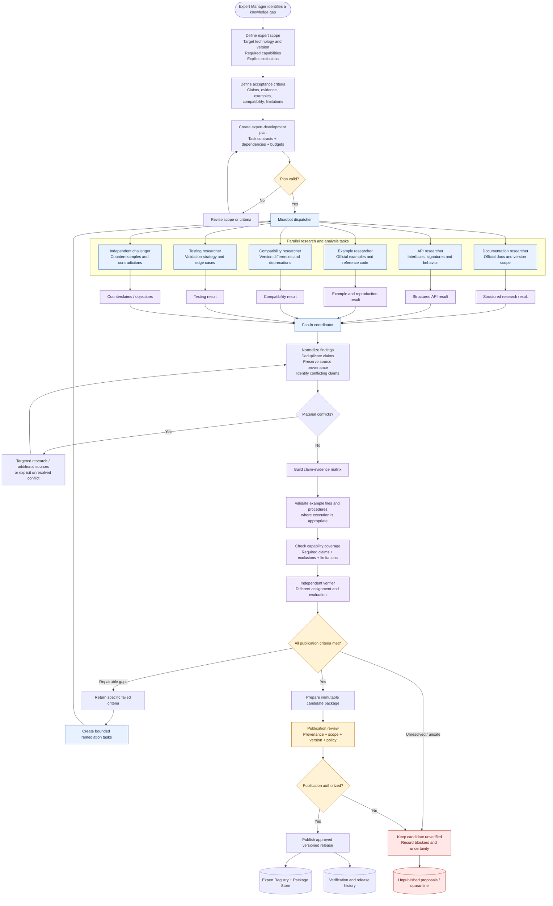

### The contract for every microbot

Every assignment should explicitly define:

- **Purpose:** the question the microbot must answer.
- **Scope:** technology, version, environment, and permitted sources.
- **Inputs:** the task contract, existing package, repository context, or supplied evidence.
- **Outputs:** a defined structure, not just a paragraph of prose.
- **Evidence requirements:** sources, version-specific support, and reproduction results where applicable.
- **Acceptance criteria:** what makes the result complete.
- **Restrictions:** forbidden writes, tools, secrets, or external actions.
- **Failure behavior:** how to report a gap, conflict, or inability to verify.
- **Budget:** bounded attempts, time, and resource use.

A researcher returning a convincing answer is not the same as a researcher satisfying the assignment contract.

### Suggested microbot output contract

```yaml
assignment_id: "expert-research-001"
expert_candidate: "nautobot.job-development"
capability: "job.input-definition"
target:
  technology: "Nautobot"
  version: "2.4"
question: "Determine supported input-definition behavior"
scope:
  allowed_sources:
    - official_documentation
    - versioned_source_code
  exclusions:
    - unsupported_version_assumptions

findings:
  - claim_id: "claim-001"
    claim: "A specific technical claim to validate"
    applicability:
      version: "2.4"
    evidence:
      - source_id: "source-001"
        location: "Exact URL, file path, or section"
    confidence: "proposed"
    limitations: []

unresolved_questions: []
contradictions: []
reproduction:
  status: "not_run"
  evidence: []

completion:
  status: "complete"
  unmet_acceptance_criteria: []
```

This is a **proposed schema**, not an existing factory record format. Its fields and allowed values should be finalized before implementation.

---

## Diagram 5 — Expert catalog: identity, capabilities, packages, and evidence

The catalog is the part that makes expertise reusable across jobs.

It must not be just a directory containing Markdown files. It needs to distinguish an expert's identity from its releases, capabilities, claims, sources, verification results, and maintenance status.

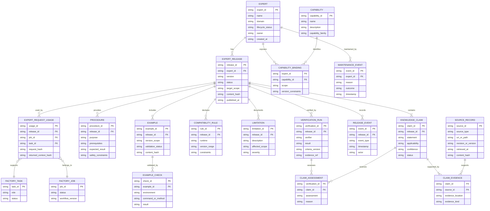

### How to interpret this model

The model separates five important things:

1. **Expert identity:** the persistent domain identity, such as `nautobot.job-development`.
2. **Expert release:** an immutable version of its approved knowledge.
3. **Capability:** the specific question or task it is qualified to address.
4. **Claim and evidence:** the factual assertion and the source material supporting it.
5. **Usage record:** the job, task, and exact expert release that informed the work.

The model is intentionally logical. It does not require every entity to become a separate database table or microservice immediately.

### Suggested catalog organization

A possible repository representation is:

```text
expert-catalog/
├── registry/
│   ├── experts.yaml
│   ├── capabilities.yaml
│   ├── compatibility-index.yaml
│   └── policy.yaml
│
├── experts/
│   ├── languages/
│   │   └── python/
│   │       ├── manifest.yaml
│   │       └── releases/
│   │
│   ├── frameworks/
│   │   ├── fastapi/
│   │   │   ├── manifest.yaml
│   │   │   └── releases/
│   │   │
│   │   └── nautobot/
│   │       ├── manifest.yaml
│   │       └── releases/
│   │           └── 1.0.0/
│   │               ├── package.yaml
│   │               ├── claims/
│   │               ├── procedures/
│   │               ├── examples/
│   │               ├── compatibility/
│   │               ├── limitations.md
│   │               └── verification.json
│   │
│   ├── architecture/
│   ├── testing/
│   ├── security/
│   ├── databases/
│   └── delivery/
│
├── evidence/
│   ├── sources/
│   ├── retrieval-records/
│   └── verification-runs/
│
├── proposals/
│   ├── new-experts/
│   └── release-updates/
│
└── maintenance/
    ├── revalidation-queue.json
    └── deprecation-records/
```

The directory structure is a proposal. For your provider-independent factory, the catalog should be accessible through a stable interface rather than assuming every provider or workflow must directly read these files.

---

## Diagram 6 — The expert package lifecycle

The package lifecycle is one of the most important diagrams because it determines what the factory is allowed to trust.

A candidate package must not replace the last approved release simply because a newer version exists.

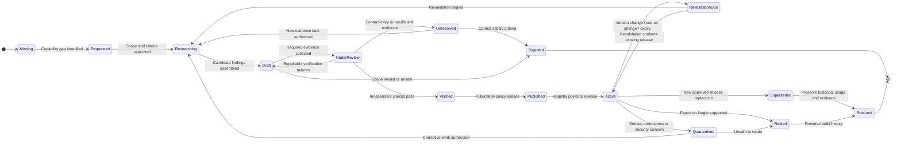

### What each state means

| State | Meaning | May ordinary agents use it as approved knowledge? |
|---|---|---|
| Missing | No expert or package satisfies the requested scope. | No |
| Requested | A capability gap and scope have been identified. | No |
| Researching | Microbots are gathering and checking information. | Not as approved knowledge |
| Draft | A candidate package exists but is incomplete or unverified. | No |
| UnderReview | Independent verification is underway. | Not as approved knowledge |
| Verified | The candidate passed its defined verification criteria. | Only if publication policy also permits it |
| Published | A release has been recorded with its verification and provenance. | Not necessarily; activation and compatibility still matter |
| Active | The registry makes the release available for matching requests. | Yes, within its declared scope and policy |
| RevalidationDue | New information may have invalidated previous assumptions. | Only according to the configured freshness policy |
| Quarantined | A serious concern requires the package to be withheld. | No |
| Superseded | A newer release replaces it for relevant requests. | Historical jobs may still reference it |
| Retired | The expert or release is no longer offered for new use. | No for new assignments |

A real implementation should preserve the last approved package while a candidate update is researched and verified. It should also record which exact release each job consumed.

---

## Diagram 7 — Every factory agent can access shared domain experts

This addresses the central design decision: **the Expert Bot Layer is shared by the whole factory, but each agent receives only the expertise relevant to its responsibilities.**

There are two dimensions of specialization:

- **Role-oriented specialist bots:** focused on a particular kind of work, such as Builder implementation diagnosis or Reviewer finding verification.
- **Domain experts:** persistent knowledge packages for technologies or domains, such as Python, FastAPI, Nautobot, PostgreSQL, security, testing, or deployment.

These dimensions must not be confused. A Builder specialist can use both Python and Nautobot expertise; a Security Reviewer can use Nautobot security guidance without becoming the owner of that domain expert.

```mermaid
flowchart TB
    subgraph AGENT_ROLES["Factory agents and workflows"]
        direction LR
        A1["Intake / Clarify"]
        A2["Ground / Research"]
        A3["Architect / Decide"]
        A4["Planner / Decompose"]
        A5["Builder"]
        A6["Tester"]
        A7["Integrator"]
        A8["Code / Security Reviewer"]
        A9["Documentation"]
        A10["Deployment / Shipping"]
        A11["Lesson Writer"]
    end

    subgraph ROLE_BOTS["Role-oriented specialist bots"]
        direction LR
        B1["Requirements analyst"]
        B2["Repository / source researcher"]
        B3["Architecture challenger"]
        B4["Task decomposition analyst"]
        B5["Implementation diagnostician"]
        B6["Test strategy analyst"]
        B7["Conflict / regression analyst"]
        B8["Finding verifier"]
        B9["Documentation checker"]
        B10["Release readiness analyst"]
        B11["Knowledge-update proposer"]
    end

    subgraph ACCESS["Shared Expert Access Interface"]
        ACCESS1["Request contract"]
        ACCESS2["Capability matching"]
        ACCESS3["Version and risk filtering"]
        ACCESS4["Context assembly"]
    end

    subgraph DOMAIN["Reusable domain experts"]
        direction TB

        subgraph LANG["Language and runtime"]
            E1["Python"]
            E2["Runtime / dependency compatibility"]
        end

        subgraph FRAMEWORK["Framework and platform"]
            E3["FastAPI"]
            E4["Nautobot"]
            E5["Django / other platform experts"]
        end

        subgraph DATA["Data and integration"]
            E6["PostgreSQL"]
            E7["API / schema integration"]
            E8["Migration / data integrity"]
        end

        subgraph QUALITY["Quality and architecture"]
            E9["Architecture patterns"]
            E10["Testing methodology"]
            E11["Performance / reliability"]
        end

        subgraph RISK["Risk and delivery"]
            E12["Application security"]
            E13["Documentation standards"]
            E14["Deployment / operations"]
            E15["Release / CI compatibility"]
        end
    end

    subgraph TRUST["Catalog and governance"]
        REG["Expert Registry"]
        PACK["Approved versioned packages"]
        EVID["Evidence + verification"]
        POLICY["Scope + permissions + freshness policy"]
    end

    A1 --> B1
    A2 --> B2
    A3 --> B3
    A4 --> B4
    A5 --> B5
    A6 --> B6
    A7 --> B7
    A8 --> B8
    A9 --> B9
    A10 --> B10
    A11 --> B11

    B1 --> ACCESS1
    B2 --> ACCESS1
    B3 --> ACCESS1
    B4 --> ACCESS1
    B5 --> ACCESS1
    B6 --> ACCESS1
    B7 --> ACCESS1
    B8 --> ACCESS1
    B9 --> ACCESS1
    B10 --> ACCESS1
    B11 --> ACCESS1

    ACCESS1 --> ACCESS2 --> ACCESS3 --> ACCESS4

    ACCESS2 <--> E1
    ACCESS2 <--> E2
    ACCESS2 <--> E3
    ACCESS2 <--> E4
    ACCESS2 <--> E5
    ACCESS2 <--> E6
    ACCESS2 <--> E7
    ACCESS2 <--> E8
    ACCESS2 <--> E9
    ACCESS2 <--> E10
    ACCESS2 <--> E11
    ACCESS2 <--> E12
    ACCESS2 <--> E13
    ACCESS2 <--> E14
    ACCESS2 <--> E15

    REG --> ACCESS2
    PACK --> ACCESS4
    EVID --> ACCESS3
    POLICY --> ACCESS3

    ACCESS4 -. "Relevant knowledge only" .-> B1
    ACCESS4 -. "Relevant knowledge only" .-> B2
    ACCESS4 -. "Relevant knowledge only" .-> B3
    ACCESS4 -. "Relevant knowledge only" .-> B4
    ACCESS4 -. "Relevant knowledge only" .-> B5
    ACCESS4 -. "Relevant knowledge only" .-> B6
    ACCESS4 -. "Relevant knowledge only" .-> B7
    ACCESS4 -. "Relevant knowledge only" .-> B8
    ACCESS4 -. "Relevant knowledge only" .-> B9
    ACCESS4 -. "Relevant knowledge only" .-> B10
    ACCESS4 -. "Candidate proposals, not automatic publication" .-> B11

    classDef agent fill:#e8f1ff,stroke:#3465a4,color:#142b4b
    classDef rolebot fill:#e8f7ed,stroke:#32834b,color:#153c22
    classDef expert fill:#f1eaff,stroke:#7650a6,color:#32204b
    classDef governance fill:#fff2d5,stroke:#a66a00,color:#533500

    class A1,A2,A3,A4,A5,A6,A7,A8,A9,A10,A11 agent
    class B1,B2,B3,B4,B5,B6,B7,B8,B9,B10,B11 rolebot
    class E1,E2,E3,E4,E5,E6,E7,E8,E9,E10,E11,E12,E13,E14,E15 expert
    class REG,PACK,EVID,POLICY governance
```

### Example of shared use

Suppose the factory is building a Nautobot Job.

| Factory role | Role-oriented bot | Domain experts it may request |
|---|---|---|
| Clarify | Requirements analyst | Nautobot capabilities, domain terminology |
| Ground | Repository researcher | Nautobot 2.4, Python runtime, dependency compatibility |
| Architect | Architecture challenger | API design, Nautobot platform patterns, security |
| Planner | Decomposition analyst | Task boundaries, testing, migration and environment constraints |
| Builder | Implementation diagnostician | Nautobot 2.4, Python, framework APIs |
| Tester | Test strategy analyst | Nautobot testing, Python testing, edge cases |
| Integrator | Conflict/regression analyst | Repository architecture, API contracts, migration behavior |
| Reviewer | Finding verifier | Security, compatibility, test quality |
| Documentation | Documentation checker | Version-specific platform behavior and documentation standards |
| Shipping | Release readiness analyst | CI, deployment, runtime compatibility |
| Lesson Writer | Knowledge-update proposer | Relevant experts whose knowledge may need a revision |

This is a many-to-many relationship. No expert belongs exclusively to a Builder or a Tester.

---

## Diagram 8 — Evidence, trust boundaries, permissions, and human oversight

The Expert Layer should inherit the factory's control philosophy: agents produce work, but the factory governs consequential transitions.

In particular, the system must prevent a microbot from elevating its own unverified output into trusted knowledge or using its technical role as a reason to bypass permissions.

```mermaid
flowchart TD
    REQUEST(["Expert request from authorized agent"])
    IDENTITY["Validate requesting agent / task identity"]
    SCOPE["Validate requested capability,<br/>data scope, target environment and version"]
    AUTH{"Authorized and within policy?"}

    REQUEST --> IDENTITY --> SCOPE --> AUTH
    AUTH -->|No| DENY["Reject and audit"]
    AUTH -->|Yes| MATCH["Select eligible expert package"]

    MATCH --> TRUST{"Package trusted and compatible?"}
    TRUST -->|Yes| CONTEXT["Return scoped knowledge bundle"]
    TRUST -->|No| CANDIDATE["Start controlled research / revalidation"]

    subgraph ISOLATED["Bounded microbot execution boundary"]
        M1["Microbot receives task contract"]
        M2["Permitted sources and tools only"]
        M3["No direct trusted-catalog publication"]
        M4["No unauthorized protected factory writes"]
        M5["No implicit permission inheritance"]
        M1 --> M2 --> M3
        M3 --> M4 --> M5
    end

    CANDIDATE --> M1
    M5 --> OUTPUT["Structured candidate output"]

    OUTPUT --> PROVENANCE["Validate provenance and source scope"]
    PROVENANCE --> CLAIMS["Validate claims and applicability"]
    CLAIMS --> SECURITY["Check secrets, sensitive content,<br/>unsafe procedures and policy violations"]
    SECURITY --> INDEPENDENT["Independent verification"]
    INDEPENDENT --> GATE{"All required checks pass?"}

    GATE -->|No| QUARANTINE["Reject / quarantine / remediate"]
    GATE -->|Yes| PUBLISH_AUTH{"Publication authorization<br/>and policy requirements met?"}

    PUBLISH_AUTH -->|No| PENDING["Remain unpublished"]
    PUBLISH_AUTH -->|Yes| RELEASE["Publish immutable release"]

    RELEASE --> REGISTRY[("Approved expert registry")]
    REGISTRY --> CONTEXT

    CONTEXT --> AGENT["Requesting agent receives scoped answer"]
    AGENT --> TASK["Agent performs its factory task"]

    TASK --> FACTORY_CHECK["Factory verification / review / policy gates"]
    FACTORY_CHECK --> PASS{"Factory acceptance criteria pass?"}
    PASS -->|Yes| CONTINUE["Continue through normal factory router"]
    PASS -->|No| REPAIR["Repair, investigate, amend or park<br/>through existing factory mechanisms"]

    AGENT -. "May submit a knowledge issue" .-> ISSUE["Structured feedback proposal"]
    ISSUE --> TRIAGE["Governed maintenance workflow"]
    TRIAGE --> CANDIDATE

    classDef trusted fill:#e8f7ed,stroke:#32834b,color:#153c22
    classDef gate fill:#fff2d5,stroke:#a66a00,color:#533500
    classDef blocked fill:#ffe7e7,stroke:#b42318,color:#64130e
    classDef records fill:#f1eaff,stroke:#7650a6,color:#32204b

    class CONTEXT,AGENT,TASK,CONTINUE trusted
    class AUTH,TRUST,GATE,PUBLISH_AUTH gate
    class DENY,QUARANTINE,PENDING,REPAIR blocked
    class REGISTRY,ISSUE records
```

### Security and trust rules

1. **No self-publication:** a microbot cannot publish its own output as an approved release.
2. **Least privilege:** a bot receives only the tools, source access, and permissions required for its assignment.
3. **Provenance is mandatory:** factual claims must be linked to their supporting evidence according to the package's acceptance criteria.
4. **Version scope is explicit:** knowledge verified for one version must not silently be generalized to another.
5. **Independent verification:** the party evaluating a candidate should not simply accept the researcher's conclusion.
6. **No gate bypass:** an expert cannot approve H1, H2, H3, ship approval, or other factory-controlled decisions merely by recommending approval.
7. **No false proof:** expert guidance can explain a failing check, but the factory's required checks and evidence determine whether acceptance criteria pass.
8. **Uncertain knowledge stays uncertain:** unresolved conflicts must remain visible rather than being converted into confident claims.

---

## Diagram 9 — Concrete execution: building a Nautobot 2.4 Job

Now let's put the architecture into a real factory scenario.

The user requests a new Nautobot Job. The factory must determine what needs to be built, whether existing expertise is available, and whether a new or extended expert package is required.

The example below assumes that an approved Nautobot Job Development Expert is not yet available. That is a scenario for the diagram, **not a claim about the actual current state of your catalog**.

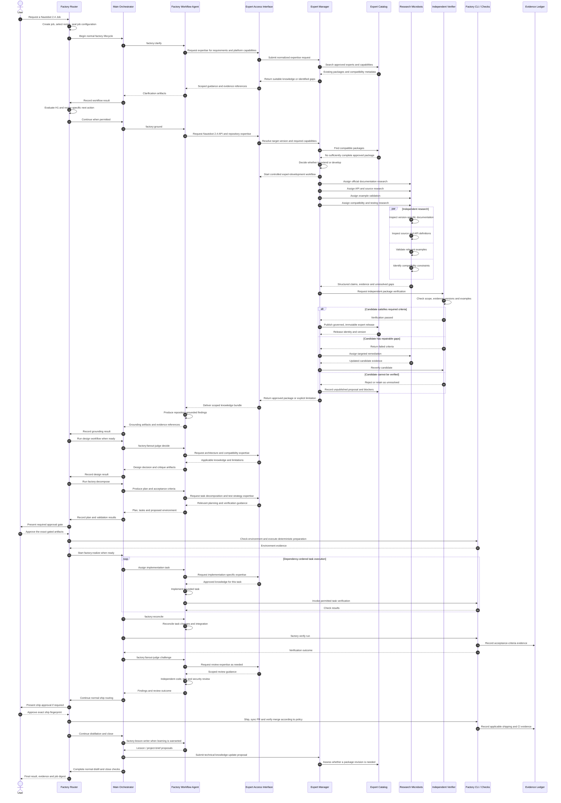

### What happens on the next Nautobot job?

If the catalog now contains a compatible, approved release, the manager can reuse it. It does not need to repeat the entire development workflow.

The second job should still inspect its actual repository, dependency versions, and requirements. An expert package provides reusable knowledge; it does not eliminate grounding in the current environment.

The reuse path is:

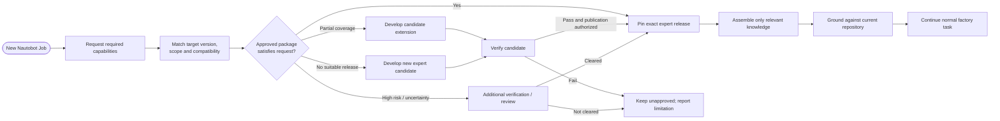

The key efficiency gain is that **expert development is amortized across future jobs**. A new job pays for the expertise it actually needs, not automatically for rebuilding every technical answer from scratch.

---

## Diagram 10 — Feedback, learning, and expert maintenance

Your existing factory already has distillation and lesson-writing concepts. These should feed the Expert Layer through a controlled bridge.

Do not merge every lesson into the technical catalog. A lesson about a particular job may be project-specific; an expert package should contain knowledge reusable within a defined technical scope.

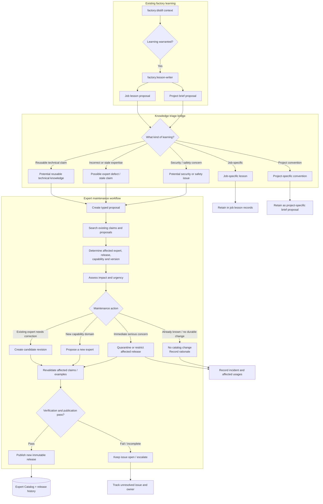

### How this works in practice

Imagine the factory completes three jobs and discovers that a particular procedure in an approved expert package is consistently misleading for one supported version.

The feedback process should:

1. Record the job findings and their evidence.
2. Identify the affected claim, procedure, and expert release.
3. Determine whether the issue is job-specific, project-specific, or reusable technical knowledge.
4. Assess the severity and whether the affected package should be restricted immediately.
5. Create a candidate correction.
6. Revalidate the corrected claim and relevant examples.
7. Publish a new release only when the required criteria pass.
8. Preserve the previous release and the historical records showing which jobs used it.

For a serious safety or security issue, normal maintenance timing may be insufficient. The system needs a policy-defined path to restrict or quarantine the affected release while the correction is investigated.

---

## Diagram 11 — Failure, recovery, and bounded retries

The Expert Bot Layer must work with the factory's existing recovery mechanisms rather than inventing a competing job lifecycle.

An expert request may fail because the catalog is unavailable, sources conflict, a microbot stalls, a candidate fails verification, or a package becomes incompatible. Each failure needs an explicit outcome.

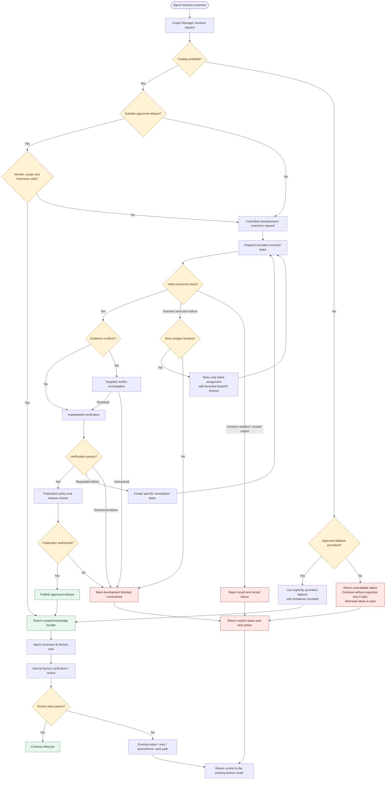

### Recovery principles

- **Bounded retries:** repeated microbot failures must not create infinite research loops.
- **Task-level retry:** retry the failed assignment rather than rebuilding every successful research result.
- **Idempotent publication:** repeating a publication attempt must not create duplicate releases or corrupt registry state.
- **Explicit fallback:** if the expert system is unavailable, the factory may proceed without it only where policy permits. It must not silently pretend the missing expertise was supplied.
- **Safe uncertainty:** unresolved high-risk issues should block or park the relevant work.
- **One authoritative router:** once the expert workflow returns a result or failure, the existing factory decides what happens to the job.
- **Traceable recovery:** every retry, rejection, quarantine, fallback, and escalation should have a recorded reason and outcome.

---

## Diagram 12 — Expert request and response contract

Every factory agent should use the same underlying Expert Access Interface. That prevents each agent from inventing its own way of searching, requesting, or consuming expertise.

The request contract should describe what the agent needs, not dictate which microbots the manager must run. The manager owns the expertise strategy.

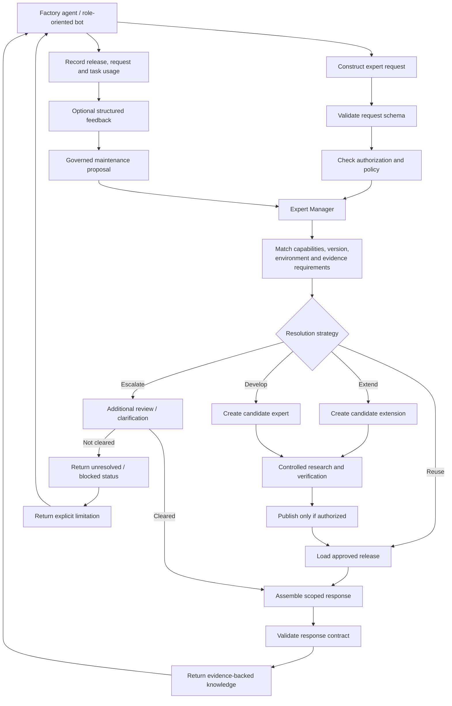

### Proposed request schema

```yaml
request_id: "expert-request-001"
job_id: "J-0001"
task_id: "T-0004"

requester:
  role: "builder"
  agent_id: "builder-task-004"

purpose: "Implement a Nautobot Job"

requirements:
  capabilities:
    - "nautobot.job-development"
    - "python.compatibility"
    - "testing.job-validation"

target_environment:
  technology: "Nautobot"
  version: "2.4"
  python_version: null

context:
  repository_revision: "<actual revision>"
  relevant_artifacts:
    - "<actual artifact reference>"

constraints:
  source_policy: "approved_sources"
  allow_unverified_knowledge: false
  allow_external_side_effects: false

verification:
  evidence_required: true
  independent_verification_required: true

budget:
  max_attempts: 3
  max_parallel_microbots: 4

response:
  include_claims: true
  include_source_references: true
  include_version_scope: true
  include_limitations: true
```

The `null` Python version is intentional: the factory should resolve it from the actual environment rather than assume a version.

The numerical limits are illustrative defaults, not recommendations derived from the current factory policy. The implementation should obtain its effective limits from the authoritative policy configuration.

### Proposed response schema

```yaml
request_id: "expert-request-001"
status: "resolved"

resolution:
  strategy: "reuse"
  experts:
    - expert_id: "nautobot.job-development"
      release: "1.0.0"
      status: "approved"
      applicability:
        technology: "Nautobot"
        version: "2.4"

knowledge:
  claims:
    - claim_id: "claim-001"
      statement: "<evidence-backed technical claim>"
      source_references:
        - "<source reference>"
      applicability:
        version: "2.4"
      limitations: []

  procedures: []
  examples: []
  compatibility_warnings: []

unresolved:
  questions: []
  missing_capabilities: []

traceability:
  request_hash: "<request hash>"
  package_hashes: []
  response_hash: "<response hash>"
```

This response should tell the agent not only what the expert recommends, but also **which release supplied the recommendation, which sources support it, and where the recommendation does not apply**.

---

## Diagram 13 — How the complete system fits into your factory's existing control plane

The final architectural question is ownership. Without clear ownership, the Expert Bot Layer can become a second orchestration system with its own competing task states, permissions, retry loops, and approval rules.

The following diagram establishes the boundaries.

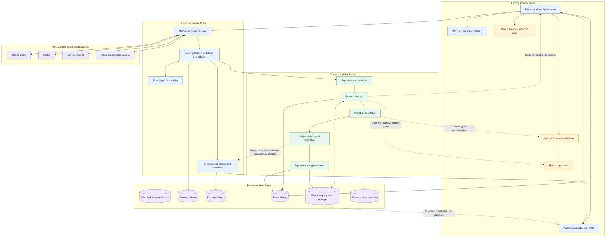

The central architectural rule is:

**The factory owns execution and truth. The Expert Layer owns expertise discovery, development, verification, and delivery.**

The Expert Manager may create its own internal research tasks, but those tasks must not compete with or silently alter the factory's authoritative job lifecycle.

---

## Diagram 14 — Implementation roadmap: from the architecture to a working system

The diagrams describe the intended system. They do not mean that every component needs to be implemented as a separate service.

Start by defining the contracts and data model. Then implement the simplest version that fits your current runtime and reuse the existing workflow and subagent infrastructure wherever possible.

```mermaid
flowchart TD
    START(["Expert Bot Layer implementation"])

    subgraph PHASE1["Phase 1 — Define the contracts"]
        A1["Expert identity and capability schema"]
        A2["Expert request / response schema"]
        A3["Claim / source / evidence schema"]
        A4["Verification and publication rules"]
        A5["Lifecycle and permission contracts"]
        A1 --> A2 --> A3 --> A4 --> A5
    end

    subgraph PHASE2["Phase 2 — Establish persistent catalog"]
        B1["Registry"]
        B2["Package and release representation"]
        B3["Capability / compatibility index"]
        B4["Evidence and release history"]
        B5["Schema validation and catalog tests"]
        B1 --> B2 --> B3 --> B4 --> B5
    end

    subgraph PHASE3["Phase 3 — Implement Expert Manager"]
        C1["Request normalization"]
        C2["Capability matching"]
        C3["Version / freshness / risk checks"]
        C4["Reuse / extend / develop / escalate"]
        C5["Context assembly and traceability"]
        C1 --> C2 --> C3 --> C4 --> C5
    end

    subgraph PHASE4["Phase 4 — Microbot execution"]
        D1["Reuse existing subagent runtime"]
        D2["Define assignment contracts"]
        D3["Bounded parallel research"]
        D4["Structured result collection"]
        D5["Retry / cancellation / failure handling"]
        D1 --> D2 --> D3 --> D4 --> D5
    end

    subgraph PHASE5["Phase 5 — Trust and publication"]
        E1["Claim / evidence validation"]
        E2["Independent verifier"]
        E3["Candidate package validation"]
        E4["Governed publication"]
        E5["Immutable release and history"]
        E1 --> E2 --> E3 --> E4 --> E5
    end

    subgraph PHASE6["Phase 6 — Integrate with factory agents"]
        F1["Ground / research"]
        F2["Architecture / decide"]
        F3["Planner / decompose"]
        F4["Builder and Tester"]
        F5["Integrator and reviewers"]
        F6["Documentation and shipping"]
        F1 --> F2 --> F3 --> F4 --> F5 --> F6
    end

    subgraph PHASE7["Phase 7 — Learning and maintenance"]
        G1["Expert usage traceability"]
        G2["Structured feedback"]
        G3["Lesson / expert proposal classification"]
        G4["Staleness and version-change triggers"]
        G5["Revalidation / deprecation"]
        G1 --> G2 --> G3 --> G4 --> G5
    end

    START --> A1
    A5 --> B1
    B5 --> C1
    C5 --> D1
    D5 --> E1
    E5 --> F1
    F6 --> G1

    G5 -. "Evidence-based improvements" .-> C1

    classDef phase fill:#e8f1ff,stroke:#3465a4,color:#142b4b
    classDef trust fill:#fff2d5,stroke:#a66a00,color:#533500
    classDef learning fill:#e8f7ed,stroke:#32834b,color:#153c22

    class A1,A2,A3,A4,A5,B1,B2,B3,B4,B5,C1,C2,C3,C4,C5,D1,D2,D3,D4,D5,F1,F2,F3,F4,F5,F6 phase
    class E1,E2,E3,E4,E5 trust
    class G1,G2,G3,G4,G5 learning
```

### What I would implement first

The first milestone should not be a massive catalog containing dozens of experts. It should be a small, complete vertical slice proving the architecture works.

1. **Define the contracts.** Establish the identity, capability, package, evidence, verification, and publication schemas.
2. **Build the registry and manager.** Support searching, matching, compatibility checks, and selecting the reuse/extend/develop/escalate strategy.
3. **Implement one expert end to end.** Use the Nautobot Job Development Expert as a candidate example, with a clearly defined target version and evidence requirements.
4. **Prove the trust lifecycle.** Research, independent verification, publication, version pinning, and rejection must all work.
5. **Integrate with the existing factory workflows.** Start with Ground, Decide, Decompose, Builder, and Tester; extend to the remaining roles through the same interface.
6. **Connect feedback to maintenance.** Technical lessons should become proposals, not automatic changes to approved knowledge.
7. **Verify failure paths.** Test unavailable catalogs, incompatible packages, failed verification, stale releases, rejected candidates, and interrupted research.

The exact sequencing may change after inspecting the implementation boundaries in the current factory, but the contracts and trust lifecycle should be established before broad integration.

---

## Final architecture summary

The complete design consists of these interconnected systems:

| System | Responsibility |
|---|---|
| **Existing Factory Control Plane** | Owns job state, workflow routing, policy, approvals, recovery, and authoritative transitions. |
| **Existing Factory Agents** | Own the outcomes assigned to their respective stages and tasks. |
| **Role-Oriented Specialist Bots** | Perform focused work for a role, such as implementation diagnosis, test analysis, or finding verification. |
| **Expert Access Interface** | Provides a consistent way for any authorized agent to request expertise. |
| **Expert Manager** | Finds suitable expertise and decides whether to reuse, extend, develop, or escalate. |
| **Microbot Runtime** | Executes bounded research, analysis, reproduction, and verification assignments. |
| **Expert Registry** | Stores expert identities, capabilities, supported scopes, and lifecycle status. |
| **Expert Package Store** | Stores versioned knowledge, procedures, examples, limitations, and compatibility information. |
| **Evidence and Verification System** | Establishes the provenance and verification status of claims and packages. |
| **Publication Governance** | Controls when candidate knowledge becomes available as approved expertise. |
| **Maintenance System** | Tracks stale knowledge, version changes, defects, revalidation, supersession, and retirement. |
| **Factory Learning Bridge** | Converts relevant lessons and technical findings into appropriately classified proposals. |

The north-star principle is that **every factory agent can draw on the same persistent body of governed expertise, while the factory retains complete control over execution, quality gates, and the truth of its results**.

That gives you a shared Expert Bot Layer rather than a Builder-only feature, without turning the Expert Layer into a competing software factory.
