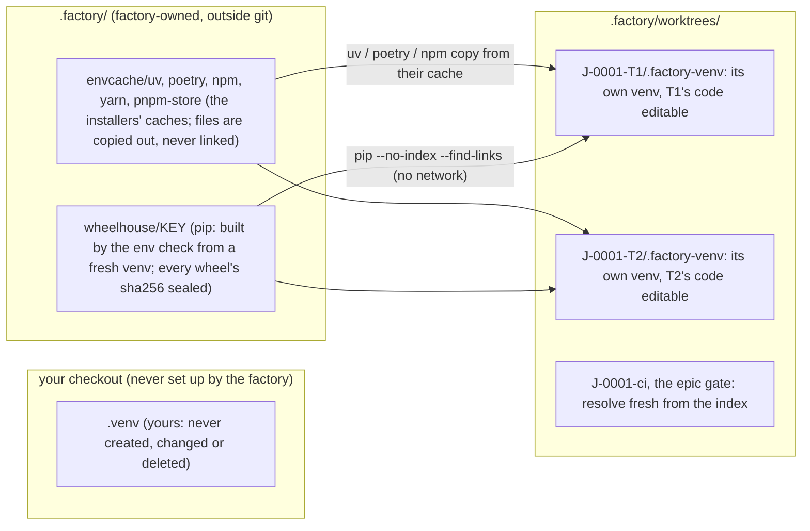

# How the factory builds your environment

Every task is built and verified in its own git worktree (`.factory/worktrees/<job>-<task>`), so its tests import **that worktree's code**, not your checkout's. Each worktree therefore builds **its own environment** with the environment's `setup`: its own `.factory-venv` (or `node_modules`, or compose project), with the worktree's project installed editable from that worktree. Workspace members, path dependencies and setuptools_scm versions work, because the install runs inside the worktree with its `.git`.

What 0.12 adds is a **shared package cache**. A package is downloaded once per machine and repository, not once per worktree.

## Where things live

## When things happen

| When | What runs | What is shared |
|---|---|---|
| `factory env check --job J` (factory next runs it before any task; also any later check) | the sealed `setup` in a scratch worktree of the base commit | Fills the uv, poetry and npm caches. For pip it builds the **wheelhouse** from that fresh venv: `pip wheel` of everything it holds, plus the build requirements. The sha256 of every wheel and the expected set go in a sealed manifest. Only this check builds a wheelhouse, never a task's worktree. |
| Every task and the job worktree | `setup` in that worktree | **pip:** first with `PIP_NO_INDEX=1 PIP_FIND_LINKS=<wheelhouse>` (no network), after checking every wheel's hash and that the set is complete. **uv:** with `UV_OFFLINE=1` once the key has installed. **poetry and npm:** from their caches, offline first. If an offline attempt misses, setup runs again from a clean environment (its venv or `node_modules` removed) with the index. The key is marked incomplete, so no later worktree tries offline before the next env check rebuilds it. |
| ci verify, the epic gate | `setup` in a fresh worktree | **Fresh** means: a resolution from the index, with a private, throwaway cache made for that run (uv in copy mode, `PIP_NO_CACHE_DIR=1`, private poetry and npm caches). It never reads the factory's shared caches, the wheelhouse, or your own `~/.cache/uv` or `~/.cache/pip`, which an agent's installs could have written, even when the sealed environment's `env` names a cache (`UV_CACHE_DIR`, `PIP_CACHE_DIR`, `POETRY_CACHE_DIR`, …): a fresh run drops those settings. Policy `environment.ci_cache: true` lets them use the shared caches. |
| Again in the same worktree | nothing | The marker records the key and what the environment holds (its installed distributions, or the `node_modules` packages). A removed or changed environment is built again, never reported ready. |

**One build at a time.** One setup runs per worktree at a time. The lock names its holder's pid and start time and is never taken over while that process lives. A killed run's setup processes are ended before the next run, and so are a killed wheelhouse build's processes; their temp dirs are removed.

**Garbage collection.** It keeps the newest 3 wheelhouses (`FACTORY_ENV_KEEP`) and any used in the last 10 minutes. `factory env gc [--keep N] [--caches]` does it by hand; `--caches` also empties the package caches and forgets which keys installed from them.

**What is trusted:**
- **Files are copied, never linked.** uv runs with `UV_LINK_MODE=copy` in setup, in the builders' and testers' shells and before every verify command (unless the environment sets it itself), so a write into one worktree's venv cannot reach another worktree, the factory's cache or your own uv cache.
- **pip's own cache is not shared:** it is not verified. pip's only shared source is the sealed wheelhouse.
- **The uv cache is trusted as uv trusts it.** uv checks hashes when the lock (or a `--require-hashes` requirements file) carries them; otherwise it uses what its cache holds.
- **poetry and npm** check what they read against `poetry.lock` and `package-lock.json`.
- **Agents may not touch the caches or the wheelhouse:** no writes, no `--cache-dir`, `UV_CACHE_DIR=`, `tar -C`, `rsync`, `find -delete`, `mkdir` or `chmod` there, and no scripts that write there. Relative paths are resolved from the directory the command is in, and the guard fails closed when it cannot know that directory. It follows only a plain `cd <literal directory>` (also `pushd`, and `popd` back), at the top level of the command, that either surely succeeds or gates everything after it (`cd src && …`); a `( )` subshell's `cd` ends with it. Any other `cd` makes the directory unknown: a variable, `$( )`, `~`, `-`, `--`, `+N`/`-N` or another option in its target, `CDPATH`, a `cd` inside `if`/`while`/`case`/`for`, `{ }` or a function, in a pipe or before/after `&`, or followed by `||`, and also `eval`, `source` and `.`. From then on every **relative** write target in that command is refused ("use an absolute path, or a simple cd"); absolute ones are checked as always.
- **This guard is best effort.** It reads commands; it is not a sandbox. Deliberate evasion (globs such as `envcach?`, a path built up in code, a directory change carried over from an earlier command in a persistent shell) is not caught. Symlinks are resolved along the whole path, and `ln -s` may not point into factory state or another task's worktree. That is why ci verify and the epic gate never read any cache unless policy says so.
- **What builders may write.** A builder may write any file that is not tracked (not in the index, not at HEAD) anywhere in its own worktree, whatever its allowed paths: its environment directories, build output, caches and logs (`build/`, `dist/`, `.pytest_cache/`, `*.log`) and scratch files (`ruff.txt`, `patch.diff`, `listing.txt` …), so a task never parks over a scratch file. Never in another task's worktree. That output is kept out of the commit: builders are told to `git add` only the files they changed in their allowed paths (never `git add -A`), and the factory's own save of uncommitted work (a timed-out or crashed attempt) unstages new build output and any new file outside the task's allowed paths before it commits. A builder that commits it anyway fails task verify's scope check, so it can never reach the job branch. Tracked files outside its allowed paths, protected paths, factory state, the caches and `.git` stay refused.

## The tool, and why

One function decides (`machine.pythonTool`), and the proposal records its choice as `tool` and `reason`:

1. **poetry**: a poetry repository with `poetry.lock`, and poetry installed. Only poetry installs from that lock and its dev group. The venv is made with uv when uv is there.
2. **uv**: installed. It makes the venv without ensurepip, installs fastest (copied from its cache), and uses `uv sync` into the worktree's venv when there is a `uv.lock`.
3. **virtualenv**: installed. It works where `python3 -m venv` lacks ensurepip.
4. **python3 -m venv**: only when the machine scan saw it make a venv with pip.

For Node, the lockfile decides: `npm ci`, `pnpm install --frozen-lockfile` or `yarn install --frozen-lockfile`.

A Nautobot app (invoke + docker compose) runs `invoke build` in each worktree. Docker's layer cache makes every build after the first quick. The image tag is fixed by the app's compose file, so two lockfiles in flight at once still retag the same image.

## Your own `.venv`

- The factory never creates, changes or deletes the `.venv` in your checkout, and never runs setup there.
- Worktrees use `.factory-venv`, so the `/.factory-venv/` line the factory adds to `.git/info/exclude` (in a block marked `copilot-factory`) cannot hide your `.venv`.
- A node environment adds `/node_modules/`, and a python one `/*.egg-info/`, only when your repository does not ignore them already. Those patterns also apply to your checkout, and `factory doctor` says so.
- 0.11 environments appended `.venv/`, which hides your own `.venv` from `git status`. `factory doctor` points that line out.

## What runs without your credentials

These run with an allowlisted environment (no tokens, no login shell, a scratch home and their own scratch caches):

- the plan probe;
- `factory env check --proposed`;
- environment repair candidates.

They may install from a wheelhouse whose hashes check out, read-only. They never write the shared caches, the wheelhouse (not even its last-use stamp) or the exclude block. Only the environment you sealed fills them.

## Seeing what happened

- **`factory env status`** is read-only. It shows:
  - the tool and why;
  - the caches and wheelhouses (path, size, wheels, built when);
  - each worktree's own environment (ok or failed, offline or fallback, or why the wheelhouse was skipped);
  - the last check;
  - the last failure, with commands and output redacted, and the exact next step.
- **`factory doctor`** has the "build environment" checks:
  - the tool that will be used and why;
  - whether `python3 -m venv` works (from the cached scan, with its age);
  - the cache;
  - your `.venv`;
  - the last check.

  `factory doctor --machine` scans the machine again and lists every tool.
- **`factory env show`** shows the sealed environment and the current proposal.

## Upgrading from 0.11

A sealed 0.11 environment (version 1) keeps working exactly as before. When its setup uses an installer the cache serves (uv, pip, poetry, npm, pnpm, yarn, docker build), `factory next` and `factory env show` offer **the same environment** as version 2, adding `tool`, `reason` and `cache`. Every setup step is kept exactly as you sealed it, pins, extras, constraints and requirement files included. You switch with one reply: `confirm environment <hash>`.

A setup step does not need to be safe to run twice. When an offline attempt misses, the factory removes the worktree's environment (the venv `VIRTUAL_ENV` names, or `node_modules`) and whatever else the first attempt created at the top of the worktree that git does not track (a `mkdir data`) before running setup again. Only a resolution miss ("No matching distribution", "not found in the cache") marks a pip wheelhouse incomplete; a flaky step does not.

## The schema (version 2)

| Field | Meaning |
|---|---|
| `tool`, `reason` | How the environment is built, and why (shown everywhere). |
| `cache` | `uv`, `pip`, `poetry`, `npm`, `pnpm`, `yarn`, `docker` or `none`: whose shared cache the setup uses (for pip: the wheelhouse). |
| `setup`, `cache_key`, `env`, `prefix`, `services`, `teardown`, `ignore`, `timeout_seconds`, `notes` | As in version 1. `setup` runs in every worktree and builds its own environment. |
