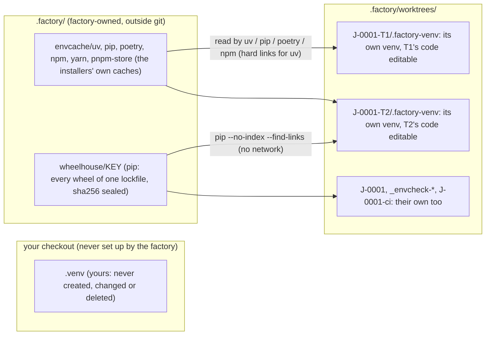

# How the factory builds your environment

Every task is built and verified in its own git worktree (`.factory/worktrees/<job>-<task>`), so its tests import **that worktree's code**, not your checkout's. Each worktree therefore builds **its own environment** with the environment's `setup`: its own `.factory-venv` (or `node_modules`, or compose project), with the worktree's project installed editable from that worktree. Workspace members, path dependencies and setuptools_scm versions work, because the install runs inside the worktree with its `.git`.

What 0.12 adds is a **shared package cache**. A package is downloaded once per machine and repository, not once per worktree.

## Where things live

## When things happen

| When | What runs | What is shared |
|---|---|---|
| The first `factory env check --job J` (factory next runs it before any task) | `setup` in a scratch worktree | It fills the caches. For pip it then builds the wheelhouse for the key (`pip wheel` of everything the venv holds, plus the build requirements, from the cache) and seals the sha256 of every wheel. |
| Every task, the job worktree, ci verify | `setup` in that worktree | **pip:** first with `PIP_NO_INDEX=1 PIP_FIND_LINKS=<wheelhouse>` (no network), after checking every wheel's hash; if a wheel is missing, once more with the index. **uv:** with `UV_OFFLINE=1` once the key has installed, falling back the same way, and hard-linked from the cache. **poetry and npm:** from their caches; they check what they read against `poetry.lock` and `package-lock.json`. |
| Again in the same worktree | nothing | The worktree's marker records the key. A removed environment (`git clean -fdx`) is built again, never reported ready. |
| A task changes a lockfile | `setup` in that worktree | New packages are downloaded once; everything else still comes from the cache. A new wheelhouse key is built. |

**One build at a time.** One setup runs per worktree at a time. The lock names its holder's pid and start time and is never taken over while that process lives. A run whose owner was killed has its setup processes ended before the next run starts. Wheelhouses are built in a temp directory and renamed into place.

**Garbage collection.** It keeps the newest 3 wheelhouses (`FACTORY_ENV_KEEP`) and any used in the last 10 minutes. `factory env gc [--keep N] [--caches]` does it by hand; `--caches` also empties the package caches. Agents may not run it, and may not write `.factory/envcache` or `.factory/wheelhouse`.

## The tool, and why

One function decides (`machine.pythonTool`), and the proposal records its choice as `tool` and `reason`:

1. **poetry**: a poetry repository with `poetry.lock`, and poetry installed. Only poetry installs from that lock and its dev group. The venv is made with uv when uv is there.
2. **uv**: installed. It makes the venv without ensurepip, installs fastest (hard links from the cache), and uses `uv sync` into the worktree's venv when there is a `uv.lock`.
3. **virtualenv**: installed. It works where `python3 -m venv` lacks ensurepip.
4. **python3 -m venv**: only when the machine scan saw it make a venv with pip.

For Node, the lockfile decides: `npm ci`, `pnpm install --frozen-lockfile` or `yarn install --frozen-lockfile`.

A Nautobot app (invoke + docker compose) runs `invoke build` in each worktree. Docker's layer cache makes every build after the first quick. The image tag is fixed by the app's compose file, so two lockfiles in flight at once still retag the same image.

## Your own `.venv`

- The factory never creates, changes or deletes the `.venv` in your checkout, and never runs setup there.
- Worktrees use `.factory-venv`, so the `/.factory-venv/` line the factory adds to `.git/info/exclude` (in a block marked `copilot-factory`) cannot hide your `.venv`.
- A node environment adds `/node_modules/`, and a python one `/*.egg-info/`, only when your repository does not ignore them already. Those patterns also apply to your checkout, and `factory doctor` says so.
- 0.11 environments appended `.venv/`, which hides your own `.venv` from `git status`. `factory doctor` points that line out.

## What runs without your credentials

These run with an allowlisted environment (no tokens, no login shell, a scratch home and their own scratch caches):

- the plan probe;
- `factory env check --proposed`;
- environment repair candidates.

They may install from a wheelhouse whose hashes check out, read-only. They never write the shared caches or the exclude block. Only the environment you sealed fills the shared caches.

## Seeing what happened

- **`factory env status`** is read-only. It shows:
  - the tool and why;
  - the caches and wheelhouses (path, size, wheels, built when);
  - each worktree's own environment (ok or failed, offline or fallback, wheelhouse built);
  - the last check;
  - the last failure, with commands and output redacted, and the exact next step.
- **`factory doctor`** has the "build environment" checks:
  - the tool that will be used and why;
  - whether `python3 -m venv` works (from the cached scan, with its age);
  - the cache;
  - your `.venv`;
  - the last check.

  `factory doctor --machine` scans the machine again and lists every tool.
- **`factory env show`** shows the sealed environment and the current proposal.

## Upgrading from 0.11

A sealed 0.11 environment (version 1) keeps working exactly as before. When its setup uses an installer the cache serves (uv, pip, poetry, npm, pnpm, yarn, docker build), `factory next` and `factory env show` offer **the same environment** as version 2, adding `tool`, `reason` and `cache`. Every setup step is kept exactly as you sealed it, pins, extras, constraints and requirement files included. You switch with one reply: `confirm environment <hash>`.

## The schema (version 2)

| Field | Meaning |
|---|---|
| `tool`, `reason` | How the environment is built, and why (shown everywhere). |
| `cache` | `uv`, `pip`, `poetry`, `npm`, `pnpm`, `yarn`, `docker` or `none`: whose shared cache the setup uses (and, for pip, the wheelhouse). |
| `setup`, `cache_key`, `env`, `prefix`, `services`, `teardown`, `ignore`, `timeout_seconds`, `notes` | As in version 1. `setup` runs in every worktree and builds its own environment. |
