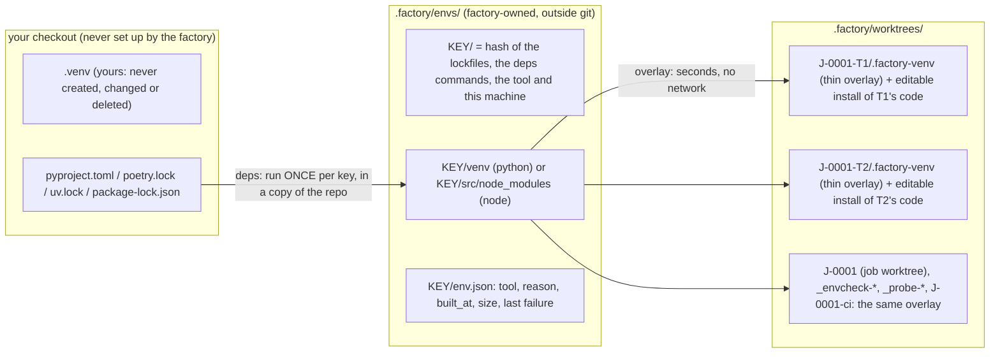

# How the factory builds your environment

Every task is built and verified in its own git worktree (`.factory/worktrees/<job>-<task>`), so its tests import **that worktree's code**, not your checkout's. Since 0.12 the factory installs your dependencies **once** and gives each worktree a cheap view of them, instead of installing everything again in every worktree.

## Where things live

## When things are built

| When | What runs | Where |
|---|---|---|
| First `factory env check --job J` (factory next runs it before any task), or the first task when the key is new | `deps` — the environment's install commands (e.g. `uv venv {env}/venv`, `uv pip install -r pyproject.toml`) | `.factory/envs/<key>/src`, a copy of the worktree's tracked files; results under `.factory/envs/<key>/` |
| Every later task, the job worktree, ci verify | nothing is installed: the shared environment for the key is reused | — |
| Each worktree, once | the **overlay** (`python -m venv --without-pip .factory-venv`, one `.pth` file pointing at the shared site-packages, console scripts re-pointed at the overlay's python), then `project` (e.g. `pip install --no-deps --no-build-isolation -e .`) | the worktree |
| A task changes a lockfile (adds a dependency) | `deps` again, for the new key only | a new `.factory/envs/<key2>/` |

Parallel tasks that need the same key wait for one build (a lock file next to it) and then reuse it; if that build fails while they wait, they report the same failure instead of each trying again. Old environments are removed after each build: the newest 3 (`FACTORY_ENV_KEEP`) and any a worktree still uses stay. `factory env gc [--keep N]` removes them by hand.

## The tool, and why

One function decides (`machine.pythonTool`), and the proposal records its choice as `tool` and `reason`:

1. **poetry** — a poetry repository with `poetry.lock`, and poetry installed: only poetry installs from that lock and its dev group (the venv itself is made with uv when uv is there).
2. **uv** — installed: makes the venv without ensurepip, installs fastest, retries by itself.
3. **virtualenv** — installed: works where `python3 -m venv` lacks ensurepip.
4. **python3 -m venv** — only when the machine scan saw it make a venv with pip.

Node: the lockfile decides (`npm ci`, `pnpm install --frozen-lockfile`, `yarn install --frozen-lockfile`); `node_modules` is installed once and each worktree links it. Repositories with workspaces or Yarn Plug'n'Play install per worktree (their links point into the worktree). A Nautobot app (invoke + docker compose) builds its development image once (`invoke build`); each worktree runs its own compose project with its code mounted.

## What each worktree gets (python)

`<worktree>/.factory-venv` is a real venv with no packages of its own except the worktree's project (editable). Its site-packages has `zzz_factory_shared.pth`, which adds the shared venv's site-packages **after** the project, so `python`, `pytest` and every console script (re-written to start the overlay's python) import the worktree's code and the shared dependencies. Nothing is ever installed into the shared venv from a worktree. `.factory-venv` is listed in a marked block of `.git/info/exclude`; it exists only in factory worktrees, so your own `git status` is unchanged.

## Your own `.venv`

The factory never creates, changes or deletes the `.venv` in your checkout, and never runs setup in your checkout. (0.11 environments added `.venv/` to `.git/info/exclude`, which also hid your own `.venv` from `git status`; `factory doctor` points that line out.)

## What runs without your credentials

The plan probe, `factory env check --proposed` and environment repair candidates run with an allowlisted environment (no tokens, no login shell, a scratch home). They **reuse** a shared environment whose key matches, read-only; otherwise they build a private one inside their own scratch worktree. They never write `.factory/envs` and never touch your environment. Only the environment you sealed builds the shared store.

## Seeing what happened

- `factory env status` — the tool and why, the shared environments (path, key, size, built when, which worktrees use them), the last check, the last failure (output redacted) and the exact next step. Read-only.
- `factory doctor` — the "build environment" checks: the tool that will be used and why, whether `python3 -m venv` works (from the cached scan, with its age), the shared environments, your `.venv`, the last check. `factory doctor --machine` scans the machine again and lists every tool.
- `factory env show` — the sealed environment and the current proposal.

## Upgrading from 0.11

A sealed 0.11 environment (`setup`, `cache_key`) keeps working exactly as before: its setup runs in every worktree. When its steps are ones the shared model covers (making a venv, installing dependencies, `invoke build`, `npm ci`, …), `factory next` and `factory env show` offer the shared version of it — services, teardown, prefix and your other variables kept — and you switch with one reply: `confirm environment <hash>`. A setup with custom steps (a script of yours) is not guessed at: split it into `deps` and `project` and propose it (`factory env propose --file …`).

## The schema (version 2)

| Field | Meaning |
|---|---|
| `tool`, `reason` | how the shared environment is built, and why (shown everywhere) |
| `deps` | commands run once per key in `{env}/src`; `{env}` is `.factory/envs/<key>` |
| `deps_key` | files whose content keys the shared environment |
| `overlay` | `python` (`.factory-venv` over `{env}/venv`), `node` (`node_modules` → `{env}/src/node_modules`) or `none` |
| `project` | commands run in each worktree after the overlay (cheap) |
| `env`, `prefix`, `services`, `teardown`, `ignore`, `timeout_seconds`, `notes` | as in version 1 |
