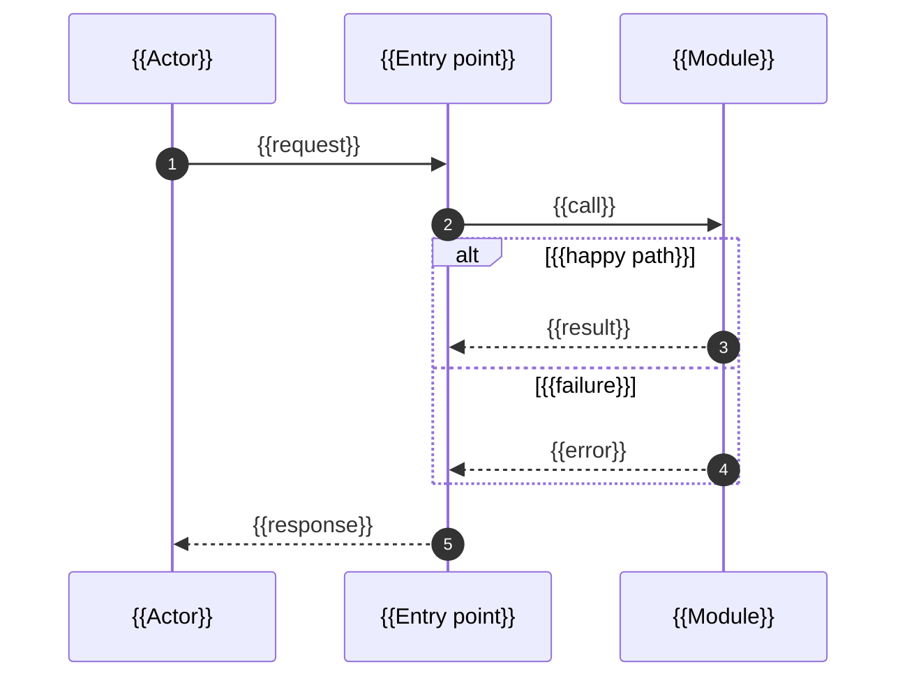

<!--
  Software Factory · ADR template adr@1 (MADR-style).
  Keep the front matter and every "##" heading below, in this order. Add "###"
  subsections freely; add extra "##" sections only after "Open questions".
  Replace every {{…}}. Comments are guidance; the "rule:" comments are what
  `factory doc check` enforces. Check before you return:
      factory doc check <this file> --job <J>
-->

# ADR {{NNN}}: {{Short decision title}}

## Context
<!-- Why a decision is needed now, in three to six sentences. Cite findings.md for
     every fact (topic and source, e.g. "findings · codebase · src/search.js:3").
     Name the acceptance criteria and constraints that make this a real decision. -->
{{Context}}

## Decision drivers
<!-- The forces that rank the options, most important first. Tie each to the
     contract (an AC, a constraint, a non-goal) or a finding. -->
- {{Driver 1 (AC-1 / constraint)}}
- {{Driver 2}}

## Considered options
<!-- rule: table -->
<!-- Every option the generators proposed, the chosen one included. One row each;
     the Verdict column says chosen, or rejected and why in a few words. -->
| # | Option | Pros | Cons | Verdict |
|---|---|---|---|---|
| 1 | {{Option}} | {{pros}} | {{cons}} | chosen |
| 2 | {{Option}} | {{pros}} | {{cons}} | rejected: {{why}} |

## Decision
<!-- "We will …" in one paragraph, then what a planner needs to split it into tasks:
     modules and files touched, interfaces and data shapes, configuration, feature
     flags, defaults and limits. Say which findings and drivers it follows from. -->
We will {{decision}}.

## Architecture diagram
<!-- rule: mermaid flowchart|graph|C4Context|C4Container|C4Component|architecture-beta|block-beta -->
<!-- Required. A C4-style context/container view of how things will look AFTER the
     change: actors and external systems outside, the system boundary as a subgraph,
     the containers or modules inside, and every edge labelled with what flows over it
     (call, event, data, protocol). Mark what is new or changed with the "changed"
     class. Add a sequenceDiagram under "### Key flow" when ordering, retries or error
     paths matter. Keep it to what this decision touches: fifteen nodes at most. -->
```mermaid
flowchart LR
  actor([{{Actor}}]) -->|{{request}}| entry
  subgraph system["{{System}} — this repository"]
    entry[{{Entry point}}] -->|{{call}}| core[{{New or changed module}}]
    core -->|{{read / write}}| store[({{Data store}})]
  end
  core -->|{{protocol}}| ext[{{External system}}]
  classDef changed fill:#fff3bf,stroke:#f08c00,stroke-width:2px
  class core changed
```

### Key flow
<!-- Optional: delete this subsection if the flow is obvious from the diagram above. -->


## External API usage
<!-- rule: optional; ledger -->
<!-- Every call this design makes into a library or service outside this repository, one row
     each: the symbol (function, class, flag, default), how the design uses it (the arguments
     and flags it passes, the behaviour it relies on), and the API ledger entry (L-n, from
     api-ledger.json / findings.md "API ledger") that shows that behaviour in the pinned
     dependency source. Required, and checked, when ground recorded an API ledger: a row
     without a ledger id, or with an id the ledger does not have, fails `factory doc check`.
     Write "None: this design calls no external API." when that is true. -->
| Symbol | How the design uses it | Ledger |
|---|---|---|
| {{library.function(arg, flag=…)}} | {{what it passes and relies on}} | {{L-1}} |

## Consequences
<!-- What becomes easier and harder, operational cost, performance, what follow-up
     work this creates or rules out. Be honest about the negatives. -->
- Positive: {{…}}
- Negative: {{…}}
- Follow-up: {{… or "none"}}

## How each acceptance criterion is met
<!-- rule: table; acs -->
<!-- One row per acceptance criterion in the contract, by id. "Proof" is the evidence
     type from the contract and the command or check that will produce it. -->
| AC | How the design meets it | Proof |
|---|---|---|
| AC-1 | {{design element}} | test: `{{verify command}}` |

## Threat mitigations
<!-- rule: threats -->
<!-- One row per threat in threat-model.md (TH-1, TH-2…) and where the design
     mitigates it. Without a threat model, write "No threat model at this risk." and
     note any security-relevant choice you made anyway. -->
| Threat | Mitigation in this design | Where |
|---|---|---|
| {{TH-1}} | {{mitigation}} | {{module / section}} |

## Rollback and migration
<!-- How to undo it once merged (revert, flag off, reverse migration, backfill) and
     any migration or rollout order. "Revert the merge commit; no data changes." is
     a fine answer when true. -->
{{Rollback}}

## Open questions
<!-- What is still unknown, who can answer it, and what changes if the answer differs.
     "None." is a fine answer. -->
- {{Question — owner — what it would change}}
