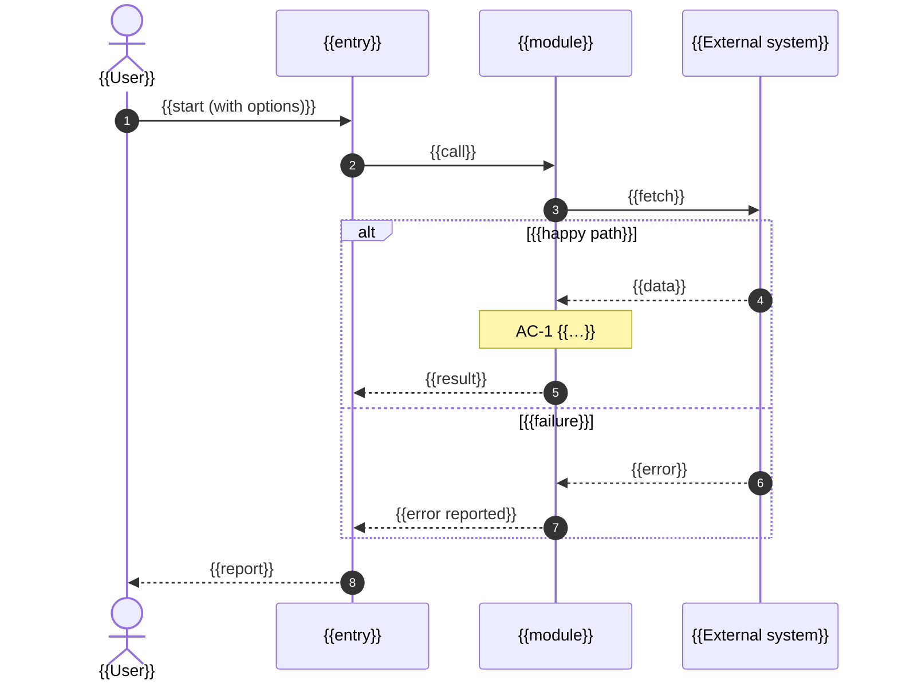

<!--
  Software Factory · ADR template adr@2 ("design depth", factory 0.11; MADR-style).
  The human approves this document at the design gate (H2, or the medium-risk combined gate):
  it must show WHAT is decided and why, HOW the whole thing works end to end, and WHERE every
  file goes. Keep the front matter (template: adr@2 is the version marker the check reads) and
  every "##" heading below, in this order. Add "###" subsections freely; extra "##" sections
  only after "Open questions". Replace every {{…}}. The "rule:" comments are what
  `factory doc check` enforces. Check before you return:
      factory doc check <this file> --job <J>
  An ADR written under an older template (template: adr@1) is still checked by adr@1's rules.
-->

# ADR {{NNN}}: {{Short decision title}}

## Context
<!-- Why a decision is needed now, in three to six sentences. Cite findings.md for
     every fact (topic and source, e.g. "findings · codebase · src/search.js:3").
     Name the acceptance criteria and constraints that make this a real decision. -->
{{Context}}

## Decision drivers
<!-- rule: refs -->
<!-- The forces that rank the options, most important first. Tie each to the contract by id
     (AC-n, a constraint, a non-goal, a grounded assumption A-n) or to a finding. -->
- {{Driver 1}} (AC-1)
- {{Driver 2}} (constraint: {{…}})

## Considered options
<!-- rule: table; options -->
<!-- Every option the option generators proposed (their ids O-1, O-2… as your brief numbers
     them; the check looks for each id), plus any you added (O-n after theirs). One row each;
     the Verdict column says chosen, or rejected and why in a few words. -->
| # | Option | Pros | Cons | Verdict |
|---|---|---|---|---|
| O-1 | {{Option}} | {{pros}} | {{cons}} | chosen |
| O-2 | {{Option}} | {{pros}} | {{cons}} | rejected: {{why}} |

## Decision
<!-- "We will …" in one paragraph: the overall shape. The detail lives in the sections below:
     each significant decision in "Decision records", the flow in "End-to-end flow", the files
     in "Project layout". -->
We will {{decision}}.

## Decision records
<!-- rule: decisions -->
<!-- One "### D-n: <title>" record per significant decision (the overall approach, the sync or
     storage strategy, how records are matched, error handling, where it is registered…), not
     one paragraph for everything. Each record has these six bold-labelled parts, in order:
       **Context.**       what forces this particular choice
       **Drivers.**       the drivers that rank its options, by id (AC-n, constraint, A-n, finding)
       **Options.**       a trade-off table: one row per option (at least two; the generators'
                          O-n where they apply), one column per driver or cost (at least two),
                          and a Verdict column with exactly one "chosen"
       **Choice.**        what was chosen and why, in terms of the drivers
       **Consequences.**  what it costs and risks, and how the risk is contained
       **Revisit when.**  the evidence or change that would reopen it -->
### D-1: {{Decision title}}
**Context.** {{What forces this choice}}

**Drivers.** AC-1 {{…}}; constraint: {{…}}

**Options.**

| Option | {{Driver 1}} | {{Driver 2}} | Cost and risk | Verdict |
|---|---|---|---|---|
| O-1 {{Option}} | {{how it does on driver 1}} | {{…}} | {{…}} | chosen |
| O-2 {{Option}} | {{…}} | {{…}} | {{…}} | rejected: {{why}} |

**Choice.** {{O-1, because …}}

**Consequences.** {{What it costs, what could go wrong, how that is contained}}

**Revisit when.** {{The evidence that would reopen it}}

## Architecture diagram
<!-- rule: mermaid flowchart|graph|C4Context|C4Container|C4Component|architecture-beta|block-beta; subgraph; layout-names -->
<!-- Required. The component view AFTER the change: actors and external systems outside, the
     system boundary as a subgraph, inside it the real modules and classes (the names in
     "Project layout": the check looks for at least one of them), every edge labelled with what
     flows over it (call, event, data, protocol). Mark new or changed parts with the "changed"
     class. Fifteen nodes at most. -->
```mermaid
flowchart LR
  actor([{{Actor}}]) -->|{{request}}| entry
  subgraph system["{{System}} — this repository"]
    entry[{{entry}}] -->|{{call}}| core[{{module}}]
    core -->|{{read / write}}| store[({{Data store}})]
  end
  core -->|{{protocol}}| ext[{{External system}}]
  classDef changed fill:#fff3bf,stroke:#f08c00,stroke-width:2px
  class core changed
```

## End-to-end flow
<!-- rule: mermaid sequenceDiagram; branch; flow-acs -->
<!-- Required. One run, start to finish, as a sequenceDiagram with the real participants: who
     starts it, what is loaded, connected to, fetched, compared, written or reported. Draw the
     dry-run / preview path and the failure paths as alt / else / opt blocks (the check needs at
     least one). Put each acceptance criterion where it is met ("Note over A,B: AC-2"): every
     AC must appear in this section or in "Failure and state flow". -->


## Data model and mapping
<!-- rule: mapping -->
<!-- Required. The data the change reads and writes: one row per field it maps, from the
     source (system and field) to the target (model and field), the transform, and the key used
     to match a source record to a target record. An erDiagram or classDiagram may go with the
     table. When the change truly moves no data, write "None: <why>" instead. -->
| Source (system.field) | Target (model.field) | Transform | Match key |
|---|---|---|---|
| {{source.field}} | {{Model.field}} | {{as is / normalise / lookup}} | {{yes: part of the key / no}} |

## Failure and state flow
<!-- rule: failures -->
<!-- Required. Every way a run can fail or partly fail (unreachable host, bad credentials,
     conflicting or invalid data, a partial write, a timeout…): how it is detected, what the
     run then does (skip, retry, roll back, stop, report) and the AC it serves. One row each.
     A stateDiagram-v2 of the run's states may go with the table. -->
| Failure | Detected by | Behaviour | AC |
|---|---|---|---|
| {{failure}} | {{exception / status / check}} | {{skip and report / retry / stop}} | AC-1 |
| {{another failure}} | {{…}} | {{…}} | AC-1 |

## Project layout
<!-- rule: layout -->
<!-- Required. Every file that will exist after the job and matters to it, as a tree in one
     fenced text block: new and changed files, tests, config, fixtures and harness, and the
     existing files they plug into. One file per line, then "# status · responsibility · ACs":
       status          new | changed | existing (pre-existing, not changed) | deleted
       responsibility  what this file does, in a few words (a class or function name helps)
       ACs             the acceptance criteria it serves (AC-1, AC-2…)
     Directories end with "/". Every AC must be served by at least one file. The planner turns
     this tree into tasks: every new, changed or deleted file is owned by exactly one task, and
     every task's allowed paths cover files listed here (`factory plan validate` checks both). -->
```text
{{package}}/
├── {{entry}}.py              # new · {{entry point: what it does}} · AC-1
├── {{module}}.py             # new · {{the core logic}} · AC-1
└── {{registry}}.py           # changed · {{registers the entry point}} · AC-1
tests/
└── test_{{module}}.py        # new · {{tests for the core logic}} · AC-1
```

## How it runs
<!-- rule: runs -->
<!-- Required. The entry points and how a person or system starts it (a command, a UI path, a
     schedule), with every option that changes behaviour (dry run, scope); where it is
     registered (plugin config, a jobs registry, a CLI dispatch table, an import that makes it
     discoverable); and the commands that build and test it. Use `code` for each command. -->
- Entry point: `{{command or UI path}}`
- Registered in: `{{file}}` ({{how}})
- Test: `{{verify command}}`

## External API usage
<!-- rule: optional; ledger -->
<!-- Every call this design makes into a library or service outside this repository, one row
     each: the symbol (function, class, flag, default), how the design uses it (the arguments
     and flags it passes, the behaviour it relies on), and the API ledger entry (L-n, from
     api-ledger.json / findings.md "API ledger") that shows that behaviour in the pinned
     dependency source. Required, and checked, when ground recorded an API ledger: a row
     without a ledger id, or with an id the ledger does not have, fails `factory doc check`.
     Write "None: this design calls no external API." when that is true. -->
| Symbol | How the design uses it | Ledger |
|---|---|---|
| {{library.function(arg, flag=…)}} | {{what it passes and relies on}} | {{L-1}} |

## Consequences
<!-- What becomes easier and harder, operational cost, performance, what follow-up
     work this creates or rules out. Be honest about the negatives. -->
- Positive: {{…}}
- Negative: {{…}}
- Follow-up: {{… or "none"}}

## How each acceptance criterion is met
<!-- rule: table; acs -->
<!-- One row per acceptance criterion in the contract, by id: the design element, the files
     from "Project layout" that implement it, the flow step or failure row that shows it, and
     the proof (the evidence type from the contract and the command that produces it). -->
| AC | How the design meets it | Files | Flow step | Proof |
|---|---|---|---|---|
| AC-1 | {{design element}} | `{{package}}/{{module}}.py` | {{step n / failure row}} | test: `{{verify command}}` |

## Threat mitigations
<!-- rule: threats -->
<!-- One row per threat in threat-model.md (TH-1, TH-2…) and where the design
     mitigates it. Without a threat model, write "No threat model at this risk." and
     note any security-relevant choice you made anyway. -->
| Threat | Mitigation in this design | Where |
|---|---|---|
| {{TH-1}} | {{mitigation}} | {{module / section}} |

## Rollback and migration
<!-- How to undo it once merged (revert, flag off, reverse migration, backfill) and
     any migration or rollout order. "Revert the merge commit; no data changes." is
     a fine answer when true. -->
{{Rollback}}

## Open questions
<!-- What is still unknown, who can answer it, and what changes if the answer differs.
     "None." is a fine answer. -->
- {{Question — owner — what it would change}}
