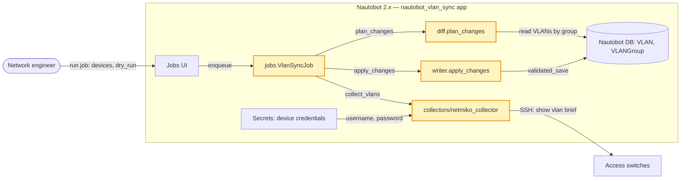
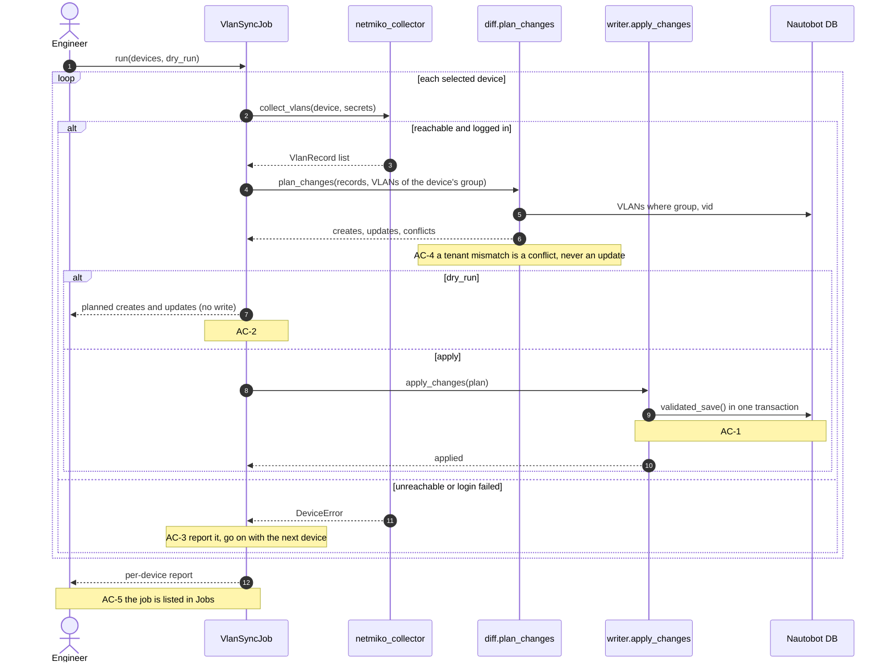
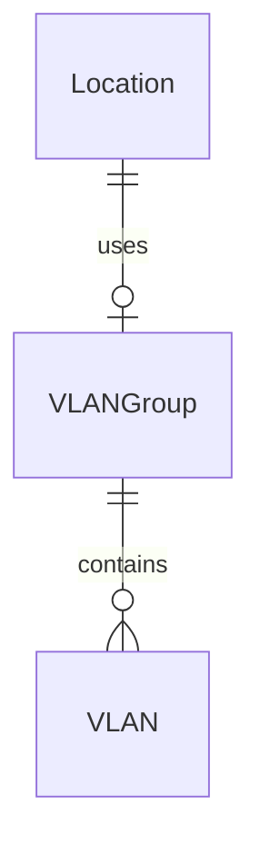
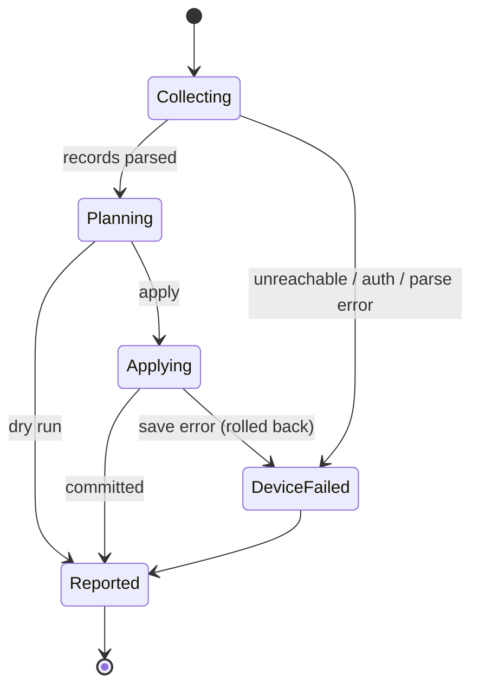

# ADR 001: Collect VLANs over SSH and sync them per device

## Context
VLANs on the access switches drift from Nautobot (findings · codebase · nautobot_vlan_sync/__init__.py:1 has no jobs yet). The job must read VLANs from devices (AC-1), preview without writing (AC-2), survive per-device failures (AC-3) and refuse to overwrite another tenant's VLAN (AC-4). Credentials must come from Nautobot Secrets (constraint). Three choices shape the build: how VLANs are collected, how found VLANs are matched to Nautobot's, and how writes are grouped.

## Decision drivers
- Correct creates and updates for every selected device (AC-1)
- A dry run that writes nothing (AC-2)
- One bad device never aborts the rest (AC-3)
- Never overwrite a conflicting VLAN (AC-4)
- Credentials only from Nautobot Secrets (constraint)

## Considered options
| # | Option | Pros | Cons | Verdict |
|---|---|---|---|---|
| O-1 | Netmiko "show vlan brief" per device, own diff, per-device transaction | Works on every switch in the lab; small; per-device isolation | We maintain a parser | chosen |
| O-2 | NAPALM get_vlans() with a diffsync adapter | Structured data; diffsync does the diff | NAPALM drivers missing for two platforms; diffsync deletes by default | rejected: platform coverage, delete semantics |
| O-3 | Read VLANs from Golden Config backups | No device connections | Backups are a day old; not installed here | rejected: stale data |

## Decision
We will collect VLANs over SSH with Netmiko, match them to Nautobot VLANs on (VLAN group, VID), and write each device's changes in its own transaction through a VlanSyncJob that supports a dry run.

## Decision records
### D-1: How VLANs are collected from devices
**Context.** The job needs the VLANs configured on each selected device; two of the five lab platforms have no NAPALM driver.

**Drivers.** AC-1 (every device), AC-3 (per-device failures), constraint: credentials from Nautobot Secrets.

**Options.**

| Option | Platform coverage (AC-1) | Failure isolation (AC-3) | Cost and risk | Verdict |
|---|---|---|---|---|
| O-1 Netmiko "show vlan brief" | all five platforms | per connection | we maintain a TextFSM parser | chosen |
| O-2 NAPALM get_vlans() | three of five | per connection | new dependency, missing drivers | rejected: two platforms uncovered |
| O-3 Golden Config backups | all with backups | none needed | data a day old; app not installed | rejected: stale data |

**Choice.** O-1: it is the only option that covers every lab platform today, and a connection per device isolates failures for AC-3.

**Consequences.** We own a parser for "show vlan brief"; a firmware that changes the output breaks parsing, contained by a parser test on captured output and a per-device parse error in the report.

**Revisit when.** NAPALM gains drivers for the remaining platforms, or Golden Config is installed with hourly backups.

### D-2: How a found VLAN is matched to a Nautobot VLAN
**Context.** VIDs repeat across sites; names drift; another tenant may own a VLAN with the same VID in a shared group.

**Drivers.** AC-1 (create or update the right record), AC-4 (never overwrite a conflict).

**Options.**

| Option | Right record (AC-1) | Conflict safety (AC-4) | Cost and risk | Verdict |
|---|---|---|---|---|
| Key on (VLAN group, VID), tenant checked | yes | conflict reported when tenant differs | one extra query per group | chosen |
| Key on VID only | wrong across groups | none | simplest | rejected: merges sites |
| Key on name | breaks on renames | none | simple | rejected: names drift |

**Choice.** Key on (VLAN group of the device's location, VID): it identifies one record per group, and a tenant mismatch is the conflict AC-4 asks to report.

**Consequences.** Devices without a VLAN group are skipped and reported; a renamed VLAN is an update, not a new record.

**Revisit when.** Nautobot models VLAN scope per device rather than per group.

### D-3: How writes are grouped
**Context.** A run touches many devices; AC-3 wants the others synced when one fails, and AC-2 wants a dry run.

**Drivers.** AC-2 (dry run writes nothing), AC-3 (isolation).

**Options.**

| Option | Dry run (AC-2) | Isolation (AC-3) | Cost and risk | Verdict |
|---|---|---|---|---|
| One transaction per device | plan only, no transaction opened | a failing device rolls back alone | partial runs possible | chosen |
| One transaction for the whole run | plan only | one failure rolls back everything | all or nothing | rejected: breaks AC-3 |

**Choice.** One transaction per device: a failure rolls back only that device's writes, and the dry run never opens a transaction.

**Consequences.** A run can finish partly applied; the job report lists each device's outcome so the engineer sees it.

**Revisit when.** The engineers ask for all-or-nothing runs.

## Architecture diagram


## End-to-end flow


## Data model and mapping


| Source (system.field) | Target (model.field) | Transform | Match key |
|---|---|---|---|
| device.location | VLANGroup (by location) | lookup | yes |
| show vlan brief: VLAN id | VLAN.vid | int | yes |
| show vlan brief: name | VLAN.name | strip | no |
| show vlan brief: status | VLAN.status | active / suspended → Status | no |
| job input: tenant | VLAN.tenant | as is | no (conflict check) |

## Failure and state flow


| Failure | Detected by | Behaviour | AC |
|---|---|---|---|
| Device unreachable | NetmikoTimeoutException | mark the device failed, continue with the next | AC-3 |
| Login failed | NetmikoAuthenticationException | mark the device failed, continue | AC-3 |
| VID owned by another tenant | tenant mismatch in plan_changes | report a conflict, no write | AC-4 |
| Save fails mid-device | ValidationError from validated_save | roll back that device's transaction, report | AC-1 |
| Output does not parse | TextFSM returns no rows | report a parse error for the device | AC-3 |

## Project layout
```text
nautobot_vlan_sync/
├── __init__.py               # changed · NautobotAppConfig: points jobs at the jobs module · AC-5
├── jobs.py                   # new · VlanSyncJob(Job): form (devices, dry_run), run() loop and the per-device report · AC-1, AC-2, AC-3, AC-5
├── records.py                # new · VlanRecord dataclass shared by collector and diff · AC-1
├── collectors/
│   ├── __init__.py           # new · exports collect_vlans · AC-1
│   └── netmiko_collector.py  # new · collect_vlans(): SSH with Secrets credentials, TextFSM parse, DeviceError · AC-1, AC-3
├── diff.py                   # new · plan_changes(): match on (group, vid), creates, updates and conflicts · AC-1, AC-4
└── writer.py                 # new · apply_changes(): validated_save per VLAN in one transaction per device · AC-1
tests/
├── fixtures/
│   └── show_vlan_brief.txt   # new · captured device output for the parser tests · AC-1
├── test_collector.py         # new · parser, unreachable and auth failures with a fake connection · AC-1, AC-3
├── test_diff.py              # new · key matching, updates and conflicts · AC-1, AC-4
└── test_jobs.py              # new · dry run writes nothing; registration; one failing device · AC-2, AC-3, AC-5
pyproject.toml                # changed · adds netmiko and textfsm · AC-1
README.md                     # existing · app overview, not changed
```

## How it runs
- Entry point: Nautobot → Jobs → "VLAN sync" (`nautobot_vlan_sync.jobs.VlanSyncJob`), inputs: devices, dry_run
- Registered in: `nautobot_vlan_sync/__init__.py` (`NautobotAppConfig.jobs = "jobs.jobs"`) and `jobs.py` (`register_jobs(VlanSyncJob)`)
- From the CLI: `nautobot-server runjob nautobot_vlan_sync.jobs.VlanSyncJob --data '{"dry_run": true}'`
- Test: `node tests/add.test.js`

## External API usage
None: this design calls no external API.

## Consequences
- Positive: every lab platform is covered; one bad device never blocks the others.
- Negative: we own a CLI parser; runs can finish partly applied (reported per device).
- Follow-up: none.

## How each acceptance criterion is met
| AC | How the design meets it | Files | Flow step | Proof |
|---|---|---|---|---|
| AC-1 | collect, plan on (group, vid), apply per device | `jobs.py`, `diff.py`, `writer.py` | steps 2–9 | test: `node tests/add.test.js` |
| AC-2 | dry run returns the plan before apply_changes | `jobs.py` | dry_run branch | test: `node tests/add.test.js` |
| AC-3 | DeviceError per device, loop continues | `netmiko_collector.py`, `jobs.py` | failure branch | test: `node tests/add.test.js` |
| AC-4 | tenant mismatch → conflict | `diff.py` | plan_changes note | test: `node tests/add.test.js` |
| AC-5 | app config points at the jobs module | `__init__.py` | final note | test: `node tests/add.test.js` |

## Threat mitigations
No threat model at this risk. Credentials are read from Nautobot Secrets inside collect_vlans and never logged.

## Rollback and migration
Revert the merge commit; the job only adds VLAN records, which stay valid.

## Open questions
None.
